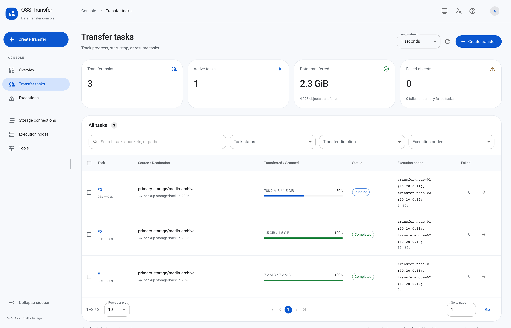
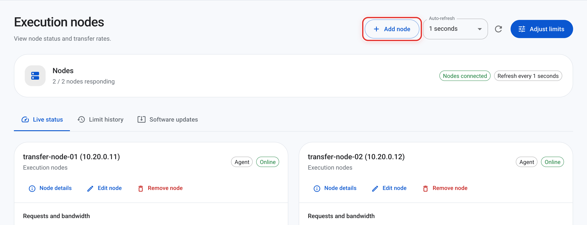
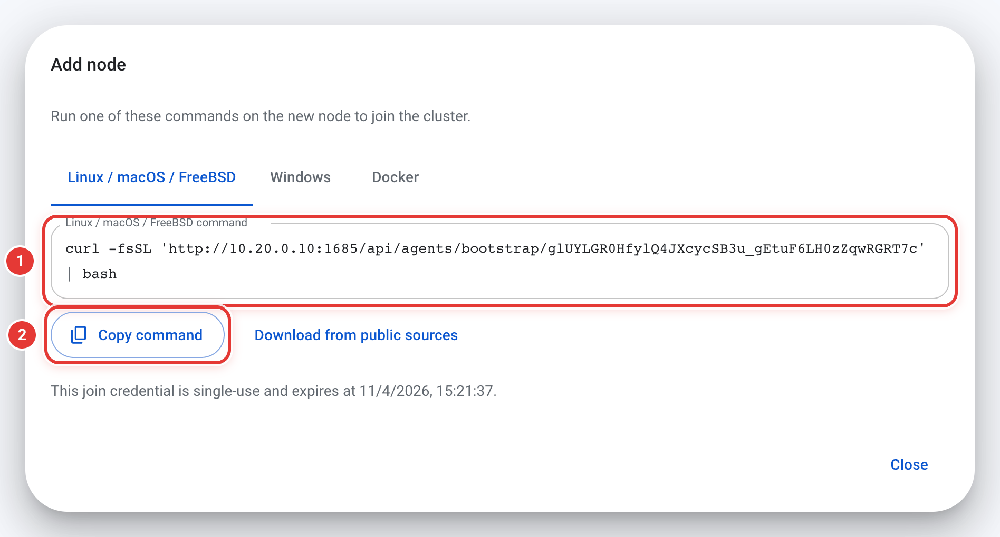
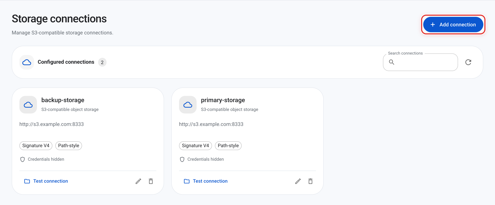
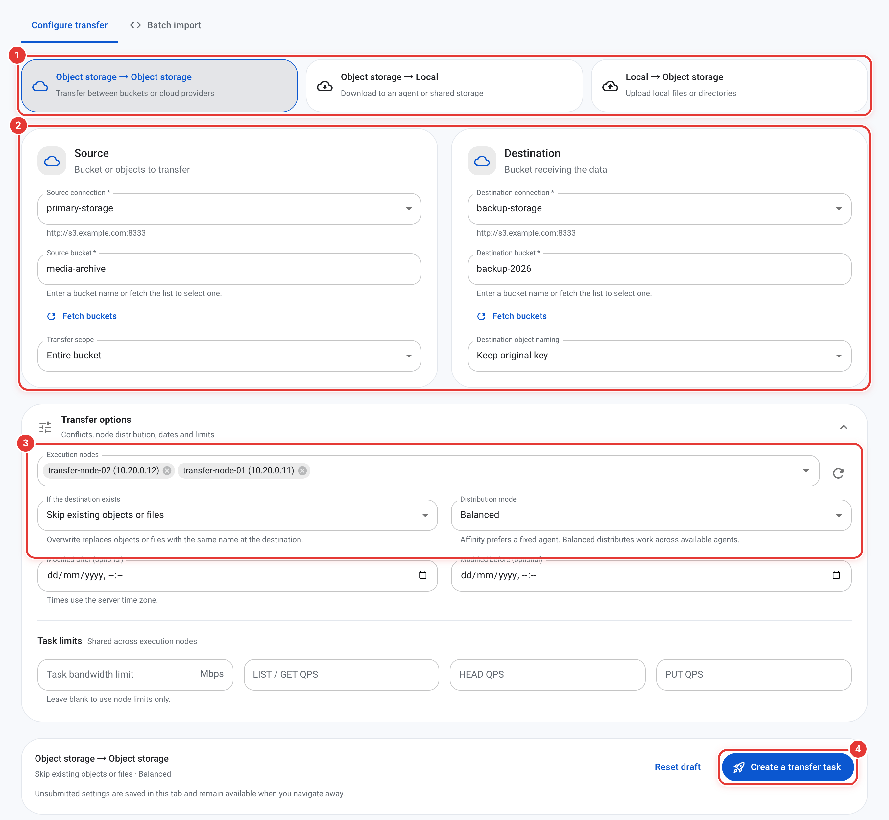
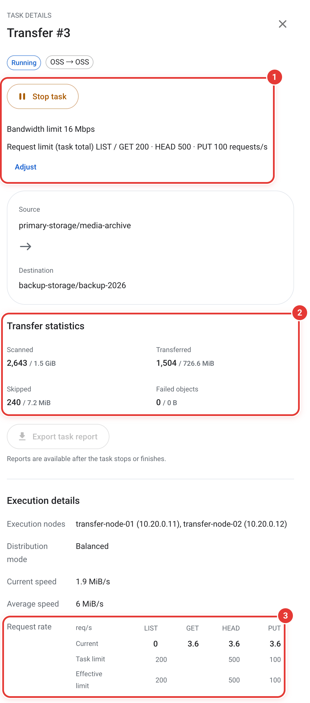

# OSS Transfer

[中文](README.zh-CN.md)

OSS Transfer is a distributed data migration tool. It copies data between S3-compatible object stores, uploads local files to object storage, and downloads objects to local directories.

One Master serves the web console and API and schedules tasks. Agents run on hosts close to the data and do the scanning and transfers. Everything can be done in a browser or from the command line.



## Features

- **Three directions:** object storage to object storage, local to object storage, and object storage to local. Transfer by prefix, single object or file list, and keep, add or replace key prefixes.
- **Multi-node execution:** a task can run on several Agents. By default work is balanced by remaining bytes. Each object is transferred by one Agent. Within that Agent, objects of 128 MiB or more are split into byte ranges transferred in parallel: uploaded as multipart parts, or downloaded concurrently and written to the local file in order. Download tasks can turn this off. Idle concurrency on the node is borrowed when available.
- **Change nodes mid-run:** add Agents to a running task or remove them, either draining their work or moving it immediately. Bandwidth and QPS shares are redistributed without exceeding the task limit. See [execution node changes](docs/operations.md#change-a-tasks-execution-nodes).
- **Live progress:** progress and speed are based on bytes actually transferred. Task details also show the live LIST, GET, HEAD and PUT request rates and their effective limits.
- **Rate control:** limit bandwidth and per-request-type QPS for each task and node. Changes to a running task take effect immediately, and node concurrency can be adjusted at any time.
- **Fault recovery:** when an Agent loses contact, its unfinished child tasks move to healthy nodes. Scans resume from checkpoints, failed files can be retried individually, and a report can be exported when a task ends.
- **Object comparison:** compare one object, or every object in a bucket or under a prefix, by metadata or by streaming SHA-256 of the contents.
- **Operations:** update the Master online, then the Agents one at a time, with automatic rollback on failure. Storage credentials are encrypted at rest. The console and CLI are available in Chinese, English and Japanese.

## Architecture

```text
 Browser / oss-transfer-cli
           │ HTTP :1685
           ▼
   ┌────────────────┐   long poll / heartbeat   ┌───────────────┐
   │     Master     │ ◄──────────────────────── │    Agent A    │ ──► source / destination
   │ console · API  │ ◄──────────────────────── │    Agent B    │ ──► object storage or
   │ scheduling     │                           │      ...      │     local directories
   └────────────────┘                           └───────────────┘
```

Agents connect to the Master, so the Master never needs to reach them. Data flows only between Agents and storage, never through the Master.

## Quick start

### 1. Install the Master

On Linux with systemd:

```sh
curl -fsSL https://raw.githubusercontent.com/MoonWX/oss-transfer/main/install.sh | sudo bash
```

From mainland China, use the mirror:

```sh
curl -fsSL https://moonwx.s3.cn-north-1.jdcloud-oss.com/oss-transfer/latest/install.sh | sudo bash
```

Choose Master and native deployment, and whether to install an Agent on the same host. That Agent joins the Master automatically. Programs, configuration and data go under `/opt/oss-transfer/` by default.

See [installation options](docs/install.md) for macOS, Windows, FreeBSD and custom directories, or [offline installation](docs/offline-install.md) for hosts without internet access.

### 2. Sign in

Open `http://<master-ip>:1685` and sign in as `admin` with the random password printed by the installer. You must change it at first login.

### 3. Add Agents

Open the **Execution nodes** page and choose **Add node** in the top right.



Enter a node name and a Master address the Agent can reach, then choose **Generate join commands**. The dialog offers commands for Linux / macOS / FreeBSD, Windows and Docker:

1. The join command for the selected system. Switch tabs first if the Agent host runs Windows or you want to use Docker.
2. Choose **Copy command** and run it on the Agent host.

<p align="center"></p>

Native installs download the installer and package from the Master by default; choose **Download from public sources** to fetch them from the internet instead. The Docker command pulls the Agent image. The join credential works once and expires. If the Agent and Master share a private network, use the Master's private address; the browser can keep using a public address or a reverse proxy.

### 4. Create a transfer

First add the source and destination object stores: on the **Storage connections** page, choose **Add connection**. By default the connection is checked when you save it.



Then choose **Create transfer** in the top left and fill in the numbered areas:

1. **Direction:** object storage to object storage, object storage to local, or local to object storage.
2. **Source and destination:** select the storage connections and buckets. You can limit the transfer to a prefix or a single object and change the destination key names. For local files, enter paths on the Agent hosts and pass the directory preflight check.
3. **Transfer options:** select the Agents, what to do when the destination already exists, and the distribution mode (balanced by default; for uploads it follows the number of bound Agents). Date filters and task limits are below.
4. Choose **Create a transfer task**. The task scans first, then starts transferring.



For uploads, the Agent service account needs read access to the source directory; for downloads, it needs write access to the destination directory.

### 5. Follow progress

On the **Transfer tasks** page, choose a task to open its details:

1. Stop or resume the task. **Adjust** (shown as **Set limit** when no bandwidth limit is set) changes the bandwidth and request limits while it runs.
2. **Transfer statistics:** scanned, transferred, skipped and failed objects with their sizes, updated live from bytes actually transferred.
3. **Request rate:** actual LIST, GET, HEAD and PUT requests per second, with the task limits and the limits in effect.

<p align="center"></p>

On the **Exceptions** page, retry a task's failed objects or resume a stopped task; objects already transferred are not copied again. Once a task stops or finishes, you can export its report.

## Command line

On an installed Master or Agent host, run the CLI as the service owner or an administrator. It connects to the local cluster without a login:

```sh
oss-transfer-cli task list
oss-transfer-cli task progress <task-id> --watch 5
oss-transfer-cli task limits <task-id> --put-qps 200 --bandwidth-mbps 100
oss-transfer-cli node list
```

The CLI covers everything the console does and offers `--json` output for scripts. See [CLI usage](docs/cli.md) for remote login, task creation and more.

## Docker Compose

With Docker Engine and the Compose plugin installed:

```sh
mkdir oss-transfer && cd oss-transfer
curl -fsSL https://raw.githubusercontent.com/MoonWX/oss-transfer/main/docker-compose.yml -o docker-compose.yml
docker compose up -d master
docker compose logs master
```

Find the initial `admin` password in the log and sign in. To add Agents, choose **Docker** under **Execution nodes → Add node**. The image is `moonwx/osstransfer`; see [Docker Compose](docs/docker-compose.md) for directory mounts and upgrades.

## Updating

Update when no tasks are running, if possible.

1. Update the Master under **Tools → Software updates**.
2. Under **Execution nodes → Software updates**, choose **Update all nodes**. The Agents update one at a time.

Each update takes a backup first and deletes it after the new version passes its health check. If startup fails, the previous version is restored. You can also update by rerunning the install command.

Update checks only offer stable releases. Prereleases (betas) are installed only when you choose an exact version; see [trying a prerelease](docs/operations.md#try-a-prerelease).

To reinstall, keep each role's `config` directory and its entire `data` directory, including the `.db.key` file. The installer then reuses the existing accounts, tasks and node identities. Before a planned downgrade, make a separate backup before updating. See [operations](docs/operations.md) for details.

## Things to know

- **`SKIP` does not compare contents.** An existing destination object or file with the same name is left in place. To verify contents, use [object comparison](docs/operations.md#compare-objects).
- **Local paths belong to the Agent hosts.** When several nodes work on one local directory, it must be a shared directory. Mount paths may differ between nodes; the preflight check writes a small file to confirm they point to the same directory.
- **Resuming a scan is not continuous sync.** A checkpoint continues the same scan and may miss changes behind it. For a fixed dataset, keep the source stable or use a snapshot.

## Supported platforms

| OS | Architectures |
| --- | --- |
| Linux | amd64, arm64, armv7, riscv64, loong64 |
| macOS | amd64, arm64 |
| Windows | amd64, arm64 |
| FreeBSD | amd64, arm64 |

Each release is published to [GitHub Releases](https://github.com/MoonWX/oss-transfer/releases), Docker Hub as `moonwx/osstransfer`, and an OSS mirror in mainland China.

## Documentation

| Document | Covers |
| --- | --- |
| [Installation options](docs/install.md) | Other systems, paths, ports, reinstallation and reverse proxies |
| [Offline installation](docs/offline-install.md) | Installing without internet access |
| [Docker Compose](docs/docker-compose.md) | Container deployment, mounts and upgrades |
| [CLI](docs/cli.md) | All command-line usage |
| [Operations](docs/operations.md) | Concurrency, comparison, updates, failover, execution node changes, scan resume and password reset |
| [Database maintenance](docs/database-maintenance.md) | Reclaiming database file space |
| [Upgrading from V4.0.x](docs/migration.md) | Offline conversion of older data |

## Building from source

Requires Go 1.26, Node.js 22.12 or later, and Python 3.

```sh
./build.sh          # current OS and architecture
./build.sh --all    # every supported platform
./build.sh --test   # run the tests before packaging
```

Archives and checksums are written to `output/packages/`. The source is organized as follows:

| Directory | Contents |
| --- | --- |
| `cmd/` | Master and Agent entry points |
| `internal/` | Scheduling, transfer engine, storage adapters and Agent communication |
| `cli/` | `oss-transfer-cli` |
| `frontend/` | Web console (React and MUI) |
| `deploy/` | Installers, packaging and release |
