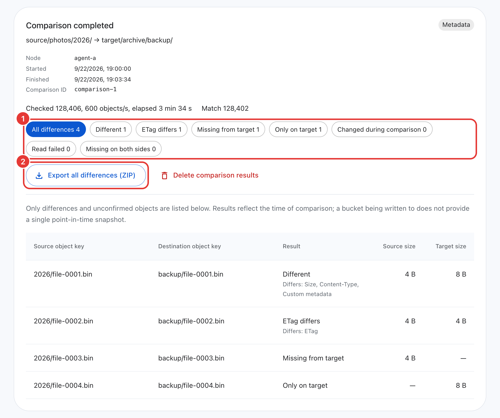
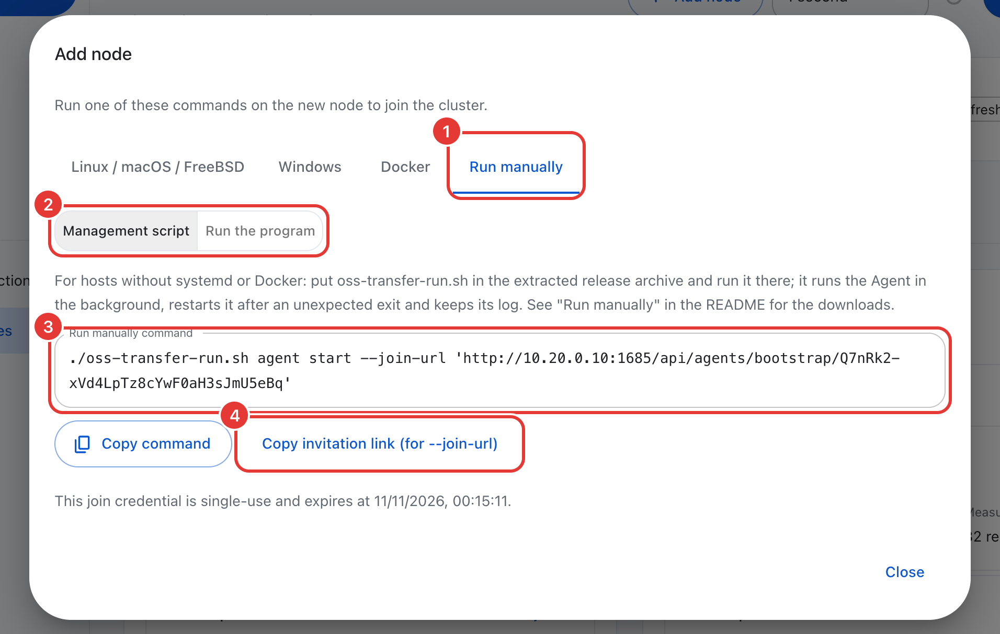

# OSS Transfer

[中文](README.zh-CN.md)

OSS Transfer is a distributed data migration tool for copying data between S3-compatible object stores, between local directories and object storage, and in the reverse direction.

One Master handles the web console, the API and task scheduling. Multiple Agents (execution nodes) run on hosts close to the data and do the actual scanning and transfers. Every operation can be carried out in the web console or from the command line.


## Features

Supported directions are object storage to object storage, local to object storage, and object storage to local. A migration can cover an entire bucket, a prefix, a single object or a key list, and the destination prefix can be preserved, added or replaced.

A task can be assigned to multiple Agents; the work is distributed evenly and [large objects](docs/operations.md#large-objects) are split into parts transferred in parallel. [Agents can be added or removed](docs/operations.md#change-a-tasks-execution-nodes) while a task runs, and bandwidth and request rate limits can be changed at any time. When the storage service throttles requests, Agents [slow down automatically](docs/operations.md#storage-throttling).

When an object with the same name already exists at the destination, three conflict policies are available: Skip existing objects or files, Overwrite existing objects or files, and Overwrite changed objects. The third is intended for [incremental migration](docs/planning.md#incremental-migration-and-cut-over): copy everything once, then transfer only what has changed in each subsequent round. When an Agent goes offline, its unfinished work is reassigned to healthy Agents and scanning resumes from the checkpoint. Failed objects can be retried, and every task has a downloadable report. After the migration, use [object comparison](docs/operations.md#compare-objects) to verify the two sides object by object.

Online updates roll back automatically on failure, storage credentials (AK/SK) are stored encrypted, and the web console and command line support Chinese, English and Japanese.

## Architecture

```text
  Browser / oss-transfer-cli
             |
             | HTTP :1685
             v
  +--------------+    long poll    +-----------+       +------------------+
  |    Master    | <-------------- |  Agent A  | <---> |  Object storage  |
  | console, API | <-------------- |  Agent B  | <---> |  or local files  |
  |  scheduling  |    heartbeat    |    ...    |       |                  |
  +--------------+                 +-----------+       +------------------+
```

Agents connect to the Master through long polls and heartbeats, so the Master does not need network access to the Agents. Data flows only between Agents and storage, never through the Master. The Master handles scheduling only and never touches the data.

## Quick start

Before a production migration, read [Planning](docs/planning.md) to understand where to deploy Agents, which ports to open, and which permissions the keys need. For HTTPS and credential security, see [Security](docs/security.md).

Most Linux servers are well served by native services: a single command installs everything, and online upgrades are supported afterwards. The steps below follow this approach. For macOS, Windows, FreeBSD and custom installation directories, see [Installation options](docs/install.md). For hosts without internet access, see [Offline installation](docs/offline-install.md).

When Docker is available on the host, Docker Compose can be used instead. Docker Desktop on macOS and Windows works as well. Follow [Docker Compose](docs/docker-compose.md) for steps 1 through 3, then continue from step 4 below.

On hosts that have neither systemd nor Docker (for example containerized development machines), the programs from the release archive can be run directly; see [Run manually](#run-manually-without-systemd-or-docker), then continue from step 2 below.

### 1. Install the Master

```sh
curl -fsSL https://raw.githubusercontent.com/MoonWX/oss-transfer/main/install.sh | sudo bash
```

From mainland China, use the mirror:

```sh
curl -fsSL https://moonwx.s3.cn-north-1.jdcloud-oss.com/oss-transfer/latest/install.sh | sudo bash
```

The installer asks whether to install a Master or an Agent, whether to use native services or Docker Compose, and whether to install an Agent on the same host. Choose Master and native services here. Programs, configuration and data go under `/opt/oss-transfer/` by default. To pass options through the pipe, add `-s --`, for example to install a specific version without prompts:

```sh
curl -fsSL https://raw.githubusercontent.com/MoonWX/oss-transfer/main/install.sh | sudo bash -s -- --role master --with-agent --version <version> --yes
```

In most cases the defaults are suitable; press Enter through all prompts.

After a successful installation, the last few lines of output look like this:

```text
=== Master and local Agent installed successfully ===
Local Agent joined the cluster.
Web UI: http://10.0.0.5:1685
Initial administrator: admin
Initial password: <random password>
```

Without the local Agent, the first line is `=== master <version> · Installed successfully ===`. If the installation fails, the installer prints the reason and the log path. Run `sudo systemctl status oss-transfer-master` to check the service status, fix the cause and run the same command again. The installer can repair an incomplete installation.

### 2. Sign in

Open the address shown in the previous step and sign in with `admin` and the initial password. Then set a new password: at least 8 characters, not a common password, and different from both the user name and the initial password.

After signing in, the **Instructions** page (and the empty overview) lists the next steps: add Agents, add storage connections, create a transfer task, run it and view the results. If the page does not load, the most common cause is that port 1685 is not open in the firewall (see [Network](docs/planning.md#network-and-firewall)). To recover a forgotten password, see [Reset the administrator password](docs/operations.md#reset-the-administrator-password).

### 3. Add Agents

If the Master was installed with a local Agent and one Agent is sufficient, skip this step. Otherwise, open the **Execution nodes** page and choose **Add node** in the top right corner.


Enter a node name and fill in the **Master address (reachable from the Agent)** with an address the Agent can reach. Within the same private network, a private IP is sufficient; the browser can still use a public address or a reverse proxy. Choose **Generate join commands**. The dialog has four tabs: Linux / macOS / FreeBSD, Windows, Docker and Run manually. The last tab is for hosts that have no systemd and do not use Docker.

<p align="center"></p>

Choose **Copy command** and run it on the Agent host. The native command has the form `curl -fsSL '…' | bash`; run it as root, or as a user that can `sudo`. On Windows, run the command in Administrator PowerShell. The **Download source** in the dialog defaults to the Master itself, but can be changed to the public sources. Hosts in the JD Cloud cn-north-1 (Beijing) region can select **JD Cloud internal (Beijing)**. The command can be used only once and expires after 30 minutes.

The installer prints `=== agent <version> · Installed successfully ===` at the end. Return to the **Execution nodes** page; within a few seconds the node appears as online. If it does not appear, first confirm that the Agent host can reach the Master address (try `curl http://10.0.0.5:1685/`). If the command has expired or has already been used, generate a new one.

### 4. Add storage connections

On the **Storage connections** page, choose **Add connection** to add the source and the destination. Make sure at least one Agent is online first, because the connection check runs on an Agent.


| Field | What to enter |
| --- | --- |
| Connection name | A short name, for example `source`; the CLI writes buckets as `source/bucket-name` |
| Endpoint | `http://` or `https://` followed by the host and an optional port, with no path: `https://s3.example.com` or `http://10.0.0.5:9000` |
| Access Key, Secret Key | Keys with the [permissions](docs/planning.md#storage-permissions) needed for this migration |
| Addressing style | **Automatic (recommended)** |
| Signature version | **Default (Signature V4)**; choose V2 only when the storage requires it |
| Validate access when saving | Leave it on |

Select **Automatic (recommended)** for the addressing style. When the endpoint includes a port, uses an IP address, `localhost`, a name without a dot, or ends with `.internal`, `.local` or `.lan`, automatic addressing uses Path-style (`http://endpoint/bucket/key`). Most self-hosted S3 services (MinIO, Ceph, SeaweedFS) fall into this category. In other cases it uses Virtual-hosted style (`https://bucket.endpoint/key`), as with AWS and other cloud providers. The form shows which addressing style applies to the current endpoint.

The web console has no region field. If the storage requires a signing region, run `oss-transfer-cli storage update <name> --region <region>`.

After a successful save, the card shows the addressing style, for example **Automatic · Path-style**. Choose **Test connection** to see which bucket it listed objects from. When saving fails, the form shows the reason and a suggestion; choose **Show original error** for details. If a bucket domain name cannot be resolved, try **Use path-style**. Keys scoped to a single bucket produce a warning after saving; use **Test connection** then **Check a bucket** to verify that bucket (see [Bucket-scoped keys and the connection check](docs/planning.md#bucket-scoped-keys-and-the-connection-check)).

### 5. Create a transfer task

Choose **Create transfer** in the top left corner and fill in the numbered areas:

1. Select the **Transfer direction**: object storage to object storage, object storage to local, or local to object storage.
2. Fill in the **Source** and **Destination**: select the storage connections and buckets. The migration can be limited to a prefix or a single object, and the destination key names can be changed. When local files are involved, enter paths on the Agent hosts and pass the directory precheck.
3. Set the **Transfer options**: select the Agents, the conflict policy (**If the destination exists**: **Skip existing objects or files**, **Overwrite changed objects** or **Overwrite existing objects or files**) and the distribution mode. Below are date filters (in the server time zone), **Ranged download** (for download tasks only) and task limits.
4. Choose **Create a transfer task**. The task scans first, then begins transferring.


When uploading local files, the Agent needs read permission on the source directory. When downloading to local, the Agent needs write permission on the destination directory. If the destination directory is not writable, the precheck reports it.

### 6. Follow progress

On the **Transfer tasks** page, choose a task to expand its details on the right. From there, stop or resume the task. **Adjust** (shown as **Set limit** when no bandwidth limit has been set) lets you change the bandwidth and request limits while the task runs. **Transfer statistics** updates in real time with the number and size of scanned, transferred, skipped and failed objects. **Request rate** shows the actual LIST, GET, HEAD and PUT requests per second, along with the task limits and the limits in effect.

<p align="center"></p>

After the task finishes, check whether the status is **Completed** and whether any objects failed. When objects have failed, the task details show the main reason; retry them from the **Exceptions** page. Objects that completed successfully are not transferred again. Choose **Export task report** to download a ZIP containing the result for every object.

### 7. Verify the result

A status of "Completed" does not guarantee that the destination data is identical to the source. "Completed" means only that every scanned object was processed. The default conflict policy, Skip existing objects or files, matches by name alone and never compares content. Before switching over, run at least one metadata comparison.

In the task details, choose **Compare source and target** (for object storage to object storage tasks). The page navigates to **Tools**, then **Compare objects**, with the buckets and prefixes already filled in. Choose **Compare**.

<p align="center"></p>

The comparison re-lists both sides and checks each object. It can find three kinds of problems: objects missing at the destination, objects whose size or metadata differ, and extra objects at the destination (for example objects that have been deleted at the source). If the comparison shows **No differences found.** after it finishes, the verification has passed. If differences exist, export the results; the ZIP includes a key list for re-transferring the missing and inconsistent objects (see [Object comparison](docs/operations.md#compare-objects), [Verifying a large migration](docs/planning.md#verify-a-large-migration)).

A comparison has a cost. Both sides are listed once more, and each object receives one HEAD request on each side. Storage services that bill per request charge accordingly. In terms of speed, a single comparison is limited by sequential listing: roughly 600 objects per second in the test environment. When there are many objects, split the comparison by prefix and let several Agents run the parts in parallel (see [Verifying a large migration](docs/planning.md#verify-a-large-migration)).

The comparison has two modes. The default metadata mode compares size and metadata. If both sides have the same size and metadata but different content, the difference is not detected. A differing ETag is only a hint, because multipart uploads and server-side encryption also produce different ETags. Content mode reads both sides in full and compares SHA-256 hashes; it is more reliable, but slower, and may incur traffic charges. It is best suited for spot checks.

Comparisons and transfer tasks share an Agent's rate limit quota, and comparison results are stored on the Agent. If that Agent is removed later, the results can no longer be read.

## Docker Compose

The Master runs from `docker-compose.yml`. The **Docker** join command in the web console starts Agents as containers without root. Docker Desktop on macOS and Windows works as well:

```sh
mkdir oss-transfer && cd oss-transfer
curl -fSL https://raw.githubusercontent.com/MoonWX/oss-transfer/main/docker-compose.yml -o docker-compose.yml
curl -fSL https://raw.githubusercontent.com/MoonWX/oss-transfer/main/.env.example -o .env
docker compose pull master
docker compose up -d master
docker compose logs master
```

The log contains the initial `admin` password. Docker Desktop, how Agents in containers connect to the Master (`host.docker.internal`), directory mounts, logs, using the CLI inside the container, updates and removal are all covered in [Docker Compose](docs/docker-compose.md).

## Run manually (without systemd or Docker)

When a host has no systemd and Docker is not an option (for example containerized development machines), run the programs from the release archive directly. [`deploy/manual/oss-transfer-run.sh`](deploy/manual/oss-transfer-run.sh) handles starting, stopping, automatic restart after unexpected exits, logging and the initial join.

<p align="center"></p>

1. Download and extract the latest stable release archive, and place the script next to the programs. Since 4.1.45, `oss-transfer-run.sh` is published with every release, like the installers, and downloads from the same address as the archive:

   ```sh
   curl -fLO https://github.com/MoonWX/oss-transfer/releases/latest/download/oss-transfer-linux-amd64.tar.gz
   tar -xzf oss-transfer-linux-amd64.tar.gz && cd oss-transfer-linux-amd64
   curl -fLO https://github.com/MoonWX/oss-transfer/releases/latest/download/oss-transfer-run.sh && chmod +x oss-transfer-run.sh
   ```

   In mainland China, replace `https://github.com/MoonWX/oss-transfer/releases/latest/download/` in both addresses with the JD Cloud OSS mirror `https://moonwx.s3.cn-north-1.jdcloud-oss.com/oss-transfer/latest/`. Hosts in the JD Cloud cn-north-1 (Beijing) region can use the internal endpoint `https://moonwx.s3-internal.cn-north-1.jdcloud-oss.com/oss-transfer/latest/`.

2. Start the Master. The output contains the initial `admin` password:

   ```sh
   ./oss-transfer-run.sh master start
   ```

3. In the web console under **Execution nodes**, choose **Add node**, or run `./oss-transfer-cli agent invite --master-url http://<Master IP>:1685` to generate an invitation. Copy the invitation link (`…/api/agents/bootstrap/<token>`) and run the following on the host to be added:

   ```sh
   ./oss-transfer-run.sh agent start --join-url 'http://<Master IP>:1685/api/agents/bootstrap/<token>'
   ```

   The **Run manually** tab in the web console provides this command and the command for running the program directly. **Copy invitation link** copies the link alone. After the initial join, subsequent starts do not need `--join-url`.

Usage: `./oss-transfer-run.sh <master|agent> <start|stop|restart|status|logs> [options]`

| Option | Default | Description |
| --- | --- | --- |
| `--data DIR` | `<script directory>/data/<role>` | Data directory; the log is at `logs/service.log` inside it. Use the same directory every time |
| `--listen ADDRESS:PORT` | `0.0.0.0:1685` | Master only: listen address |
| `--join-url LINK` | none | Agent only, required on the first start: the invitation link. A trailing `?lang=…` is removed automatically |

`status` reports "running" only while the program itself is running. When the program keeps exiting, it reports "restarting". An Agent removed on the Master exits with status code 78, and the script does not restart it.

You can also run the programs directly without the script:

```sh
./oss-transfer-master --listen 0.0.0.0:1685 --data-dir /data/oss-transfer/master
./oss-transfer-agent --join-url 'http://<Master IP>:1685/api/agents/bootstrap/<token>' --data-dir /data/oss-transfer/agent   # first start
./oss-transfer-agent --data-dir /data/oss-transfer/agent                                                                    # later
```

| Program | Parameter | Description |
| --- | --- | --- |
| `oss-transfer-master` | `--listen` | Listen address, default `:1685` |
| | `--data-dir` | Data directory, default `./data/master` |
| | `--config` | Read these settings and the log file path from a `service.json` instead of command-line parameters |
| | `--reset-admin-password [--username NAME]` | Reset an administrator password while the Master is stopped |
| `oss-transfer-agent` | `--join-url` | Invitation link for the first join; works once and expires after 30 minutes. Installer parameters such as `?lang=…` copied with it are ignored |
| | `--master-url` and `--join-token` | Instead of `--join-url`: the Master address and the invitation token separately (the token can also be given as the `OSS_TRANSFER_JOIN_TOKEN` environment variable) |
| | `--data-dir` | Data directory, default `./data/agent`. It stores the node identity, so subsequent starts need only this |
| | `--label`, `--address` | Node display name; node address or name |
| | `--enroll-only` | Join and exit without starting tasks |
| | `--config` | Read the data directory and the log file path from a `service.json` |
| Both | `--version` | Print the version |

The Master address in the invitation must be reachable from the Agent. `127.0.0.1` works only for an Agent on the same machine as the Master. The script does not handle startup at boot; add `@reboot /path/oss-transfer-run.sh master start` to root's crontab (and the same for the Agent).

This approach does not support online updates from the web console or the CLI, nor the installer's `--uninstall`. To upgrade, run `stop`, replace the three programs with the new version and run `start`; do not change the data directory. To uninstall, stop the programs and delete the directory.

## Command line

On a host where the Master or an Agent is installed, run the CLI as root (or the account that owns the service). It connects to the local cluster automatically, with no login required:

```sh
oss-transfer-cli task list
oss-transfer-cli task progress <task-id> --watch 5
oss-transfer-cli task limits <task-id> --put-qps 200 --bandwidth-mbps 100
oss-transfer-cli node list
```

In a Docker deployment, run it inside the Master container: `docker compose exec master oss-transfer-cli task list`. The CLI can do everything the web console does. Add `--json` for structured output suitable for scripting. For remote login, task creation and exit status codes, see the [CLI documentation](docs/cli.md).

## Updating

Update when no tasks are running, if possible.

1. Update the Master under **Tools**, then **Software updates**, or run `oss-transfer-cli update master --yes`.
2. Under **Execution nodes**, then **Software updates**, choose **Update all nodes**. Agents are updated one at a time. Docker Agents require their containers to be recreated; choose the **Update commands** button to see the command (see [Docker Compose](docs/docker-compose.md#container-agents)). When the Agent is already at the same version as the Master, the button reads **Recreate commands** and can be used for configuration changes such as adding a directory mount.

A backup is taken automatically before each upgrade, and the backup is deleted only after the new version passes its health check. If startup fails, the previous version is restored automatically. Running the install command again also performs an upgrade. Update checks offer only stable releases; to try a beta, see [Trying a prerelease](docs/operations.md#try-a-prerelease).

To reinstall, keep each role's `config` directory and its entire `data` directory, including the key file (`master.db.key` or `agent.db.key`). To remove a native installation, run the installer with `--uninstall` (see [Installation options](docs/install.md)). For Docker deployments, see [Removing an installation](docs/docker-compose.md#remove-an-installation). For full details, see [Operations](docs/operations.md).

## Things to know

The default conflict policy, Skip existing objects or files, compares names only. When the destination already has an object with the same name, it is skipped without comparing content. For subsequent rounds, use **Overwrite changed objects** and verify with [object comparison](docs/operations.md#compare-objects).

Migration copies objects but does not delete them. Objects deleted at the source remain at the destination and appear as **Only on target** in a comparison. For cleanup methods, see [Deletions at the source](docs/planning.md#deletions-at-the-source).

When local files are involved, paths refer to paths on the Agent hosts. When multiple Agents work on the same local directory, it must be a shared directory. The mount paths on each Agent may differ; the precheck writes a small file to confirm that they point to the same directory.

A task reflects the data as it was at the time of the scan. Changes behind the scan's progress are not captured in the current round. When the data keeps changing, copy it in rounds and stop writes before the final round (see [Cut-over](docs/planning.md#incremental-migration-and-cut-over)).

## Supported platforms

| OS | Architectures |
| --- | --- |
| Linux | amd64, arm64, armv7, riscv64, loong64 |
| macOS | amd64, arm64 |
| Windows | amd64, arm64 |
| FreeBSD | amd64, arm64 |

Native Linux services require systemd 219 or later, Bash 4.2 or later, and curl 7.29 or later.

Each release is published to [GitHub Releases](https://github.com/MoonWX/oss-transfer/releases), Docker Hub as `moonwx/osstransfer`, and an OSS mirror in mainland China. GitHub Releases and the mirror both contain every file needed for offline installation (the platform archives, `manifest.tsv` and the three installers `install.sh`, `native-install.sh` and `Install.ps1`), plus `SHA256SUMS`. The mirror's `latest/` directory always holds the newest stable release.

## Documentation

| Document | Contents |
| --- | --- |
| [Planning](docs/planning.md) | Deployment topology, ports and firewall, storage permissions, speed and sizing, verification, incremental migration and cut-over |
| [Security](docs/security.md) | Network exposure, HTTPS, storage credentials, passwords, sessions, join commands and service accounts |
| [Installation options](docs/install.md) | Installation on each system, specifying a version or prerelease, directories, ports, reinstallation and reverse proxies |
| [Offline installation](docs/offline-install.md) | Installing in environments without internet access |
| [Docker Compose](docs/docker-compose.md) | Container deployment on Linux and Docker Desktop, Agents in containers, directory mounts, logs, CLI, updates and removal |
| [CLI](docs/cli.md) | Full command-line usage |
| [Operations](docs/operations.md) | Concurrency, node limits, task limit distribution, storage throttling, large objects, object comparison, updates, prereleases, failover, execution node changes, scan resume and password reset |
| [Database maintenance](docs/database-maintenance.md) | Reclaiming database file space |
| [Upgrading from V4.0.x](docs/migration.md) | Offline conversion of older data |

## Building from source

Requires Go 1.26, Node.js 22.12 or later, and Python 3.

```sh
./build.sh          # build for the current system and architecture
./build.sh --all    # build for all platforms
./build.sh --test   # run the tests before packaging
```

Archives and checksum files are written to `output/packages/`. For CI tests and the release process, see [Acceptance tests](.github/acceptance/README.md) and [Releases](.github/RELEASING.md). The source is organized as follows:

| Directory | Contents |
| --- | --- |
| `cmd/` | Master and Agent entry points |
| `internal/` | Scheduling, transfer engine, storage adapters and Agent communication |
| `cli/` | `oss-transfer-cli` |
| `frontend/` | Web console (React and MUI) |
| `deploy/` | Installers, packaging and release |
