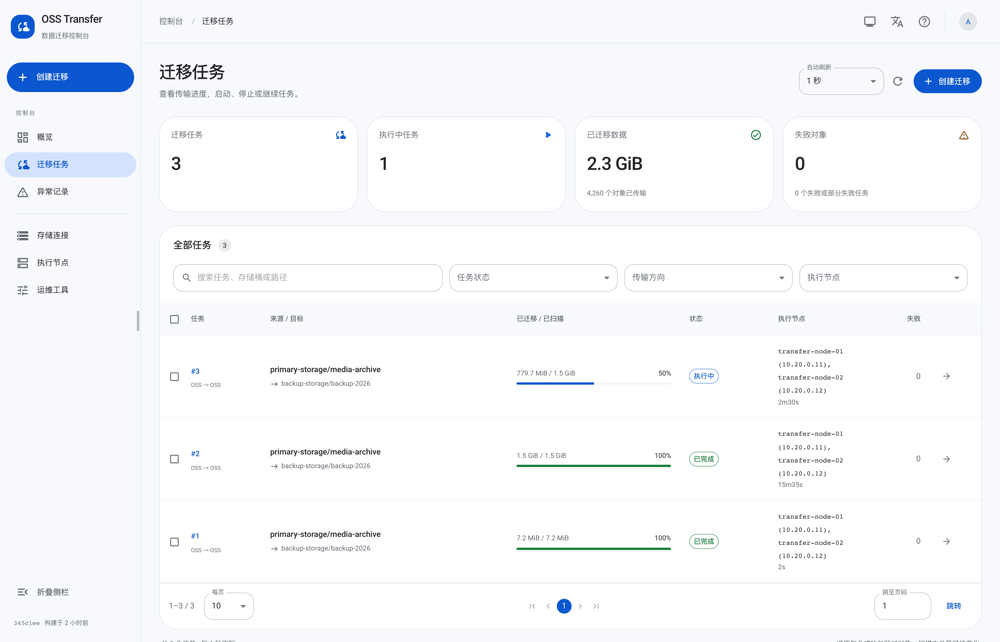
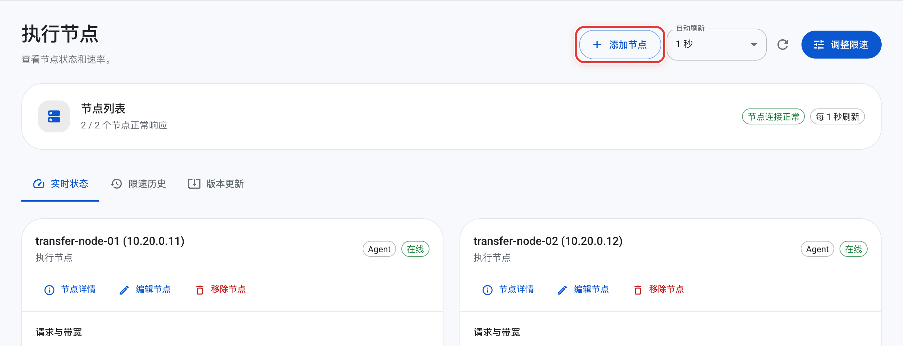
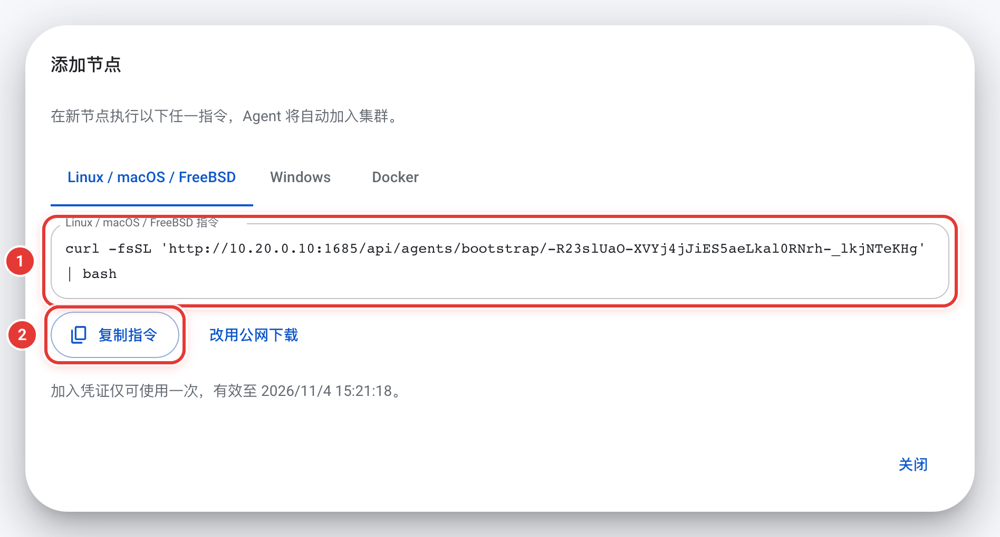
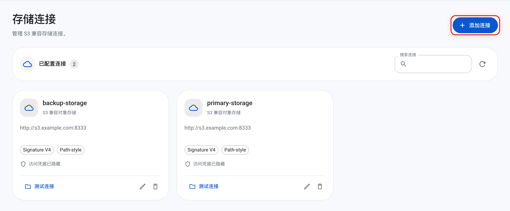
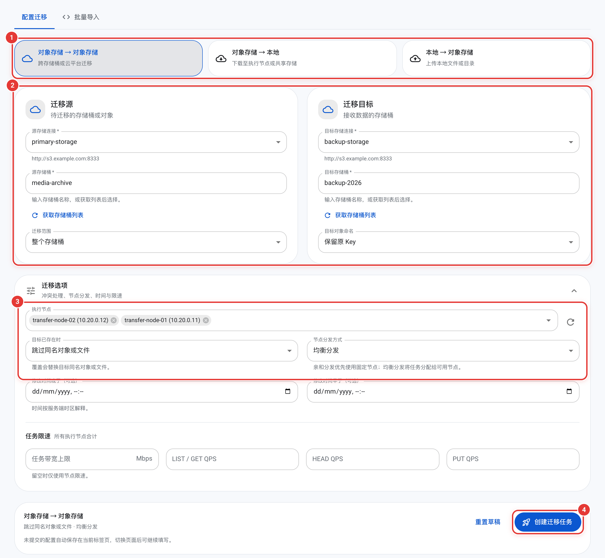
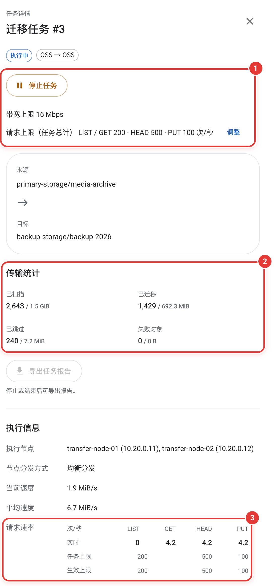

# OSS Transfer

[English](README.md)

OSS Transfer 是一个分布式数据迁移工具，用于在 S3 兼容对象存储之间迁移数据，也可以把本地文件上传到对象存储，或把对象下载到本地。

一个 Master 提供管理页面、API 和任务调度；多个执行节点（Agent）部署在靠近数据的主机上，负责扫描和传输。所有操作都可以在浏览器或命令行中完成。



## 功能

- **三种迁移方向**：对象存储 → 对象存储、本地 → 对象存储、对象存储 → 本地，可以按存储桶、前缀、单个对象或 Key 清单迁移，并保留、添加或替换前缀。
- **一个任务多个执行节点**：工作在多个执行节点间均衡分配，大对象拆成多个分片并行传输（见[大对象](docs/operations.zh-CN.md#大对象)）。任务运行中也可以添加或移出执行节点（见[调整任务的执行节点](docs/operations.zh-CN.md#调整任务的执行节点)）。
- **流量控制**：按任务和节点限制带宽以及 LIST、GET、HEAD、PUT 请求速率，运行中也能修改。存储服务限流时，执行节点会自动降速（见[任务限速](docs/operations.zh-CN.md#任务限速在节点间的分配)、[存储限流](docs/operations.zh-CN.md#存储限流)）。
- **冲突策略**：跳过同名对象、覆盖同名对象，或只覆盖有变化的对象，用于切换前的增量轮次（见[规划迁移](docs/planning.zh-CN.md#增量迁移与切换)）。
- **故障恢复**：执行节点失联后，未完成的工作会转给健康的执行节点；扫描可以断点续扫，失败的对象可以重试。每个迁移任务都可以下载报告。
- **对象比对**：按元数据或内容 SHA-256 比对存储桶或前缀，并导出差异和用于重新迁移的 Key 清单（见[对象比对](docs/operations.zh-CN.md#对象比对)）。
- **运维**：在线更新并在失败时自动回滚，存储凭证加密保存，管理页面和 CLI 支持中文、英文和日文。

## 架构

```text
 浏览器 / oss-transfer-cli
           │ HTTP :1685
           ▼
   ┌───────────────┐      长轮询 / 心跳      ┌───────────────┐
   │    Master     │ ◄────────────────────── │    Agent A    │ ──► 源端 / 目标端
   │ 页面 · API    │ ◄────────────────────── │    Agent B    │ ──► 对象存储或本地目录
   │ 调度          │                         │      ...      │
   └───────────────┘                         └───────────────┘
```

执行节点主动连接 Master，所以 Master 不需要能访问执行节点。数据只在执行节点和存储之间传输，不经过 Master。

## 开始之前

正式迁移前请阅读[规划迁移](docs/planning.zh-CN.md)：执行节点部署在哪里、要开放哪些端口、密钥需要哪些存储权限，以及如何规划验收和切换。HTTPS、凭证和密码见[安全说明](docs/security.zh-CN.md)。

## 快速开始

有两种安装方式：

- **原生服务**：在使用 systemd 的 Linux 上运行下面的一行安装命令。macOS、Windows、FreeBSD 和自定义目录见[安装选项](docs/install.zh-CN.md)，无法联网的主机见[离线安装](docs/offline-install.zh-CN.md)。
- **Docker**：用 Docker Compose 运行 Master，用容器运行执行节点，适用于 Linux 以及 macOS、Windows 上的 Docker Desktop。第 1 到 3 步按 [Docker Compose](docs/docker-compose.zh-CN.md) 操作，然后从第 4 步继续。

### 1. 安装 Master

```sh
curl -fsSL https://raw.githubusercontent.com/MoonWX/oss-transfer/main/install.sh | sudo bash
```

在中国大陆可以使用镜像：

```sh
curl -fsSL https://moonwx.s3.cn-north-1.jdcloud-oss.com/oss-transfer/latest/install.sh | sudo bash
```

按提示选择 Master 和原生服务，并决定是否同时安装本机执行节点。程序、配置和数据默认放在 `/opt/oss-transfer/`。要通过管道传递参数，请加 `-s --`，例如不提问、安装指定版本：

```sh
curl -fsSL https://raw.githubusercontent.com/MoonWX/oss-transfer/main/install.sh | sudo bash -s -- --role master --with-agent --version 4.1.42 --yes
```

**成功时**，输出的最后几行类似：

```text
=== Master 和本机 Agent 安装成功 ===
本机 Agent 已加入集群。
访问地址: http://10.0.0.5:1685
初始管理员: admin
初始密码: <随机密码>
```

不安装本机执行节点时，第一行是 `=== master 4.1.42 · 安装成功 ===`。

**失败时**，安装器会输出原因和日志路径。运行 `sudo systemctl status oss-transfer-master` 查看服务状态，解决问题后重新运行同一条命令：它会修复未完成的安装。

### 2. 登录

打开 **访问地址**，用 `admin` 和初始密码登录，然后设置新密码：至少 8 个字符，不能是常见或容易猜到的密码，也不能与用户名或初始密码相同。

**成功时**，会进入管理页面。**操作说明**（以及空的概览页）会显示一份清单：添加执行节点、添加存储连接、创建迁移任务、执行与查看结果。

如果页面打不开，请在主机防火墙中开放 1685 端口（见[网络](docs/planning.zh-CN.md#网络与防火墙)）。忘记密码时，见[重置管理员密码](docs/operations.zh-CN.md#重置管理员密码)。

### 3. 添加执行节点

如果已安装本机执行节点并且够用，可以跳过这一步。否则打开 **执行节点** 页面，点击右上角的 **添加节点**。



填写节点名称和 **Master 地址（Agent 需能访问）**：同一网络内可以填写内网地址，浏览器仍可使用公网地址或反向代理。点击 **生成加入指令**，窗口中会显示 Linux / macOS / FreeBSD、Windows 和 Docker 三种命令：

1. 当前所选系统的加入命令。执行节点主机是 Windows 或要用 Docker 运行时，先切换到对应标签。
2. 点击 **复制指令**，在执行节点主机上运行。

<p align="center"></p>

原生命令的形式是 `curl -fsSL '…' | bash`，以 root 运行，或由可以使用 `sudo` 的用户运行（安装脚本会自动通过 `sudo` 重新执行并询问密码）；Windows 命令请在管理员 PowerShell 中运行。窗口会显示执行节点从哪里下载安装包：默认从 Master 本身下载，点击 **改用公网下载** 后改为从公网下载。指令只能使用一次，30 分钟后过期。

**成功时**，安装器输出 `=== agent 4.1.42 · 安装成功 ===`，**执行节点** 页面中该节点显示为 **在线**（也可以运行 `oss-transfer-cli node list` 查看）。

**失败时**：确认执行节点主机能访问 Master 地址（例如 `curl http://10.0.0.5:1685/`）。指令已过期或已被使用时，重新生成。

### 4. 添加存储连接

在 **存储连接** 页面点击 **添加连接**，分别添加源端和目标端。请先添加执行节点：连接检查在执行节点上运行。



| 字段 | 填写内容 |
| --- | --- |
| 连接名称 | 简短的名称，例如 `source`；CLI 中把存储桶写成 `source/存储桶` |
| Endpoint | `http://` 或 `https://` 加主机和可选端口，不带路径：`https://s3.example.com` 或 `http://10.0.0.5:9000` |
| Access Key、Secret Key | 具备本次迁移所需[权限](docs/planning.zh-CN.md#存储权限)的密钥 |
| 寻址方式 | **自动（推荐）** |
| 签名版本 | **默认（Signature V4）**；只有存储要求时才选 V2 |
| 保存时验证访问权限 | 保持开启 |

**自动寻址**在以下情况使用 Path-style（`http://endpoint/bucket/key`）：Endpoint 带端口，或主机是 IP 地址、`localhost`、不含点的名称，或以 `.internal`、`.local`、`.lan` 结尾，大多数自建 S3（MinIO、Ceph、SeaweedFS）都属于这种情况；其他情况使用 Virtual-hosted（`https://bucket.endpoint/key`），例如 AWS 和其他云服务的域名。表单会显示当前 Endpoint 实际使用哪一种。管理页面没有区域字段；如果存储需要指定签名区域，请运行 `oss-transfer-cli storage update <连接名> --region <区域>`。

**成功时**，连接保存后没有警告，卡片上显示寻址方式，例如 **自动 · Path-style**。**测试连接** 会说明已列举某个存储桶中的对象。

**失败时**，表单会显示原因和处理建议，原始错误可以通过 **显示原始错误** 查看。存储桶域名无法解析时，点击 **改用 Path-style**。只授权到单个存储桶的密钥保存后会显示警告，请在 **测试连接 → 检查指定存储桶** 中检查该存储桶（见[只授权到单个存储桶的密钥](docs/planning.zh-CN.md#只授权到单个存储桶的密钥与连接检查)）。

### 5. 创建迁移任务

点击左上角的 **创建迁移**，按图中编号填写：

1. **迁移方向**：对象存储 → 对象存储、对象存储 → 本地，或本地 → 对象存储。
2. **迁移源和迁移目标**：选择存储连接和存储桶，可以只迁移某个前缀或单个对象，也可以修改目标端的对象名称。涉及本地文件时，这里填写执行节点主机上的路径，并需要通过目录预检。
3. **迁移选项**：选择执行节点、冲突策略（**目标已存在时**：**跳过同名对象或文件**、**覆盖有变化的对象** 或 **覆盖同名对象或文件**）和节点分发方式。下方还可以设置时间范围（按服务端时区解释）、**分段下载**（仅下载任务）和任务限速。
4. 点击 **创建迁移任务**。任务会先扫描，再开始传输。



上传本地文件时，执行节点需要源目录的读权限；下载到本地时，需要目标目录的写权限。目标目录不可写时，预检会报告。

### 6. 查看进度

在 **迁移任务** 页面点击任务，右侧会打开任务详情：

1. 停止或继续任务；点击 **调整**（未设置带宽上限时显示为 **限速**）可以在运行中修改带宽和请求上限。
2. **传输统计**：已扫描、已迁移、已跳过和失败的对象数及数据量，实时更新。
3. **请求速率**：LIST、GET、HEAD、PUT 每秒的实际请求数，以及任务上限和最终生效的上限。

<p align="center"></p>

**成功时**，任务以 **已完成** 结束且没有失败对象。有对象失败时，任务详情会显示主要原因，请在 **异常记录** 页面重试；已完成的对象不会重复传输。**导出任务报告** 会下载一个包含每个对象结果的 ZIP。

### 7. 验证结果

在任务详情中点击 **比对源和目标**（对象存储 → 对象存储任务），会打开 **运维工具 → 对象比对** 并填好该任务的存储桶和前缀。点击 **开始比对**。

**成功时**，比对完成并显示 **未发现差异。** 否则请导出差异：ZIP 中附带用于重新迁移缺失和不一致对象的 Key 清单（见[对象比对](docs/operations.zh-CN.md#对象比对)、[验收大规模迁移](docs/planning.zh-CN.md#验收大规模迁移)）。

## Docker Compose

Master 通过 `docker-compose.yml` 运行，管理页面的 **Docker** 加入指令会以容器方式启动执行节点，不需要 root，macOS 和 Windows 上的 Docker Desktop 也适用：

```sh
mkdir oss-transfer && cd oss-transfer
curl -fSL https://raw.githubusercontent.com/MoonWX/oss-transfer/main/docker-compose.yml -o docker-compose.yml
curl -fSL https://raw.githubusercontent.com/MoonWX/oss-transfer/main/.env.example -o .env
docker compose pull master
docker compose up -d master
docker compose logs master
```

日志中有 `admin` 的初始密码。Docker Desktop、容器中的执行节点如何访问 Master（`host.docker.internal`）、目录挂载、日志、在容器中使用 CLI、更新和删除，见 [Docker Compose](docs/docker-compose.zh-CN.md)。

## 手动运行（不依赖 systemd 和 Docker）

主机没有 systemd、也不能用 Docker 时（例如容器化的开发机），可以直接运行发布包中的程序。[`deploy/manual/oss-transfer-run.sh`](deploy/manual/oss-transfer-run.sh) 负责启动、停止、异常退出后自动重启、日志和首次加入。

1. 下载并解压发布包（中国大陆可把下载地址换成 `https://moonwx.s3.cn-north-1.jdcloud-oss.com/oss-transfer/v4.1.42/`），并把脚本放在程序旁边：

   ```sh
   curl -fLO https://github.com/MoonWX/oss-transfer/releases/download/v4.1.42/oss-transfer-linux-amd64.tar.gz
   tar -xzf oss-transfer-linux-amd64.tar.gz && cd oss-transfer-linux-amd64
   curl -fsSL https://raw.githubusercontent.com/MoonWX/oss-transfer/main/deploy/manual/oss-transfer-run.sh -o oss-transfer-run.sh && chmod +x oss-transfer-run.sh
   ```

2. 启动 Master，输出中有 `admin` 的初始密码：

   ```sh
   ./oss-transfer-run.sh master start
   ```

3. 在控制台 **执行节点 → 添加节点** 或用 `./oss-transfer-cli agent invite --master-url http://<Master IP>:1685` 生成邀请，复制其中的邀请链接（`…/api/agents/bootstrap/<令牌>`），在要加入的主机上运行。以后再启动时不需要 `--join-url`：

   ```sh
   ./oss-transfer-run.sh agent start --join-url 'http://<Master IP>:1685/api/agents/bootstrap/<令牌>'
   ```

用法：`./oss-transfer-run.sh <master|agent> <start|stop|restart|status|logs> [选项]`

| 选项 | 默认值 | 说明 |
| --- | --- | --- |
| `--data 目录` | `<脚本目录>/data/<角色>` | 数据目录，日志在其中的 `logs/service.log`。每次都要使用同一个目录 |
| `--listen 地址:端口` | `0.0.0.0:1685` | 仅 Master：监听地址 |
| `--join-url 链接` | 无 | 仅 Agent，首次启动时必填：邀请链接，末尾的 `?lang=…` 会自动去掉 |

`status` 只有在程序本身运行时才显示“正在运行”；程序反复退出时显示“正在重启”。被 Master 移除的 Agent 以状态码 78 退出，脚本不会再重启它。

也可以不用脚本，直接运行程序：

```sh
./oss-transfer-master --listen 0.0.0.0:1685 --data-dir /data/oss-transfer/master
./oss-transfer-agent --join-url 'http://<Master IP>:1685/api/agents/bootstrap/<令牌>' --data-dir /data/oss-transfer/agent   # 首次
./oss-transfer-agent --data-dir /data/oss-transfer/agent                                                                   # 之后
```

| 程序 | 参数 | 说明 |
| --- | --- | --- |
| `oss-transfer-master` | `--listen` | 监听地址，默认 `:1685` |
| | `--data-dir` | 数据目录，默认 `./data/master` |
| | `--config` | 用 `service.json` 指定以上设置和日志文件，代替命令行参数 |
| | `--reset-admin-password [--username 名称]` | Master 停止时重置管理员密码 |
| `oss-transfer-agent` | `--join-url` | 首次加入用的邀请链接，只能使用一次，30 分钟内有效；不能带 `?lang=…` 这类参数 |
| | `--master-url` 和 `--join-token` | 代替 `--join-url`：分别给出 Master 地址和邀请令牌（也可用环境变量 `OSS_TRANSFER_JOIN_TOKEN`） |
| | `--data-dir` | 数据目录，默认 `./data/agent`，保存节点身份；之后启动只需要它 |
| | `--label`、`--address` | 节点显示名称；节点地址或名称 |
| | `--enroll-only` | 只完成加入并退出，不开始执行任务 |
| | `--config` | 用 `service.json` 指定数据目录和日志文件 |
| 两者 | `--version` | 显示版本 |

注意：

- 邀请里的 Master 地址必须是执行节点能访问的地址；`127.0.0.1` 只适用于与 Master 在同一台主机上的执行节点。
- 脚本不处理开机自启，可在 root 的 crontab 中加入 `@reboot /路径/oss-transfer-run.sh master start`（执行节点同理）。
- 这种方式不支持控制台和 CLI 的在线更新，也不支持安装脚本的 `--uninstall`。升级时先 `stop`，把三个程序换成新版本再 `start`，数据目录保持不变；卸载时停止后删除目录即可。

## 命令行

在已安装的 Master 或执行节点主机上，以 root（或服务所属账号）运行 CLI，会直接连接本机所属的集群，不需要登录：

```sh
oss-transfer-cli task list
oss-transfer-cli task progress <任务ID> --watch 5
oss-transfer-cli task limits <任务ID> --put-qps 200 --bandwidth-mbps 100
oss-transfer-cli node list
```

Docker 部署时，在 Master 容器中运行：`docker compose exec master oss-transfer-cli task list`。CLI 可以完成页面上的全部操作，并支持 `--json` 输出，方便写脚本。远程登录、创建任务和退出状态码见 [CLI 文档](docs/cli.zh-CN.md)。

## 升级

建议在没有运行中的任务时升级。

1. 在 **运维工具 → 版本更新** 中更新 Master，或运行 `oss-transfer-cli update master --yes`。
2. 在 **执行节点 → 版本更新** 中点击 **更新全部节点**，执行节点会逐台更新。Docker 执行节点需要重建容器来更新，点击它的 **更新命令** 按钮即可看到命令（见 [Docker Compose](docs/docker-compose.zh-CN.md#容器中的执行节点)）。版本已与 Master 一致时，按钮为 **重建命令**，可用于添加目录挂载等。

升级前会自动备份，新版本通过健康检查后删除备份；启动失败时会自动回滚。也可以重新运行安装命令来升级。检测更新只提供正式版，试用 beta 版本见[试用预发布版本](docs/operations.zh-CN.md#试用预发布版本)。

需要重装时，保留各角色的 `config` 目录和完整的 `data` 目录，包括密钥文件（`master.db.key` 或 `agent.db.key`）。要卸载原生安装，用 `--uninstall` 运行安装器（见[安装选项](docs/install.zh-CN.md)）；Docker 部署见[删除安装](docs/docker-compose.zh-CN.md#删除安装)。详见[运维说明](docs/operations.zh-CN.md)。

## 注意事项

- **跳过同名对象或文件只比较名称**：目标端已有同名对象或文件时直接跳过。后续轮次请使用 **覆盖有变化的对象**，并用[对象比对](docs/operations.zh-CN.md#对象比对)验收。
- **不会同步删除**：在源端删除的对象会留在目标端，比对时显示为 **目标多余**（见[源端删除的对象](docs/planning.zh-CN.md#源端删除的对象)）。
- **本地路径是执行节点主机上的路径**：多个节点处理同一个本地目录时，这个目录必须是共享目录。各节点的挂载路径可以不同，预检会写入一个小文件，确认它们指向同一个目录。
- **一个任务只复制变化中数据的一个时刻**：扫描看不到已扫描部分之后发生的变化。数据持续变化时，请分轮复制，并在最后一轮前停写（见[切换](docs/planning.zh-CN.md#增量迁移与切换)）。

## 支持的平台

| 系统 | 架构 |
| --- | --- |
| Linux | amd64、arm64、armv7、riscv64、loong64 |
| macOS | amd64、arm64 |
| Windows | amd64、arm64 |
| FreeBSD | amd64、arm64 |

Linux 原生服务需要 systemd 219、Bash 4.2、curl 7.29 及以上版本。在较旧的 systemd 上，在线更新有两点限制。低于 236 时，在线更新失败后，其辅助单元 `oss-transfer-update-*` 会一直显示为失败状态，执行 `systemctl reset-failed` 即可清除。低于 240 时，更新辅助进程无法启动不会立即报告，要等更新超时后才会标记为失败。

每个版本都会发布到 [GitHub Releases](https://github.com/MoonWX/oss-transfer/releases)、Docker Hub `moonwx/osstransfer` 和国内 OSS 镜像。GitHub Releases 和镜像都包含离线安装所需的全部文件（各平台安装包、`manifest.tsv` 和三个安装脚本 `install.sh`、`native-install.sh`、`Install.ps1`），另附 `SHA256SUMS`。镜像的 `latest/` 目录始终是最新正式版。

## 文档

| 文档 | 内容 |
| --- | --- |
| [规划迁移](docs/planning.zh-CN.md) | 部署拓扑、端口和防火墙、存储权限、速度与容量、验收、增量迁移与切换 |
| [安全说明](docs/security.zh-CN.md) | 网络暴露面、HTTPS、存储凭证、密码、会话、加入指令和服务运行身份 |
| [安装选项](docs/install.zh-CN.md) | 各系统的安装方法、指定版本或预发布版本、目录、端口、重装和反向代理 |
| [离线安装](docs/offline-install.zh-CN.md) | 在无法联网的环境中安装 |
| [Docker Compose](docs/docker-compose.zh-CN.md) | 在 Linux 和 Docker Desktop 上用容器部署、容器中的执行节点、目录挂载、日志、CLI、更新和删除 |
| [CLI](docs/cli.zh-CN.md) | 命令行的全部用法 |
| [运维说明](docs/operations.zh-CN.md) | 并发、节点限速、任务限速分配、存储限流、大对象、对象比对、升级、预发布版本、故障转移、调整执行节点、断点续扫、重置密码 |
| [数据库维护](docs/database-maintenance.zh-CN.md) | 回收数据库文件空间 |
| [从 V4.0.x 升级](docs/migration.zh-CN.md) | 旧版本数据的离线转换 |

## 从源码构建

需要 Go 1.26、Node.js 22.12 或更高版本，以及 Python 3。

```sh
./build.sh          # 构建当前系统和架构
./build.sh --all    # 构建全部平台
./build.sh --test   # 先运行测试再打包
```

安装包和校验文件输出到 `output/packages/`。CI 测试和发布流程见[验收测试](.github/acceptance/README.zh-CN.md)和[发布流程](.github/RELEASING.zh-CN.md)。代码结构如下：

| 目录 | 内容 |
| --- | --- |
| `cmd/` | Master 和 Agent 的入口 |
| `internal/` | 调度、传输引擎、存储适配和 Agent 通信 |
| `cli/` | `oss-transfer-cli` |
| `frontend/` | 管理页面（React + MUI） |
| `deploy/` | 安装脚本、打包和发布 |
