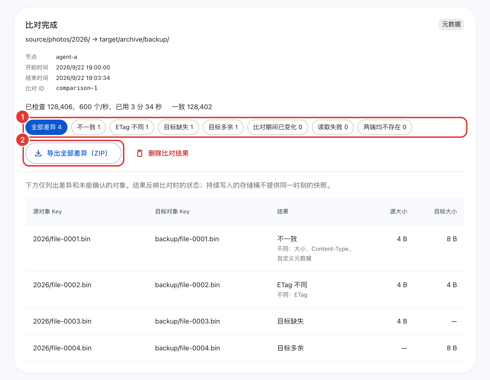
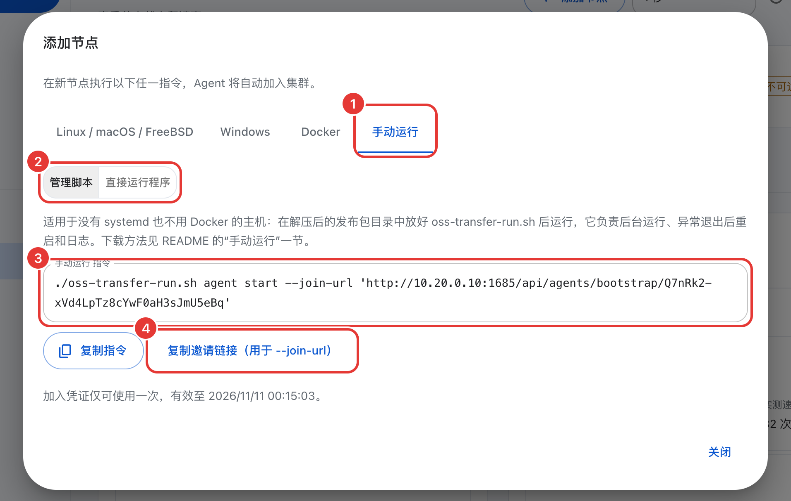

# OSS Transfer

[English](README.md)

OSS Transfer 是一个分布式数据迁移工具，可以在 S3 标准的对象存储之间、本地与 S3 标准的对象存储之间方便地进行迁移。

一个 Master 负责管理页面、API 和任务调度，多个执行节点（Agent）部署在靠近数据的主机上，负责实际的扫描和传输。所有操作都可以在 WebUI 或命令行中完成。


## 功能
支持方向有：对象存储到对象存储、本地到对象存储、对象存储到本地。迁移范围可以是整个存储桶、某个前缀、单个对象或一份 Key 清单，目标端的前缀可以保留、添加或替换。

一个任务可以分配给多个执行节点，工作量均衡分配，[大对象](docs/operations.zh-CN.md#大对象)拆成分片并行传输。任务开始运行后随时可以[添加或移出节点](docs/operations.zh-CN.md#调整任务的执行节点)，运行中也可以调整带宽和请求速率的上限。存储服务限流时，执行节点[自动降速](docs/operations.zh-CN.md#存储限流)。

目标端已有同名对象时，有三种处理方式：跳过同名对象或文件、覆盖同名对象或文件、覆盖有变化的对象。第三种适合[增量迁移](docs/planning.zh-CN.md#增量迁移与切换)，也就是先全量复制一遍，之后每轮只传有变化的部分。执行节点失联时，未完成的工作会自动转给健康的节点，扫描从断点继续。失败的对象可以重试，每个任务都可以下载报告。迁移完成后，用[对象比对](docs/operations.zh-CN.md#对象比对)把两端逐个核对一遍。

在线更新失败时自动回滚，存储凭证（AK/SK）加密保存，管理页面和命令行支持中文、英文、日文。

## 架构

```text
  Browser / oss-transfer-cli
             |
             | HTTP :1685
             v
  +--------------+    long poll    +-----------+       +------------------+
  |    Master    | <-------------- |  Agent A  | <---> |  Object storage  |
  | console, API | <-------------- |  Agent B  | <---> |  or local files  |
  |  scheduling  |    heartbeat    |    ...    |       |                  |
  +--------------+                 +-----------+       +------------------+
```

执行节点主动连接 Master，通过长轮询和心跳保持通信，所以 Master 不需要能访问执行节点的网络。数据只在执行节点和存储之间传输，不经过 Master。Master 只负责调度，不接触数据。

## 快速开始

正式迁移前，建议先读一遍[规划迁移](docs/planning.zh-CN.md)，了解执行节点部署在哪里、需要开放哪些端口、密钥需要哪些权限。HTTPS 和凭证安全见[安全说明](docs/security.zh-CN.md)。

大多数 Linux 服务器适合使用原生服务，一行命令即可安装完成，后续也支持在线升级。下面的步骤按这种方式编写。macOS、Windows、FreeBSD 和自定义安装目录见[安装选项](docs/install.zh-CN.md)，无法联网的主机见[离线安装](docs/offline-install.zh-CN.md)。

主机上有 Docker 时，也可以用 Docker Compose 部署，macOS 和 Windows 的 Docker Desktop 同样适用。第 1 到 3 步按 [Docker Compose](docs/docker-compose.zh-CN.md) 操作，然后从第 4 步继续。

既没有 systemd 也不便安装 Docker（例如容器化的开发机），可以直接运行发布包中的程序，见[手动运行](#手动运行不依赖-systemd-和-docker)，之后从第 2 步继续。

### 1. 安装 Master

```sh
curl -fsSL https://raw.githubusercontent.com/MoonWX/oss-transfer/main/install.sh | sudo bash
```

在中国大陆可以使用镜像：

```sh
curl -fsSL https://moonwx.s3.cn-north-1.jdcloud-oss.com/oss-transfer/latest/install.sh | sudo bash
```

安装脚本会询问安装 Master 还是执行节点、使用原生服务还是 Docker Compose，以及是否在本机同时安装一个执行节点。这里选择 Master 和原生服务。程序、配置和数据默认放在 `/opt/oss-transfer/`。如果需要通过管道传参，加 `-s --`，例如不提问、安装指定版本：

```sh
curl -fsSL https://raw.githubusercontent.com/MoonWX/oss-transfer/main/install.sh | sudo bash -s -- --role master --with-agent --version <版本号> --yes
```

在大多数情况下，使用安装脚本时，可以一路回车，全部使用默认值。

安装完成后，输出的最后几行大致如下：

```text
=== Master 和本机 Agent 安装成功 ===
本机 Agent 已加入集群。
访问地址: http://10.0.0.5:1685
初始管理员: admin
初始密码: <随机密码>
```

未安装本机执行节点时，第一行是 `=== master <版本号> · 安装成功 ===`。如果安装失败，安装器会输出原因和日志路径。可以用 `sudo systemctl status oss-transfer-master` 查看服务状态，问题解决后重新运行同一条命令即可。安装器能修复未完成的安装。

### 2. 登录

打开上一步给出的访问地址，用 `admin` 和初始密码登录，然后设置新密码：至少 8 个字符，不能是常见密码，也不能与用户名或初始密码相同。

登录后，**操作说明**（以及空的概览页）中列出了接下来的步骤：添加执行节点、添加存储连接、创建迁移任务、执行与查看结果。如果页面无法打开，通常是防火墙未放行 1685 端口（见[网络](docs/planning.zh-CN.md#网络与防火墙)）。忘记密码见[重置管理员密码](docs/operations.zh-CN.md#重置管理员密码)。

### 3. 添加执行节点

如果安装 Master 时已包含本机执行节点，并且一个节点已能满足需要，这一步可以跳过。否则打开 **执行节点** 页面，点击右上角的 **添加节点**。


填写节点名称，在 **Master 地址（Agent 需能访问）** 中填写执行节点能访问到的 Master 地址。同一内网填写内网 IP 即可，浏览器仍可使用公网地址或反向代理。点击 **生成加入指令**，窗口有四个页签：Linux / macOS / FreeBSD、Windows、Docker 和手动运行，最后一个适用于没有 systemd 也不使用 Docker 的主机。

<p align="center"></p>

点击 **复制指令**，到执行节点的主机上运行。原生命令的形式是 `curl -fsSL '…' | bash`，以 root 运行，或者用可以 `sudo` 的账号运行。Windows 在管理员 PowerShell 中运行。窗口中的 **下载来源** 默认是 Master 本身，也可以改为公网；位于京东云华北-北京地域的主机可以选择 **京东云内网（华北-北京）**。指令只能使用一次，30 分钟后过期。

安装器最后输出 `=== agent <版本号> · 安装成功 ===`。回到 **执行节点** 页面，几秒内该节点会显示为在线。如果未出现，先确认执行节点能访问 Master 地址（尝试 `curl http://10.0.0.5:1685/`）。指令过期或已使用过，重新生成即可。

### 4. 添加存储连接

在 **存储连接** 页面点击 **添加连接**，分别添加源端和目标端。先确认至少有一个在线的执行节点，因为连接检查在执行节点上执行。


| 字段 | 填写内容 |
| --- | --- |
| 连接名称 | 简短的名称，例如 `source`；CLI 中把存储桶写成 `source/存储桶` |
| Endpoint | `http://` 或 `https://` 加主机和可选端口，不带路径：`https://s3.example.com` 或 `http://10.0.0.5:9000` |
| Access Key、Secret Key | 具备本次迁移所需[权限](docs/planning.zh-CN.md#存储权限)的密钥 |
| 寻址方式 | **自动（推荐）** |
| 签名版本 | **默认（Signature V4）**；只有存储要求时才选 V2 |
| 保存时验证访问权限 | 保持开启 |

寻址方式选择“自动”即可。Endpoint 带端口、使用 IP 地址、`localhost` 或不含点的名称时，自动采用 Path-style（`http://endpoint/bucket/key`）。以 `.internal`、`.local`、`.lan` 结尾的也一样。大多数自建 S3（MinIO、Ceph、SeaweedFS）都属于这种情况。其他情况采用 Virtual-hosted（`https://bucket.endpoint/key`），例如 AWS 和各家云服务的域名。表单上显示当前 Endpoint 实际使用的寻址方式。

管理页面没有区域字段。如果存储需要指定签名区域，运行 `oss-transfer-cli storage update <连接名> --region <区域>`。

保存成功后，卡片上显示寻址方式，例如 **自动 · Path-style**，点击 **测试连接** 可以查看它列举了哪个存储桶中的对象。保存失败时，表单上显示原因和建议，点击 **显示原始错误** 查看详情。存储桶域名无法解析时，尝试 **改用 Path-style**。只授权到单个存储桶的密钥，保存后会有警告，用 **测试连接 → 检查指定存储桶** 检查该存储桶即可（见[只授权到单个存储桶的密钥](docs/planning.zh-CN.md#只授权到单个存储桶的密钥与连接检查)）。

### 5. 创建迁移任务

点击左上角的 **创建迁移**，按图中编号填写：

1. 选择 **迁移方向**：对象存储 → 对象存储、对象存储 → 本地，或本地 → 对象存储。
2. 填写 **迁移源和迁移目标**：选择存储连接和存储桶，也可以只迁移某个前缀或单个对象，目标端的对象名称也可以修改。涉及本地文件时，填写执行节点主机上的路径，并需要通过目录预检。
3. 设置 **迁移选项**：选择执行节点、冲突策略（**目标已存在时**：**跳过同名对象或文件**、**覆盖有变化的对象** 或 **覆盖同名对象或文件**）和节点分发方式。下方还可以设置时间范围（按服务端时区）、**分段下载**（仅下载任务）和任务限速。
4. 点击 **创建迁移任务**。任务先扫描，再开始传输。


上传本地文件时，执行节点需要源目录的读权限。下载到本地时，需要目标目录的写权限。目标目录不可写时，预检会给出提示。

### 6. 查看进度

在 **迁移任务** 页面点击一个任务，右侧展开详情。这里可以停止或继续任务，点击 **调整**（未设置带宽上限时显示为 **限速**）在运行中修改带宽和请求上限。**传输统计** 实时更新已扫描、已迁移、已跳过和失败的对象数及数据量。**请求速率** 显示 LIST、GET、HEAD、PUT 每秒的实际请求数，以及任务上限和最终生效的上限。

<p align="center"></p>

任务结束后，检查状态是否为 **已完成**，以及是否有对象失败。有对象失败时，任务详情中会显示主要原因，在 **异常记录** 页面重试即可，已完成的对象不会重复传输。点击 **导出任务报告** 下载一个 ZIP，其中包含每个对象的处理结果。

### 7. 验证结果

任务显示“已完成”，并不代表目标端的数据与源端完全一致。“已完成”只说明扫描到的对象都处理过了，而默认的“跳过同名对象或文件”只按名称判断，不比较内容。正式切换前，建议至少做一次元数据比对。

在任务详情中点击 **比对源和目标**（对象存储 → 对象存储任务），页面跳转到 **运维工具 → 对象比对**，存储桶和前缀已经填好，直接点击 **开始比对**。

<p align="center"></p>

比对重新列举两端，逐个对象核对，能发现三类问题：目标端缺失的对象、大小或元数据不一致的对象，以及目标端多余的对象（例如源端已删除的）。比对完成后如果显示 **未发现差异**，本轮验证即通过。如果存在差异，可以导出结果，ZIP 中附带用于重新迁移缺失和不一致对象的 Key 清单（见[对象比对](docs/operations.zh-CN.md#对象比对)、[验收大规模迁移](docs/planning.zh-CN.md#验收大规模迁移)）。

比对有一定代价。两端各列举一遍，每个对象还要各发一次 HEAD 请求，按请求计费的存储会产生相应费用。速度方面，单个比对受顺序列举限制，在测试环境中大约每秒 600 个对象。对象很多时，按前缀拆成多个比对，由多个执行节点并行执行（见[验收大规模迁移](docs/planning.zh-CN.md#验收大规模迁移)）。

比对有两种模式。默认的元数据模式比较大小和元数据，如果两端大小和元数据相同但内容不同，则无法发现。ETag 不同只作为提示，因为分片上传和服务端加密也会导致 ETag 不同。内容模式完整读取两端数据，用 SHA-256 比较，更可靠，但速度较慢，还可能产生流量费用，适合抽样检查。

比对和迁移任务共用执行节点的限速配额，比对结果保存在执行节点上。如果之后移除了该节点，结果将无法读取。

## Docker Compose

Master 用 `docker-compose.yml` 运行，管理页面中的 **Docker** 加入指令以容器方式运行执行节点，不需要 root，macOS 和 Windows 上的 Docker Desktop 同样适用：

```sh
mkdir oss-transfer && cd oss-transfer
curl -fSL https://raw.githubusercontent.com/MoonWX/oss-transfer/main/docker-compose.yml -o docker-compose.yml
curl -fSL https://raw.githubusercontent.com/MoonWX/oss-transfer/main/.env.example -o .env
docker compose pull master
docker compose up -d master
docker compose logs master
```

日志中有 `admin` 的初始密码。Docker Desktop、容器中的执行节点如何连接 Master（`host.docker.internal`）、目录挂载、日志、在容器中使用 CLI、更新和删除，均在 [Docker Compose](docs/docker-compose.zh-CN.md) 中说明。

## 手动运行（不依赖 systemd 和 Docker）

主机没有 systemd、也不便安装 Docker 时（例如容器化的开发机），可以直接运行发布包中的程序。[`deploy/manual/oss-transfer-run.sh`](deploy/manual/oss-transfer-run.sh) 负责启动、停止、异常退出后自动重启、日志和首次加入。

<p align="center"></p>

1. 下载并解压最新正式版的发布包，将脚本放在程序旁边。从 4.1.45 起，`oss-transfer-run.sh` 和安装脚本一样随每个版本发布，下载地址与发布包相同：

   ```sh
   curl -fLO https://github.com/MoonWX/oss-transfer/releases/latest/download/oss-transfer-linux-amd64.tar.gz
   tar -xzf oss-transfer-linux-amd64.tar.gz && cd oss-transfer-linux-amd64
   curl -fLO https://github.com/MoonWX/oss-transfer/releases/latest/download/oss-transfer-run.sh && chmod +x oss-transfer-run.sh
   ```

   在中国大陆，将这两个地址中的 `https://github.com/MoonWX/oss-transfer/releases/latest/download/` 替换为京东云 OSS 镜像 `https://moonwx.s3.cn-north-1.jdcloud-oss.com/oss-transfer/latest/`；位于京东云华北-北京地域的主机可以使用内网地址 `https://moonwx.s3-internal.cn-north-1.jdcloud-oss.com/oss-transfer/latest/`。

2. 启动 Master，输出中有 `admin` 的初始密码：

   ```sh
   ./oss-transfer-run.sh master start
   ```

3. 在控制台 **执行节点 → 添加节点** 或用 `./oss-transfer-cli agent invite --master-url http://<Master IP>:1685` 生成邀请，复制邀请链接（`…/api/agents/bootstrap/<令牌>`），到要加入的主机上运行：

   ```sh
   ./oss-transfer-run.sh agent start --join-url 'http://<Master IP>:1685/api/agents/bootstrap/<令牌>'
   ```

   控制台的 **手动运行** 页签直接给出这条命令和直接运行程序的命令，**复制邀请链接** 只复制链接本身。加入成功后，再次启动时不需要 `--join-url`。

用法：`./oss-transfer-run.sh <master|agent> <start|stop|restart|status|logs> [选项]`

| 选项 | 默认值 | 说明 |
| --- | --- | --- |
| `--data 目录` | `<脚本目录>/data/<角色>` | 数据目录，日志在其中的 `logs/service.log`。每次都要使用同一个目录 |
| `--listen 地址:端口` | `0.0.0.0:1685` | 仅 Master：监听地址 |
| `--join-url 链接` | 无 | 仅 Agent，首次启动时必填：邀请链接，末尾的 `?lang=…` 会自动去掉 |

`status` 只有在程序本身运行时才显示“正在运行”。程序反复退出时显示“正在重启”。被 Master 移除的 Agent 以状态码 78 退出，脚本不再重启它。

也可以不用脚本，直接运行程序：

```sh
./oss-transfer-master --listen 0.0.0.0:1685 --data-dir /data/oss-transfer/master
./oss-transfer-agent --join-url 'http://<Master IP>:1685/api/agents/bootstrap/<令牌>' --data-dir /data/oss-transfer/agent   # 首次
./oss-transfer-agent --data-dir /data/oss-transfer/agent                                                                   # 之后
```

| 程序 | 参数 | 说明 |
| --- | --- | --- |
| `oss-transfer-master` | `--listen` | 监听地址，默认 `:1685` |
| | `--data-dir` | 数据目录，默认 `./data/master` |
| | `--config` | 用 `service.json` 指定以上设置和日志文件，代替命令行参数 |
| | `--reset-admin-password [--username 名称]` | Master 停止时重置管理员密码 |
| `oss-transfer-agent` | `--join-url` | 首次加入用的邀请链接，只能使用一次，30 分钟内有效；复制时带上的 `?lang=…` 等安装参数会被忽略 |
| | `--master-url` 和 `--join-token` | 代替 `--join-url`：分别给出 Master 地址和邀请令牌（也可用环境变量 `OSS_TRANSFER_JOIN_TOKEN`） |
| | `--data-dir` | 数据目录，默认 `./data/agent`，保存节点身份；之后启动只需要它 |
| | `--label`、`--address` | 节点显示名称；节点地址或名称 |
| | `--enroll-only` | 只完成加入并退出，不开始执行任务 |
| | `--config` | 用 `service.json` 指定数据目录和日志文件 |
| 两者 | `--version` | 显示版本 |

邀请中的 Master 地址必须是执行节点能访问的地址，`127.0.0.1` 只适用于与 Master 在同一台机器上的执行节点。脚本不处理开机自启，可以在 root 的 crontab 中加入 `@reboot /路径/oss-transfer-run.sh master start`（执行节点同理）。

这种方式不支持控制台和 CLI 的在线更新，也不支持安装脚本的 `--uninstall`。升级时先 `stop`，把三个程序替换为新版本再 `start`，不要改动数据目录。卸载时先停止程序，再删除目录即可。

## 命令行

在安装了 Master 或执行节点的主机上，以 root（或服务所属账号）运行 CLI，会自动连接本机所属的集群，不需要登录：

```sh
oss-transfer-cli task list
oss-transfer-cli task progress <任务ID> --watch 5
oss-transfer-cli task limits <任务ID> --put-qps 200 --bandwidth-mbps 100
oss-transfer-cli node list
```

Docker 部署时，在 Master 容器中运行：`docker compose exec master oss-transfer-cli task list`。管理页面上的所有操作 CLI 均可完成，加 `--json` 输出结构化数据，方便编写脚本。远程登录、创建任务和退出状态码见 [CLI 文档](docs/cli.zh-CN.md)。

## 升级

建议在没有运行中的任务时升级。

1. 在 **运维工具 → 版本更新** 中更新 Master，或运行 `oss-transfer-cli update master --yes`。
2. 在 **执行节点 → 版本更新** 中点击 **更新全部节点**，执行节点逐台更新。Docker 执行节点需要重建容器来更新，点击其 **更新命令** 按钮查看命令（见 [Docker Compose](docs/docker-compose.zh-CN.md#容器中的执行节点)）。版本已与 Master 一致时，按钮显示为 **重建命令**，可用于添加目录挂载等配置。

升级前自动备份，新版本通过健康检查后才删除备份。启动失败时自动回滚。重新运行安装命令也可以升级。检测更新只提供正式版，如需试用 beta 版本，见[试用预发布版本](docs/operations.zh-CN.md#试用预发布版本)。

需要重装时，保留各角色的 `config` 目录和完整的 `data` 目录，包括密钥文件（`master.db.key` 或 `agent.db.key`）。卸载原生安装用 `--uninstall` 运行安装器（见[安装选项](docs/install.zh-CN.md)）；Docker 部署见[删除安装](docs/docker-compose.zh-CN.md#删除安装)。详见[运维说明](docs/operations.zh-CN.md)。

## 注意事项

默认的“跳过同名对象或文件”只比较名称。目标端有同名对象时直接跳过，不比较内容。后续轮次应使用 **覆盖有变化的对象**，并用[对象比对](docs/operations.zh-CN.md#对象比对)验收。

迁移只复制对象，不删除对象。在源端删除的对象仍然保留在目标端，对象比对时列在“目标多余”中。清理方法见[源端删除的对象](docs/planning.zh-CN.md#源端删除的对象)。

涉及本地文件时，路径指的是执行节点主机上的路径。多个节点处理同一个本地目录时，这个目录必须是共享目录。各节点的挂载路径可以不同，预检时写入一个小文件来确认它们指向同一个目录。

一个任务只反映扫描那一刻的数据。已扫描的部分之后发生的变化，本轮无法捕获。数据持续变化时，应分轮复制，在最后一轮前停写（见[切换](docs/planning.zh-CN.md#增量迁移与切换)）。

## 支持的平台

| 系统 | 架构 |
| --- | --- |
| Linux | amd64、arm64、armv7、riscv64、loong64 |
| macOS | amd64、arm64 |
| Windows | amd64、arm64 |
| FreeBSD | amd64、arm64 |

Linux 原生服务需要 systemd 219、Bash 4.2、curl 7.29 及以上版本。

每个版本都发布到 [GitHub Releases](https://github.com/MoonWX/oss-transfer/releases)、Docker Hub `moonwx/osstransfer` 和国内 OSS 镜像。GitHub Releases 和镜像都包含离线安装所需的全部文件（各平台安装包、`manifest.tsv` 和三个安装脚本 `install.sh`、`native-install.sh`、`Install.ps1`），另附 `SHA256SUMS`。镜像的 `latest/` 目录始终是最新正式版。

## 文档

| 文档 | 内容 |
| --- | --- |
| [规划迁移](docs/planning.zh-CN.md) | 部署拓扑、端口和防火墙、存储权限、速度与容量、验收、增量迁移与切换 |
| [安全说明](docs/security.zh-CN.md) | 网络暴露面、HTTPS、存储凭证、密码、会话、加入指令和服务运行身份 |
| [安装选项](docs/install.zh-CN.md) | 各系统的安装方法、指定版本或预发布版本、目录、端口、重装和反向代理 |
| [离线安装](docs/offline-install.zh-CN.md) | 在无法联网的环境中安装 |
| [Docker Compose](docs/docker-compose.zh-CN.md) | 在 Linux 和 Docker Desktop 上用容器部署、容器中的执行节点、目录挂载、日志、CLI、更新和删除 |
| [CLI](docs/cli.zh-CN.md) | 命令行的全部用法 |
| [运维说明](docs/operations.zh-CN.md) | 并发、节点限速、任务限速分配、存储限流、大对象、对象比对、升级、预发布版本、故障转移、调整执行节点、断点续扫、重置密码 |
| [数据库维护](docs/database-maintenance.zh-CN.md) | 回收数据库文件空间 |
| [从 V4.0.x 升级](docs/migration.zh-CN.md) | 旧版本数据的离线转换 |

## 从源码构建

需要 Go 1.26、Node.js 22.12 或更高版本，以及 Python 3。

```sh
./build.sh          # 构建当前系统和架构
./build.sh --all    # 构建全部平台
./build.sh --test   # 先运行测试再打包
```

安装包和校验文件输出到 `output/packages/`。CI 测试和发布流程见[验收测试](.github/acceptance/README.zh-CN.md)和[发布流程](.github/RELEASING.zh-CN.md)。代码结构如下：

| 目录 | 内容 |
| --- | --- |
| `cmd/` | Master 和 Agent 的入口 |
| `internal/` | 调度、传输引擎、存储适配和 Agent 通信 |
| `cli/` | `oss-transfer-cli` |
| `frontend/` | 管理页面（React + MUI） |
| `deploy/` | 安装脚本、打包和发布 |
