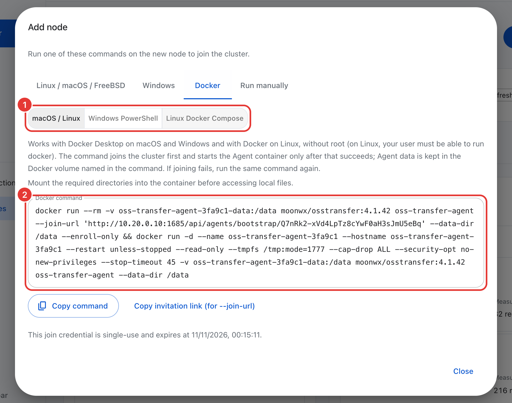
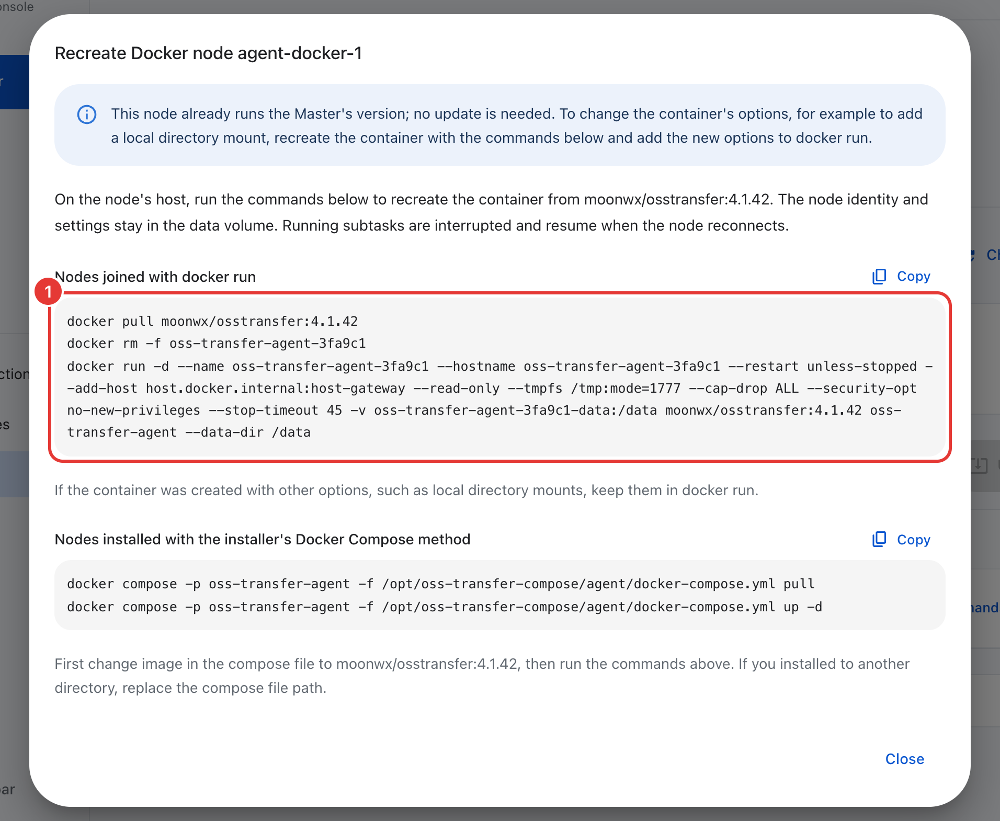

# Docker Compose

[中文](docker-compose.zh-CN.md)

Run the Master with Docker Compose and the Agents (execution nodes) as Docker containers. This works with Docker Engine on Linux and with Docker Desktop on macOS and Windows, and needs no root on Docker Desktop. The image is `moonwx/osstransfer`.

[Native installation](../README.md#1-install-the-master) is simpler when Agents need to reach many or changing host directories: containers can only use the directories mounted into them. Before a large migration, also read [planning](planning.md) and [security](security.md).

## Start the Master

### Linux

On a host with Docker Engine and the Compose plugin:

```sh
mkdir oss-transfer && cd oss-transfer
curl -fSL https://raw.githubusercontent.com/MoonWX/oss-transfer/main/docker-compose.yml -o docker-compose.yml
curl -fSL https://raw.githubusercontent.com/MoonWX/oss-transfer/main/.env.example -o .env
docker compose pull master
docker compose up -d master
docker compose logs master
```

Run the `docker` commands with `sudo` if your user is not allowed to use Docker.

### Docker Desktop on macOS and Windows

Install and start Docker Desktop. No root or administrator rights are needed. On macOS, run the Linux commands above in Terminal. On Windows, run in PowerShell:

```powershell
mkdir oss-transfer; cd oss-transfer
Invoke-WebRequest https://raw.githubusercontent.com/MoonWX/oss-transfer/main/docker-compose.yml -OutFile docker-compose.yml
Invoke-WebRequest https://raw.githubusercontent.com/MoonWX/oss-transfer/main/.env.example -OutFile .env
docker compose pull master
docker compose up -d master
docker compose logs master
```

### Check that it works

The log contains:

```text
Master listening on [::]:1685
Initial administrator: admin
Initial password: <random password>
```

Open port `1685` of this host in a browser (`http://localhost:1685` on the same computer), sign in as `admin` with the initial password and choose your own password (at least 8 characters, not a common or easily guessed password, not the user name). After the change, the log says that the initial password is no longer valid.

If the page does not open, check `docker compose ps` (the `master` service should be running) and `docker compose logs master`. Another program may already use port 1685: set another port in `.env`.

`.env` selects the image and the published port:

```dotenv
OSS_TRANSFER_IMAGE=moonwx/osstransfer:latest
TRANSFER_PORT=1685
```

`latest` follows stable releases. To control when you upgrade, pin a version, for example `OSS_TRANSFER_IMAGE=moonwx/osstransfer:4.1.42`.

## Add an Agent

1. In the console, open **Execution nodes** and choose **Add node**.
2. Enter a node name and the **Master address (reachable from the Agent)**. Inside a container, `localhost` is the container itself, so the dialog warns when the address is a loopback address:
   - For an Agent on the same computer as the Master (typical with Docker Desktop), choose **host.docker.internal (Docker on the Master's host)**. The address becomes `http://host.docker.internal:1685`.
   - For an Agent on another host, enter an address of the Master host that the Agent can reach, such as its private IP. (A natively installed Master also offers its LAN addresses as buttons; a Master in a container cannot see them.)
3. Choose **Generate join commands**, open the **Docker** tab and pick the variant:

   | Variant | Where | What it does |
   | --- | --- | --- |
   | **macOS / Linux** | Docker Desktop on macOS, Docker Engine on Linux | Plain `docker run` commands; no root (on Linux, your user must be allowed to run `docker`) |
   | **Windows PowerShell** | Docker Desktop on Windows | The same commands for PowerShell |
   | **Linux Docker Compose** | Linux with root | The Compose installer (`curl … \| bash`, as root or with `sudo`); see [below](#the-linux-compose-installer) |

4. Choose **Copy command** and run it on the Agent host within 30 minutes. The command works once.

<p align="center"></p>

The `docker run` variant runs two commands. The first joins the cluster in a temporary container and saves the Agent's identity in a Docker volume. Only if that succeeds, the second starts the Agent:

- container `oss-transfer-agent-<id>` and volume `oss-transfer-agent-<id>-data`, where `<id>` is the first 6 characters of the invitation ID, so several Agents on one host do not collide;
- a read-only container running as UID 65532, without capabilities, restarted automatically (`--restart unless-stopped`);
- for `host.docker.internal`, `--add-host host.docker.internal:host-gateway`, so the name also resolves on Linux.

**When it worked,** `docker ps` lists the container `oss-transfer-agent-<id>`, and the node shows **Online** on the **Execution nodes** page.

**When it did not:**

| Message | Cause and action |
| --- | --- |
| Connection refused, or the Master cannot be reached | The Master address is wrong or blocked. Start the Master, fix the address or firewall, and run the same command again: a failed join creates no Agent container. |
| HTTP 403, invitation invalid, expired or already used | Generate new join commands. |
| Permission denied | The data volume or a mounted directory is not writable by UID 65532. |

### The Linux Compose installer

The **Linux Docker Compose** variant runs the installer as root (`curl … | bash`; run by another user, it restarts itself through `sudo`). It writes a Compose project to `/opt/oss-transfer-compose/agent/docker-compose.yml` with its data in `/var/lib/oss-transfer-compose/agent`, and on Debian and Ubuntu offers to install Docker Engine if it is missing. If the installation fails, it removes what it created; fix the cause and run the same command again. It runs on Linux only: on macOS it stops and points you to the Docker command.

## Mount a host directory for local transfers

A container Agent can only read or write the host directories mounted into it. In a task, enter the path as the container sees it. Use the same absolute path on both sides, such as `/mnt/storage:/mnt/storage`, so paths look the same on the host and in the console.

- **`docker run` Agents:** before running the copied command, add `-v /mnt/storage:/mnt/storage` to the second `docker run`, before the image name. For an existing Agent, recreate its container with the extra option: its row in **Execution nodes → Software updates** has **Recreate commands** (or **Update commands** when an update is available), as in [updating container Agents](#container-agents); the identity stays in the volume.
- **Docker Desktop on Windows:** mount a Windows folder on a Linux path, for example `-v C:\transfer:/mnt/transfer`, and use `/mnt/transfer` in tasks.
- **Linux Compose installer:** add `--files-dir`, for example `curl -fsSL '<join link>' | sudo bash -s -- --files-dir /mnt/storage`. The directory must exist.

The Agent runs as UID 65532. On Linux, give that user access, for example `sudo chown -R 65532:65532 /mnt/storage` for a download destination. Downloads check that the destination is writable before the task starts; an unwritable directory fails with `LOCAL_PATH_NOT_WRITABLE` and a hint.

The `agent` profile in `docker-compose.yml` starts an Agent from an already enrolled `agent-data` volume, with `TRANSFER_LOCAL_ROOT` mounted at `/files`. You do not need it when you add Agents from the console.

## Logs

```sh
docker compose logs -f master               # Master, in the Master's directory
docker logs -f oss-transfer-agent-<id>      # an Agent added with docker run
sudo docker compose -p oss-transfer-agent -f /opt/oss-transfer-compose/agent/docker-compose.yml logs -f
```

`docker ps -a --filter name=oss-transfer-agent` lists the Agent containers on a host.

## Use the CLI in the container

The image contains `oss-transfer-cli`. In the Master container it needs no login:

```sh
docker compose exec master oss-transfer-cli task list
docker compose exec master oss-transfer-cli node list
```

To get files out of the container:

- **Task reports:** write the ZIP to standard output. Use `-T` so Docker passes the bytes unchanged:

  ```sh
  docker compose exec -T master oss-transfer-cli task report 12 --output - > task-12-report.zip
  ```

  If the report is incomplete, the ZIP is still written, the reason goes to standard error and the exit status is 3.
- **Other exports** (comparisons, exception records): write them into the data volume, copy them out, then delete them:

  ```sh
  docker compose exec master oss-transfer-cli object export <comparison-id> --output /data/comparison.zip
  docker compose cp master:/data/comparison.zip .
  docker run --rm --volumes-from "$(docker compose ps -q master)" busybox:1.37 rm /data/comparison.zip
  ```

The console's download buttons (**Export task report**, **Export all differences (ZIP)**) download to your browser directly.

## Settings and the administrator password

Containers have no `service.json`. Change node limits and concurrency on the **Execution nodes** page or with the CLI; they are kept in the Agent's volume. The comparison result budget keeps its defaults ([result storage](operations.md#result-storage-and-retention)).

To reset a lost administrator password, stop the Master and run the reset in a one-off container:

```sh
docker compose stop master
docker compose run --rm master oss-transfer-master --data-dir /data/master --reset-admin-password
docker compose start master
```

Sign in with the printed password and choose a new one.

## Back up

Stop active transfer tasks in the console, then stop the containers. The following commands back up the Master's data volume to `backups/master-data.tar.gz`:

```sh
docker compose stop
mkdir -p backups
docker run --rm --volumes-from "$(docker compose ps -aq master)" \
  -v "$PWD/backups:/backup" busybox:1.37 \
  tar -czf /backup/master-data.tar.gz -C /data .
```

For an Agent added with `docker run`, stop it and archive its volume the same way:

```sh
docker stop oss-transfer-agent-<id>
docker run --rm -v oss-transfer-agent-<id>-data:/data \
  -v "$PWD/backups:/backup" busybox:1.37 \
  tar -czf /backup/agent-<id>-data.tar.gz -C /data .
docker start oss-transfer-agent-<id>
```

For an Agent installed with the Linux Compose installer, stop its Compose service and copy `/var/lib/oss-transfer-compose/agent` to your backup location, together with its Compose file under `/opt/oss-transfer-compose/agent`. Use the paths printed by the installer if you changed the defaults.

Keep the Master's `docker-compose.yml` and `.env` with its backup too. Back up transferred files separately. The archive commands overwrite an earlier archive with the same name.

## Update

Update the Master first, then the Agents, preferably when no tasks are running. Back up first.

A new release can raise the database schema, after which older images cannot open the data (see [database space](database-maintenance.md)). Downgrading therefore requires restoring the matching pre-upgrade Master and Agent data backups as well as the old image.

### Master

If `.env` pins a version, change the tag first. Then:

```sh
docker compose pull master
docker compose up -d master
```

Keep the existing volumes. `docker compose down -v` deletes them.

### Container Agents

Container Agents cannot update online. Recreate each container from the new image; the identity and settings stay in its volume. Running child tasks are interrupted and resume when the Agent reconnects.

<p align="center"></p>

1. Open **Execution nodes → Software updates**. A Docker Agent's row has an **Update commands** button. When the Agent already runs the Master's version, the button is labelled **Recreate commands** and shows the same commands, for example to add a directory mount.
2. The dialog shows the commands for that Agent, using the Master's image:
   - **Nodes joined with docker run:** `docker pull <image>`, `docker rm -f <container>` and the `docker run` command that starts it again.
   - **Nodes installed with the installer's Docker Compose method:** change `image` in `/opt/oss-transfer-compose/agent/docker-compose.yml`, then run:

     ```sh
     sudo docker compose -p oss-transfer-agent -f /opt/oss-transfer-compose/agent/docker-compose.yml pull
     sudo docker compose -p oss-transfer-agent -f /opt/oss-transfer-compose/agent/docker-compose.yml up -d
     ```

3. If you created the container with extra options, such as directory mounts, add them to the `docker run` command again. On Linux, an Agent that reaches the Master as `host.docker.internal` also needs `--add-host host.docker.internal:host-gateway` again.
4. The node shows **Online** with the new version.

## Remove an installation

**An Agent added with `docker run`:**

1. Export the task reports and comparison results you want to keep. The per-object results of task reports and the object comparison results are stored on the Agent, in its volume; after the node is removed they are no longer available, task reports become incomplete and its comparisons disappear ([remove a node](operations.md#remove-a-node)).
2. Remove the node on the **Execution nodes** page, or with `oss-transfer-cli agent remove <node> --yes`. The Agent stops working and stays idle.
3. On its host, remove the container and its volume. The volume holds the Agent's identity, its per-object task results and its comparison results.

   ```sh
   docker rm -f oss-transfer-agent-<id>
   docker volume rm oss-transfer-agent-<id>-data
   ```

   Agents added by versions before v4.1.42 use the names `oss-transfer-agent` and `oss-transfer-agent-data`.

**An Agent installed with the Linux Compose installer:** remove the node as above, then run on its host:

```sh
curl -fsSL https://raw.githubusercontent.com/MoonWX/oss-transfer/main/install.sh | sudo bash -s -- --uninstall --method compose --role agent
```

It lists what it will remove and asks for confirmation (`--yes` skips the question). It stops the Compose project and removes its Compose file and, unless you add `--keep-data`, `/var/lib/oss-transfer-compose/agent`. It only touches a Compose project that the installer wrote, and keeps the Docker image.

**The Master:** in its directory, `docker compose down` removes the containers and keeps the `master-data` volume. `docker compose down -v` also deletes the volume, with every task, account and storage connection. Remove the image with `docker image rm moonwx/osstransfer:<tag>` if you no longer need it.
