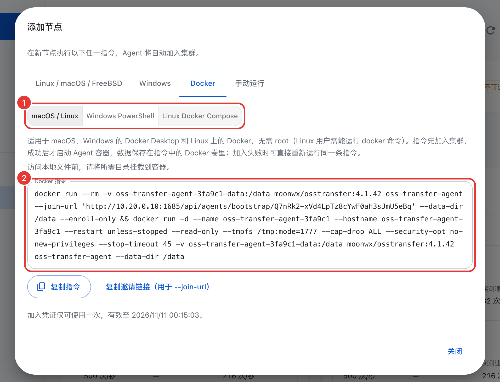
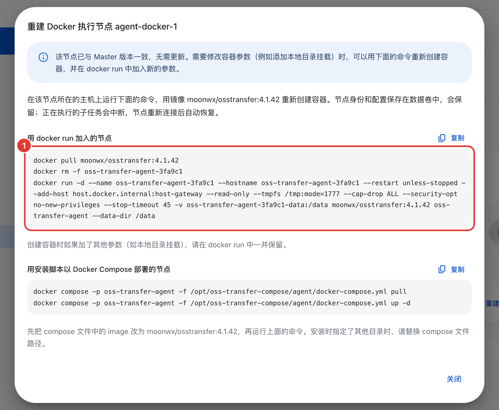

# Docker Compose

[English](docker-compose.md)

这一页介绍如何用 Docker 运行整套 OSS Transfer：Master 运行在 Docker Compose 中，执行节点（Agent）运行在独立的容器中。Linux 上的 Docker Engine、macOS 和 Windows 上的 Docker Desktop 均可使用，Docker Desktop 不需要 root。镜像是 `moonwx/osstransfer`。

如果执行节点要访问的主机目录很多或者经常变化，[原生安装](../README.zh-CN.md#1-安装-master)更为简便，因为容器只能访问你挂载进去的目录。大规模迁移前，先阅读[规划迁移](planning.zh-CN.md)和[安全说明](security.zh-CN.md)。

## 启动 Master

### Linux

在已安装 Docker Engine 和 Compose 插件的主机上，运行以下命令即可：

```sh
mkdir oss-transfer && cd oss-transfer
curl -fSL https://raw.githubusercontent.com/MoonWX/oss-transfer/main/docker-compose.yml -o docker-compose.yml
curl -fSL https://raw.githubusercontent.com/MoonWX/oss-transfer/main/.env.example -o .env
docker compose pull master
docker compose up -d master
docker compose logs master
```

如果当前用户没有 Docker 权限，在 `docker` 命令前加 `sudo`。

### macOS 和 Windows 上的 Docker Desktop

先安装 Docker Desktop 并启动它，不需要 root 或管理员权限。macOS 上直接打开终端，运行上面的 Linux 命令即可。Windows 上在 PowerShell 中运行：

```powershell
mkdir oss-transfer; cd oss-transfer
Invoke-WebRequest https://raw.githubusercontent.com/MoonWX/oss-transfer/main/docker-compose.yml -OutFile docker-compose.yml
Invoke-WebRequest https://raw.githubusercontent.com/MoonWX/oss-transfer/main/.env.example -OutFile .env
docker compose pull master
docker compose up -d master
docker compose logs master
```

### 确认启动成功

日志中会出现以下内容：

```text
Master listening on [::]:1685
Initial administrator: admin
Initial password: <随机密码>
```

在浏览器打开这台主机的 `1685` 端口。如果在本机操作，地址是 `http://localhost:1685`。用 `admin` 和日志中的初始密码登录，然后设置自己的密码。密码要求至少 8 个字符，不能是常见或容易猜到的密码，也不能和用户名相同。修改密码后，日志中会记录初始密码已失效。

如果页面无法打开，先运行 `docker compose ps` 确认 `master` 服务是否在运行，再查看 `docker compose logs master` 是否有报错。另一种可能是 1685 端口被其他程序占用，在 `.env` 中换一个端口即可。

`.env` 用于设置镜像和对外端口：

```dotenv
OSS_TRANSFER_IMAGE=moonwx/osstransfer:latest
TRANSFER_PORT=1685
```

`latest` 始终跟随正式版。如果需要自行控制升级时间，可以固定版本号，例如 `OSS_TRANSFER_IMAGE=moonwx/osstransfer:<版本号>`。

## 添加执行节点

1. 在管理页面打开 **执行节点**，点击 **添加节点**。
2. 填写节点名称和 **Master 地址（Agent 需能访问）**。容器中的 `localhost` 指的是容器自身，不是宿主机，所以地址填写了回环地址时窗口会给出警告。执行节点和 Master 在同一台电脑上（这在 Docker Desktop 下很常见），点击 **host.docker.internal（Docker 与 Master 在同一台主机）**，地址会变为 `http://host.docker.internal:1685`。执行节点在其他主机上，填写那台主机能访问到的 Master 地址，例如内网 IP。原生安装的 Master 还会把自己的局域网地址列为按钮，容器中的 Master 无法获取这些地址。
3. 点击 **生成加入指令**，打开 **Docker** 标签页，选择对应的方式：

   | 方式 | 适用环境 | 说明 |
   | --- | --- | --- |
   | **macOS / Linux** | macOS 上的 Docker Desktop、Linux 上的 Docker Engine | 普通的 `docker run` 命令，不需要 root（Linux 上当前用户需能运行 `docker`） |
   | **Windows PowerShell** | Windows 上的 Docker Desktop | 同样的命令，PowerShell 写法 |
   | **Linux Docker Compose** | 有 root 权限的 Linux | Compose 安装器（`curl … \| bash`，以 root 或通过 `sudo` 运行），见[下文](#linux-compose-安装器) |

4. 点击 **复制指令**，在 30 分钟内到执行节点主机上运行。指令只能使用一次。

<p align="center"></p>

`docker run` 方式包含两条命令。第一条在一个临时容器中加入集群，把执行节点的身份写入 Docker 数据卷。只有第一条运行成功，第二条才会启动执行节点容器。

容器名为 `oss-transfer-agent-<id>`，数据卷为 `oss-transfer-agent-<id>-data`。`<id>` 取自邀请 ID 的前 6 个字符，同一台主机上部署多个执行节点也不会冲突。容器以只读模式运行，UID 65532，没有任何 capability，退出后自动重启（`--restart unless-stopped`）。地址为 `host.docker.internal` 时，命令中还会加上 `--add-host host.docker.internal:host-gateway`，使该名称在 Linux 上也能正常解析。

运行完成后，`docker ps` 中可以看到 `oss-transfer-agent-<id>`，**执行节点** 页面中该节点显示为 **在线**。

如果未成功，对照下表排查：

| 提示 | 原因和处理 |
| --- | --- |
| 连接被拒绝，或无法访问 Master | Master 地址不对或被防火墙拦截。启动 Master、修正地址或防火墙后，重新运行同一条命令。加入失败时不会创建执行节点容器。 |
| HTTP 403，邀请无效、已过期或已被使用 | 重新生成加入指令。 |
| Permission denied | 数据卷或挂载的目录不允许 UID 65532 写入。 |

### Linux Compose 安装器

**Linux Docker Compose** 方式需要以 root 运行安装器（`curl … | bash`）。当前用户不是 root 时，安装器会自动通过 `sudo` 重新执行。安装器把 Compose 项目写到 `/opt/oss-transfer-compose/agent/docker-compose.yml`，数据放在 `/var/lib/oss-transfer-compose/agent`。在 Debian 和 Ubuntu 上，如果主机尚未安装 Docker Engine，安装器会询问是否安装。

安装失败时，安装器会自动清理本次创建的内容，解决问题后重新运行同一条命令即可。该安装器只能在 Linux 上运行。在 macOS 上它会停止，并提示改用 Docker 指令。

## 为本地迁移挂载主机目录

容器中的执行节点只能读写挂载到容器内的主机目录。创建任务时，填写的是容器内看到的路径。建议两侧使用相同的绝对路径，例如 `/mnt/storage:/mnt/storage`，这样主机上和管理页面中看到的路径一致，不易混淆。

用 `docker run` 方式加入的节点，运行复制的指令之前，在第二条 `docker run` 的镜像名前添加 `-v /mnt/storage:/mnt/storage`。节点已经在运行的情况下，需要添加该参数并重建容器：在 **执行节点 → 版本更新** 中，点击它所在行的 **重建命令**（有可用更新时按钮为 **更新命令**），方法与[更新容器中的执行节点](#容器中的执行节点)相同。身份保存在数据卷中，不受重建影响。

Windows 上的 Docker Desktop 需要把 Windows 文件夹挂载到 Linux 路径，例如 `-v C:\transfer:/mnt/transfer`，然后在任务中填写 `/mnt/transfer`。

Linux Compose 安装器加上 `--files-dir`，例如 `curl -fsSL '<加入链接>' | sudo bash -s -- --files-dir /mnt/storage`。目录必须提前创建。

执行节点在容器中以 UID 65532 运行。Linux 上需要为该用户授权，例如对下载任务的目标目录执行 `sudo chown -R 65532:65532 /mnt/storage`。下载任务开始前会检查目标目录是否可写。不可写时任务以 `LOCAL_PATH_NOT_WRITABLE` 失败，并给出处理提示。

`docker-compose.yml` 中有一个 `agent` profile，用于从已经加入集群的 `agent-data` 数据卷启动执行节点，并把 `TRANSFER_LOCAL_ROOT` 挂载到 `/files`。从管理页面添加执行节点时不需要它。

## 查看日志

```sh
docker compose logs -f master               # Master，在 Master 所在目录中运行
docker logs -f oss-transfer-agent-<id>      # 用 docker run 添加的执行节点
sudo docker compose -p oss-transfer-agent -f /opt/oss-transfer-compose/agent/docker-compose.yml logs -f
```

查看主机上有哪些执行节点容器，可以运行 `docker ps -a --filter name=oss-transfer-agent`。

## 在容器中使用 CLI

镜像中自带 `oss-transfer-cli`。在 Master 容器中使用时不需要登录：

```sh
docker compose exec master oss-transfer-cli task list
docker compose exec master oss-transfer-cli node list
```

从容器中取出文件有两种方法。

任务报告可以直接写入标准输出。加上 `-T` 让 Docker 原样传递字节，不分配终端：

```sh
docker compose exec -T master oss-transfer-cli task report 12 --output - > task-12-report.zip
```

报告不完整时，ZIP 本身仍然完整，原因输出到标准错误，退出状态为 3。

对象比对和异常记录这类导出文件，先写入数据卷，再复制到主机，使用后删除：

```sh
docker compose exec master oss-transfer-cli object export <比对ID> --output /data/comparison.zip
docker compose cp master:/data/comparison.zip .
docker run --rm --volumes-from "$(docker compose ps -q master)" busybox:1.37 rm /data/comparison.zip
```

如果不想使用命令行，管理页面上的 **导出任务报告** 和 **导出全部差异（ZIP）** 按钮可以直接下载到浏览器。

## 设置与管理员密码

容器中没有 `service.json`。节点限速和并发在 **执行节点** 页面或用 CLI 修改，它们保存在执行节点的数据卷中。对象比对结果预算使用默认值（见[结果的保存和清理](operations.zh-CN.md#结果的保存和清理)）。

忘记管理员密码时，先停止 Master，再用一个临时容器重置：

```sh
docker compose stop master
docker compose run --rm master oss-transfer-master --data-dir /data/master --reset-admin-password
docker compose start master
```

用输出的密码登录，然后设置新密码。

## 备份

先在管理页面停止正在运行的迁移任务，再停止容器。下面的命令把 Master 的数据卷备份到 `backups/master-data.tar.gz`：

```sh
docker compose stop
mkdir -p backups
docker run --rm --volumes-from "$(docker compose ps -aq master)" \
  -v "$PWD/backups:/backup" busybox:1.37 \
  tar -czf /backup/master-data.tar.gz -C /data .
```

用 `docker run` 添加的执行节点，先停止容器，再用同样的方法打包数据卷：

```sh
docker stop oss-transfer-agent-<id>
docker run --rm -v oss-transfer-agent-<id>-data:/data \
  -v "$PWD/backups:/backup" busybox:1.37 \
  tar -czf /backup/agent-<id>-data.tar.gz -C /data .
docker start oss-transfer-agent-<id>
```

用 Linux Compose 安装器安装的执行节点，先停止它的 Compose 服务，把 `/var/lib/oss-transfer-compose/agent` 复制到备份位置，并保存 `/opt/oss-transfer-compose/agent` 下的 Compose 文件。如果安装时修改过默认路径，以安装器输出的路径为准。

Master 的 `docker-compose.yml` 和 `.env` 也要一起备份。已传输的文件需要另外备份。归档命令会覆盖之前同名的归档文件。

## 更新

先更新 Master，再更新执行节点，尽量选择没有任务运行时进行。更新前先备份。

新版本可能会升级数据库 schema，升级之后旧镜像无法再打开这些数据（见[数据库空间](database-maintenance.zh-CN.md)）。因此如果需要降级，仅换回旧镜像不够，还需要恢复升级前的 Master 和执行节点数据备份。

### Master

如果 `.env` 中固定了版本，先修改镜像标签，然后：

```sh
docker compose pull master
docker compose up -d master
```

升级时现有的数据卷保留。不要使用 `docker compose down -v`，它会删除数据卷。

### 容器中的执行节点

容器中的执行节点不能在线更新，需要用新镜像重建容器。身份和设置保存在数据卷中，重建不会丢失。正在执行的子任务会中断，执行节点重新连接后自动恢复。

<p align="center"></p>

1. 打开 **执行节点 → 版本更新**。Docker 执行节点所在的行有一个 **更新命令** 按钮。如果执行节点已经和 Master 版本一致，按钮显示为 **重建命令**，给出的命令相同，例如可以用来添加目录挂载。
2. 窗口中显示该执行节点的命令，镜像与 Master 对应。用 `docker run` 加入的节点，命令是 `docker pull <镜像>`、`docker rm -f <容器>`，再加一条重新启动的 `docker run`。用安装脚本以 Docker Compose 部署的节点，先把 `/opt/oss-transfer-compose/agent/docker-compose.yml` 中的 `image` 修改为新镜像，再运行：

   ```sh
   sudo docker compose -p oss-transfer-agent -f /opt/oss-transfer-compose/agent/docker-compose.yml pull
   sudo docker compose -p oss-transfer-agent -f /opt/oss-transfer-compose/agent/docker-compose.yml up -d
   ```

3. 创建容器时如果添加了其他参数（例如目录挂载），需要在 `docker run` 中一并加上。在 Linux 上，通过 `host.docker.internal` 访问 Master 的执行节点还需要加上 `--add-host host.docker.internal:host-gateway`。
4. 更新完成后，该节点显示为 **在线**，版本号也会刷新。

## 删除安装

删除之前，先把需要保留的数据导出。任务报告中逐个对象的结果和对象比对结果保存在执行节点的数据卷中，节点一旦移除就无法再获取。移除之后任务报告会不完整，比对记录也会消失（见[移除执行节点](operations.zh-CN.md#移除执行节点)）。

用 `docker run` 添加的执行节点，先在 **执行节点** 页面移除它（或运行 `oss-transfer-cli agent remove <节点> --yes`），执行节点随即停止工作并保持空闲。然后在它的主机上删除容器和数据卷。数据卷中保存着执行节点的身份、逐个对象的任务结果和对象比对结果：

```sh
docker rm -f oss-transfer-agent-<id>
docker volume rm oss-transfer-agent-<id>-data
```

v4.1.42 之前添加的执行节点，名称是 `oss-transfer-agent` 和 `oss-transfer-agent-data`，没有 ID 后缀。

用 Linux Compose 安装器安装的执行节点，按上面的方法移除节点，然后在它的主机上运行：

```sh
curl -fsSL https://raw.githubusercontent.com/MoonWX/oss-transfer/main/install.sh | sudo bash -s -- --uninstall --method compose --role agent
```

运行后先列出要删除的内容，等待确认（加 `--yes` 跳过确认）。确认后停止 Compose 项目、删除 Compose 文件，如果未加 `--keep-data` 还会删除 `/var/lib/oss-transfer-compose/agent`。该命令只处理安装脚本生成的 Compose 项目，Docker 镜像保留。

Master 在它所在的目录中删除。`docker compose down` 删除容器，保留 `master-data` 数据卷。`docker compose down -v` 会同时删除数据卷，其中所有任务、账号和存储连接将全部丢失。不再需要镜像时，用 `docker image rm moonwx/osstransfer:<标签>` 删除。
