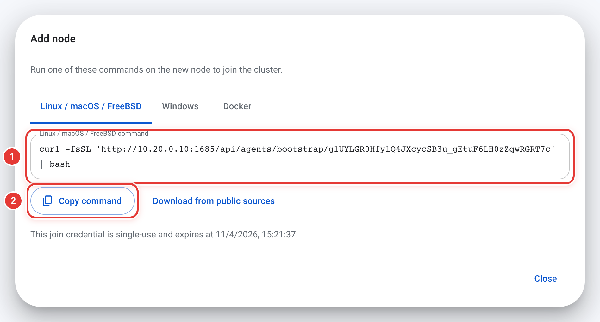

# Install, upgrade and uninstall

[中文](install.zh-CN.md)

This page covers the entire process of installing OSS Transfer on a server, from the first installation command to confirming that the service is running. Upgrading, uninstalling and installing the CLI on a workstation are also here. For the shortest path on Linux, see the [quick start](../README.md#quick-start). When the host cannot reach the public internet, see [offline installation](offline-install.md); for container deployments, see [Docker Compose](docker-compose.md).

If you need to set up a cluster for a large-scale migration, read [planning](planning.md) (topology, ports, storage permissions, sizing) and [security](security.md) (TLS, credentials, passwords) before you install.

## Before you start

Linux requires systemd 219 or later, plus Bash, curl, tar and a SHA-256 tool. Run the installer as root or through `sudo`. For macOS, Windows and FreeBSD, see [other systems](#other-systems).

The Master listens on TCP `1685` by default. Browsers, the CLI and every Agent (execution node) must be able to reach this port. Agents do not need any inbound port open. See [planning](planning.md) for the full port list.

Native services installed by the installer run as root on Linux and FreeBSD (the systemd unit and rc.d script do not specify another user), as root for a macOS system service, and as LocalSystem on Windows. A macOS `--user` installation runs as the current signed-in user. Online updates also require these privileges. Agents started with the console's Docker command run as UID 65532 inside the container.

## Install on Linux

Run the following command on the host that will serve as the Master:

```sh
curl -fsSL https://raw.githubusercontent.com/MoonWX/oss-transfer/main/install.sh | sudo bash
```

From mainland China, replace the URL with the mirror `https://moonwx.s3.cn-north-1.jdcloud-oss.com/oss-transfer/latest/install.sh`.

The installer asks for the language, the role (Master or Agent) and the deployment method (native or Docker Compose). When installing a native Master, it also asks whether to install an Agent on the same host. If one is installed, it joins the Master automatically and requires no separate configuration.

To pass options through a pipe, place them after `bash -s --`. For example, to install a Master and a local Agent unattended:

```sh
curl -fsSL https://raw.githubusercontent.com/MoonWX/oss-transfer/main/install.sh | sudo bash -s -- --role master --with-agent --yes
```

Run `bash install.sh --help` on a saved copy of the script to see every option.

### Check the installation

After a successful installation, the installer prints the following output (paths and addresses vary on your host; labels are in Chinese when the installation language is Chinese):

```text
Service: oss-transfer-master
Configuration: /opt/oss-transfer/master/config/service.json
Log: /opt/oss-transfer/master/data/logs/service.log
Installation: /opt/oss-transfer/master/bin
CLI: /usr/local/bin/oss-transfer-cli
Tasks: /usr/local/bin/oss-transfer-cli task list

=== master <version> · Installed successfully ===
Web UI: http://10.0.0.5:1685

Initial administrator: admin
Initial password: <printed once>
```

Confirm three things:

1. Run `sudo systemctl status oss-transfer-master` and verify that the status is `active (running)`. The Agent service name is `oss-transfer-agent`.
2. Open the **Web UI** address in a browser and sign in with `admin` and the initial password. You must change the password on first login: at least 8 characters, not a common or easily guessed password, and different from the user name and the initial password.
3. If a local Agent was installed, run `sudo oss-transfer-cli node list` on the Master host. You should see it listed as online.

> The initial password is printed only once. If you lose it, follow [reset the administrator password](operations.md#reset-the-administrator-password).

When the installer reports an error, consult this table:

| Message | What to do |
| --- | --- |
| `Cannot listen on …: port 1685 is already in use by …` | Stop the program that occupies the port, or use `--port` to choose a different port (Master only; see [paths and ports](#paths-and-ports)). The installer made no changes. |
| `Startup timed out after …s` | Check the log and `systemctl status` named in the message, fix the issue, then run the same command again. |
| `Startup failed: this Agent was removed from the cluster on the Master` | This Agent's enrollment was revoked. Go to **Execution nodes > Add node** and copy a new join command, or [uninstall](#uninstall) the Agent. |
| `… is already v… and running; nothing was changed. Add --force to reinstall it.` | The same version is already installed and running normally. Add `--force` only if you truly need to reinstall. |
| `… data was last used by …; … is older and may not read it` | The version to be installed is older than the one that last used the data. Install the version shown in the message with `--version`; add `--force` only if you truly need the older version. The installer made no changes. |

### Add Agents

Open **Execution nodes > Add node** in the console, enter a node name and a Master address that the new node can reach, and choose **Generate join commands**. Copy the command for the target system and run it on that host. The native command for Linux, macOS and FreeBSD looks like `curl -fsSL '<link>' | bash`: run it as root, or as a user who can `sudo` (the installer restarts itself through `sudo` and asks for the password). Within a few seconds the node appears as online on the **Execution nodes** page.

From the CLI, `oss-transfer-cli agent invite` prints the same commands; see [CLI](cli.md#add-and-remove-agents). For the Docker method, see [Docker Compose](docker-compose.md).

<p align="center"></p>

## Other systems

### Older systemd

The installer and online updates support systemd 219, Bash 4.2 and curl 7.29 or later; the installation command is the same as on other Linux systems. Older systemd versions differ in two ways during online updates:

- Before systemd 236, a failed online update leaves its helper unit `oss-transfer-update-*` in a failed state. Run `systemctl reset-failed` to clear it.
- Before systemd 240, if the update helper process cannot start, the failure is not reported immediately; it appears only after the timeout.

### macOS

Install a service for the current user:

```sh
curl -fsSL https://raw.githubusercontent.com/MoonWX/oss-transfer/main/install.sh -o install.sh
bash install.sh --role master --user
```

To install as a system service, change the second line to `sudo bash install.sh --role master`. The installer prints the service name and paths. The installer's Docker Compose method supports Linux only; with Docker Desktop, use the console's Docker command to add Agents instead.

### Windows

Run in Administrator PowerShell:

```powershell
Invoke-WebRequest https://raw.githubusercontent.com/MoonWX/oss-transfer/main/deploy/native/Install.ps1 -OutFile Install.ps1
powershell.exe -NoProfile -ExecutionPolicy Bypass -File .\Install.ps1 -Role master
```

From mainland China, the script is also available at `https://moonwx.s3.cn-north-1.jdcloud-oss.com/oss-transfer/latest/Install.ps1`. After installation the output shows `Installation successful: master <version>`, the web console address, the service name (`OSSTransferMaster` or `OSSTransferAgent`), the paths and the log file. Run `Get-Help .\Install.ps1` for the options.

### FreeBSD

Run as root:

```sh
pkg install -y bash curl
curl -fsSL https://raw.githubusercontent.com/MoonWX/oss-transfer/main/install.sh -o install.sh
bash install.sh --role master
```

On every system, sign in with the `admin` password printed by the installer. The native Master installer asks whether to install a local Agent as well.

## Download sources

The installer downloads from GitHub by default. When the host's public IP is in mainland China, it switches automatically to the JD Cloud OSS mirror. If the preferred source is unreachable, it tries the other one. To determine the location, it queries `https://www.cloudflare.com/cdn-cgi/trace` and then `https://ipinfo.io/country`.

To skip the automatic detection, pass `--source github` or `--source jdoss` (`-Source` for `Install.ps1`) to specify the source directly.

The mirror address `https://moonwx.s3.cn-north-1.jdcloud-oss.com/oss-transfer/latest/` always contains every file of the latest stable release, including `install.sh` and `Install.ps1`. Each version (prereleases included) has its own directory named `v<version>/`.

When the installer is saved as a file and run directly (rather than piped into the shell), it first looks for `manifest.tsv` or the platform archive for the current host in its own directory and the current directory. If found, it installs from those local files without downloading anything; if `--version` is specified, it must match the version of those files. Adding `--source github` or `--source jdoss` (`-Source` for `Install.ps1`) forces a download instead. See [offline installation](offline-install.md) for details.

Agents added from the console download the installer and packages from the Master by default and do not need internet access. The **Add node** dialog provides a **Download source** option above the native deployment commands, which can be changed to download from the public internet. When the Master uses the official release packages, the option **JD Cloud internal (Beijing)** is also available, and the resulting join command accesses only the internal endpoint.

### JD Cloud internal network

Hosts in the JD Cloud cn-north-1 (Beijing) region should use `--source jdoss-internal` (`-Source jdoss-internal` for `Install.ps1`). The installer then downloads the same files through the internal endpoint `https://moonwx.s3-internal.cn-north-1.jdcloud-oss.com/oss-transfer/`, which uses no public bandwidth and works even when the host cannot reach the public internet. Automatic source selection never uses this address, so it must be specified explicitly. `install.sh` supports this option from v4.1.44; `Install.ps1` supports it from v4.1.45.

The installer itself can also be fetched from the internal endpoint. When running through a pipe, place the options after `bash -s --`:

```bash
curl -fsSL https://moonwx.s3-internal.cn-north-1.jdcloud-oss.com/oss-transfer/latest/install.sh | sudo bash -s -- --source jdoss-internal
```

To upgrade, append `--upgrade --yes`.

## Install a specific or prerelease version

The installer installs the latest stable release by default. To install a fixed version, use `--version` (`-Version` for `Install.ps1`). A leading `v` is optional:

```sh
curl -fsSL https://raw.githubusercontent.com/MoonWX/oss-transfer/main/install.sh | sudo bash -s -- --version <version>
```

```sh
bash install.sh --role master --version <version>
```

```powershell
powershell.exe -NoProfile -ExecutionPolicy Bypass -File .\Install.ps1 -Role master -Version <version>
```

The installer downloads the corresponding version from the GitHub release tagged `v<version>` or the mirror directory `oss-transfer/v<version>/`. Release notes and all files for each version are on [GitHub Releases](https://github.com/MoonWX/oss-transfer/releases).

Prereleases are installed the same way. Their version numbers take the form `X.Y.Z-beta.N`:

```sh
bash install.sh --role master --version <prerelease-version>
```

The installer verifies a prerelease exactly as it does a stable release: using the GitHub release digest for that tag or the versioned OSS manifest, never `latest`. Running the installer again with `--upgrade` and `--version` upgrades an existing installation to the specified version, including from a prerelease to the corresponding stable release. Agents added from the console download the same version as the Master.

For Docker Compose deployments, set the exact image tag in `.env`. The `latest` and `X.Y` tags follow stable releases only:

```dotenv
OSS_TRANSFER_IMAGE=moonwx/osstransfer:<version>
```

Prereleases are experimental. See [trying a prerelease](operations.md#try-a-prerelease) for online updates and returning to stable.

## Paths and ports

New native installations keep their files under a single root directory. Linux defaults to `/opt/oss-transfer`, macOS to `/Library/Application Support/OSS Transfer` (under the user's Library with `--user`), FreeBSD to `/usr/local/lib/oss-transfer`, and Windows to `%ProgramData%\OSS Transfer`. Use `--root-dir` or `-RootDir` to install to a different disk. OS service registration remains outside this directory; Unix systems also keep a global CLI entry point.

Default Linux locations:

| | Master | Agent |
| --- | --- | --- |
| Service | `oss-transfer-master` | `oss-transfer-agent` |
| Programs | `/opt/oss-transfer/master/bin` | `/opt/oss-transfer/agent/bin` |
| Configuration | `/opt/oss-transfer/master/config/service.json` | `/opt/oss-transfer/agent/config/service.json` |
| Data | `/opt/oss-transfer/master/data` | `/opt/oss-transfer/agent/data` |
| Service log | `/opt/oss-transfer/master/data/logs/service.log` | `/opt/oss-transfer/agent/data/logs/service.log` |
| Upgrade backups | `/opt/oss-transfer/master/backups` | `/opt/oss-transfer/agent/backups` |
| CLI | `/usr/local/bin/oss-transfer-cli` | `/usr/local/bin/oss-transfer-cli` |

On Windows the service names are `OSSTransferMaster` and `OSSTransferAgent`, and each role uses `bin`, `config`, `data` and `backups` under `%ProgramData%\OSS Transfer\<role>`; the CLI is `bin\oss-transfer-cli.exe`.

The default Master port is `1685`. In `install.sh`, use `--port 1785` to change it; in `Install.ps1`, use `-Listen '0.0.0.0:1785'`. Use `--install-dir`, `--config-dir` or `--data-dir` to specify individual locations, but these directories must not contain one another. Upgrades reuse the existing paths.

## Logs

Each service writes its log to `logs/service.log` in its own data directory (see the table above; the installer prints the path as `Log:`). Startup errors, task problems, comparison failures and the explanation when an Agent is removed all appear here. Agent logs are more detailed: the start and end of each child task attempt with its counts, the first failed objects in each attempt, storage retries during outages, and changes to the connection with the Master. See [monitoring and logs](operations.md#monitoring-and-logs) for details.

The two most common commands for viewing logs:

```sh
sudo tail -n 100 /opt/oss-transfer/master/data/logs/service.log
sudo tail -f /opt/oss-transfer/agent/data/logs/service.log
```

systemd records only the start, stop, failure and exit status of the service:

```sh
sudo systemctl status oss-transfer-agent
sudo journalctl -u oss-transfer-agent --since today
```

The log file grows indefinitely; the service does not rotate it. Because the service writes by appending, `logrotate` with `copytruncate` works without restarting the service. Online update logs also go to the same file. For what to watch in the logs, see [monitoring and logs](operations.md#monitoring-and-logs).

## Upgrade

In most cases an online upgrade from the console is sufficient: update the Master under **Tools > Software updates**, then update the Agents under **Execution nodes > Software updates** (see [software updates](operations.md#software-updates)). Use the installer instead when: the first upgrade of an installation that cannot update online, the host has no internet access (see [offline installation](offline-install.md#upgrade-and-reinstall)), or a version other than the latest is needed.

To upgrade with the installer, run it on each host, starting with the Master:

```sh
curl -fsSL https://raw.githubusercontent.com/MoonWX/oss-transfer/main/install.sh | sudo bash -s -- --upgrade --yes
```

`--upgrade` finds the native services installed on the host, backs up each one, installs the new version and confirms that it starts. Add `--role master` or `--role agent` to upgrade only one of them, or `--version` to specify a version. Running the one-line installation command without options on a host that already has an installation also prompts whether to upgrade. On Windows, add `-Upgrade` to the installation command.

On success, each service displays `=== master <version> · Installed successfully ===` (or `agent`). If the new version fails to start, the installer restores the previous version and keeps the backup (see [recover from a failed upgrade](operations.md#recover-from-a-failed-upgrade)).

Running the same version again on a complete, running installation makes no changes. In interactive mode the installer asks whether to reinstall; with `--yes` it prints `… is already v… and running; nothing was changed. Add --force to reinstall it.` and exits with status 0. When no installation changed, the output ends with `=== Nothing changed ===`. Add `--force` to reinstall. Missing or damaged parts (programs, service definitions, CLI, Agent packages) are repaired without `--force`. `Install.ps1` has no `-Force` and always reinstalls.

The installer does not silently install a version older than the one that last used the installation's data. For example, data last used by a prerelease may be newer than the default latest stable release. In interactive mode the installer warns and asks (the default is no); with `--yes` it stops without making any changes. Use `--version` to specify a newer version; add `--force` only if you truly need the older version.

Before an interactive installation begins, the installer lists what it will install and asks `Install? y / n`: the role (and whether a local Agent is included), the version, the program and data directories, the service name, and for a new Master the listen address. The version line notes any prerelease status and the version being replaced.

Before upgrading an existing cluster, read [what changes with v4.1.42](operations.md#upgrading-to-v4142).

## Reinstall without losing data

Run the installer again. If you changed `--root-dir`, use the same value. The installer recognizes the retained service configuration and data, restores missing programs or service definitions, and reuses the Agent identity. Installations in the older directory layout continue to use their original paths.

If a previous uninstall used `--uninstall --keep-data`, run the command printed at the end of the uninstall. It includes the version that was last used (`--version`), the role and any non-default paths, for example `bash install.sh --role agent --version <version>`.

What must be preserved: each role's `config` directory and the entire `data` directory, including the key file (`master.db.key` or `agent.db.key`). The key and the database are paired; neither works without the other. If the configuration or key is missing, the installer stops without creating an empty replacement. Source files, destination files and shared mounts are independent of these application directories. To migrate an installation to another host, see [backup and restore](operations.md#backup-and-restore).

For an unattended native Master installation, use `--with-agent` or `--without-agent`; on Windows use `-WithAgent` or `-WithoutAgent`. An existing local Agent is reused only if it belongs to that Master.

## Uninstall

Before uninstalling an Agent, remove it on the Master so that it no longer appears among the available nodes for tasks. Use the **Execution nodes** page, or run `oss-transfer-cli agent remove NODE --yes` (see [remove a node](operations.md#remove-a-node)). Uninstalling a Master does not uninstall its Agents; they must be uninstalled separately on their own hosts.

### Linux, macOS and FreeBSD

Run the installer with `--uninstall`. The uninstall downloads nothing, because `install.sh` contains a built-in copy of the native installer.

```sh
curl -fsSL https://raw.githubusercontent.com/MoonWX/oss-transfer/main/install.sh | sudo bash -s -- --uninstall --role agent
```

With a saved copy, run `sudo bash install.sh --uninstall --role agent`.

| Option | Effect |
| --- | --- |
| `--role master` or `--role agent` | Uninstall only that role. Without it, every installation on the host is uninstalled. |
| `--keep-data` | Keep the configuration, the data directory and the upgrade backups, so that the installation can be restored later with the same identity, tasks and settings. The installed version is recorded in `installed-version` beside the retained `service.json`, and the output ends with the command to reinstall. If you plan to reinstall an Agent, do not remove it on the Master. |
| `--yes` | Do not ask for confirmation. Required when there is no terminal. |
| `--service-name`, `--root-dir`, `--install-dir`, `--user` | Select an installation with a custom name or location, or a macOS user service. |

`--uninstall` cannot be combined with installation options, and `--keep-data` must be used with `--uninstall`.

The installer first lists everything under `Installations to uninstall:`, `Will remove:` and `Will keep:`, then asks `Uninstall? [y/N]`. It stops all services before deleting any files, and finishes with `=== Uninstalled ===` and the next steps.

What is removed:

- Service definitions (systemd unit, launchd plist or rc.d script) and programs.
- The installation record (`install.tsv`) and the CLI recorded by that installation (for example `/usr/local/bin/oss-transfer-cli`) with its state files.
- Without `--keep-data`: `service.json` (and `installed-version`), the data directory, the service's upgrade backups, and when no other backups remain, the backup directory with its `.retention.lock`.
- When no installation remains on the host (and without `--keep-data`): the CLI logins and preferences of root and the user who ran `sudo` (`~/.config/oss-transfer-cli`, or `~/Library/Application Support/oss-transfer-cli` on macOS).

The following are kept, and the installer explains why: a CLI that is still used by another installation, other installations' backups, a data directory that contains unrecognized files or is a shared or shallow directory, and directories that still contain other files (shown as `Kept (contains other files)`). If a service definition runs a different program, or a service cannot be stopped, the installer refuses to uninstall and makes no changes. When there is nothing installed, it reports that there is nothing to uninstall and exits with status 0. Migrated files in source and destination directories are never touched.

### Docker Compose installations made by the installer

```sh
sudo bash install.sh --uninstall --method compose --role agent
```

This command runs `docker compose down` on the project created by the installer, removes the Compose files under `/opt/oss-transfer-compose/<role>`, and without `--keep-data` also removes the data under `/var/lib/oss-transfer-compose/<role>`. It acts only on Compose files written by the installer; Docker images are not removed (use `docker image rm` to remove them). When such an installation exists, a plain `--uninstall` also mentions it.

### Agents started with the console's Docker command

An Agent started with `docker run` from **Add node > Docker** has no installer. After removing the node on the Master, delete its container and data volume. The names are in the original join command, for example:

```sh
docker rm -f oss-transfer-agent-1a2b3c
docker volume rm oss-transfer-agent-1a2b3c-data
```

Agents added this way before v4.1.42 use `oss-transfer-agent` and `oss-transfer-agent-data`. For your own Compose projects, see [Docker Compose](docker-compose.md).

### Windows

`Install.ps1` does not provide an uninstall option yet. In Administrator PowerShell, for an Agent with the default service name and paths (for a Master, replace `OSSTransferAgent` with `OSSTransferMaster` and `agent` with `master`):

```powershell
Stop-Service OSSTransferAgent
sc.exe delete OSSTransferAgent
Remove-Item -Recurse -Force "$env:ProgramData\OSS Transfer\agent\bin"
```

To delete the data as well, also remove `config`, `data` and `backups`:

```powershell
Remove-Item -Recurse -Force "$env:ProgramData\OSS Transfer\agent\config", "$env:ProgramData\OSS Transfer\agent\data", "$env:ProgramData\OSS Transfer\agent\backups"
```

Each user's CLI logins and preferences are in `%APPDATA%\oss-transfer-cli`; remove that folder when the CLI is no longer needed.

## Install the CLI on another computer

Every release archive contains the CLI. To manage a cluster remotely from a workstation, download the archive for the target platform, verify the checksum and extract `oss-transfer-cli`. For Linux amd64, to download the latest stable release:

```sh
p=linux-amd64
curl -fLO "https://github.com/MoonWX/oss-transfer/releases/latest/download/oss-transfer-$p.tar.gz"
curl -fLO "https://github.com/MoonWX/oss-transfer/releases/latest/download/SHA256SUMS"
grep " oss-transfer-$p.tar.gz\$" SHA256SUMS
sha256sum "oss-transfer-$p.tar.gz"
```

The two checksums must be identical (on macOS, use `shasum -a 256`). From mainland China, replace the GitHub address with `https://moonwx.s3.cn-north-1.jdcloud-oss.com/oss-transfer/latest`. Archive names are listed in [offline installation](offline-install.md#1-prepare-the-files); Apple Silicon uses `darwin-arm64`. On Windows, extract `oss-transfer-cli.exe` from `oss-transfer-windows-amd64.zip`.

The CLI version should match the Master. When the Master is not on the latest stable release, replace `latest/download` in the GitHub URL with `download/v<version>`, or replace `latest` with `v<version>` in the mirror URL.

After verification, extract and install:

```sh
tar -xzf "oss-transfer-$p.tar.gz"
sudo install -m 755 "oss-transfer-$p/oss-transfer-cli" /usr/local/bin/oss-transfer-cli
```

Then connect to the Master and verify:

```sh
oss-transfer-cli --version
oss-transfer-cli config set master http://10.0.0.5:1685
oss-transfer-cli login
oss-transfer-cli task list
```

`--version` prints `OSS Transfer CLI v<version>` and build information. `login` signs in as `admin` by default (add `--username` for another account), asks for the password without echoing it, and on success prints `Logged in to … (user admin)`. For scripting and more options, see [CLI](cli.md#connect-to-a-master).

## Reverse proxy

The application should be deployed at the domain root, for example `https://transfer.example.com/`. Add the following to the NGINX server block for that domain:

```nginx
client_max_body_size 16m;

location / {
    proxy_pass http://127.0.0.1:1685;
    proxy_set_header Host $http_host;
    proxy_read_timeout 60s;
}
```

`client_max_body_size` must allow at least about 8 MiB, because Agents send up to 8 MiB per request and NGINX allows only 1 MiB by default. `proxy_read_timeout` must be longer than 25 seconds, the maximum hold time for an Agent's poll request. Subpaths such as `/transfer/` are not supported. When adding an Agent, choose a Master address that the Agent can reach; the browser may access the Master through the reverse proxy while the Agent uses a private IP. For TLS certificates and HTTPS Master addresses, see [security](security.md).
