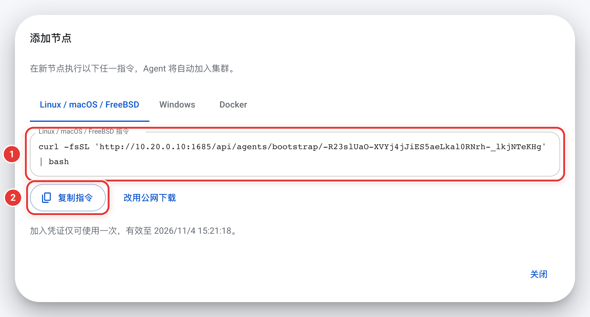

# 安装、升级与卸载

[English](install.md)

这一页涵盖在服务器上安装 OSS Transfer 的全过程，从第一条安装命令到确认服务正常运行。升级、卸载和在工作站上安装 CLI 也在这里。Linux 上最快的方式见[快速开始](../README.zh-CN.md#快速开始)。主机无法访问公网时，见[离线安装](offline-install.zh-CN.md)；需要容器部署时，见 [Docker Compose](docker-compose.zh-CN.md)。

如果你需要搭建集群进行大规模迁移，安装之前建议先阅读[规划](planning.zh-CN.md)（拓扑、端口、存储权限、规格）和[安全](security.zh-CN.md)（TLS、凭据、密码）。

## 开始之前

Linux 需要 systemd 219 及以上，加上 Bash、curl、tar 和 SHA-256 工具。以 root 身份或通过 `sudo` 运行安装脚本。macOS、Windows、FreeBSD 的安装方式见[其他系统](#其他系统)。

Master 默认监听 TCP `1685`。浏览器、CLI、每个执行节点（Agent）都要能访问这个端口。执行节点不需要开放任何入站端口。完整的端口清单见[规划](planning.zh-CN.md)。

安装脚本安装的原生服务在 Linux 和 FreeBSD 上以 root 运行（systemd 单元和 rc.d 脚本没有指定其他用户），macOS 系统服务以 root 运行，Windows 服务以 LocalSystem 运行。macOS 使用 `--user` 时改为当前登录用户。在线更新也需要这些权限。用控制台 Docker 指令启动的执行节点在容器内以 UID 65532 运行。

## 在 Linux 上安装

在计划用作 Master 的机器上运行以下命令：

```sh
curl -fsSL https://raw.githubusercontent.com/MoonWX/oss-transfer/main/install.sh | sudo bash
```

在中国大陆，可以将地址替换为镜像 `https://moonwx.s3.cn-north-1.jdcloud-oss.com/oss-transfer/latest/install.sh`。

安装脚本依次询问语言、角色（Master 还是 Agent）、部署方式（原生还是 Docker Compose）。安装原生 Master 时，还会询问是否在本机同时安装一个执行节点。如果安装了，它会自动加入该 Master，无需单独配置。

通过管道运行时，参数写在 `bash -s --` 后面。例如无人值守地安装 Master 和本机执行节点：

```sh
curl -fsSL https://raw.githubusercontent.com/MoonWX/oss-transfer/main/install.sh | sudo bash -s -- --role master --with-agent --yes
```

将脚本保存为文件后运行 `bash install.sh --help`，可以查看全部选项。

### 检查安装结果

安装完成后，安装脚本打印以下输出（路径和地址以你的主机为准；安装语言为中文时标签也是中文）：

```text
服务: oss-transfer-master
配置文件: /opt/oss-transfer/master/config/service.json
日志: /opt/oss-transfer/master/data/logs/service.log
Installation: /opt/oss-transfer/master/bin
CLI: /usr/local/bin/oss-transfer-cli
Tasks: /usr/local/bin/oss-transfer-cli task list

=== master <版本号> · 安装成功 ===
访问地址: http://10.0.0.5:1685

初始管理员: admin
初始密码: <只显示这一次>
```

接下来确认三件事：

1. 运行 `sudo systemctl status oss-transfer-master`，确认状态为 `active (running)`。执行节点的服务名是 `oss-transfer-agent`。
2. 用浏览器打开 **访问地址**，用 `admin` 和初始密码登录。首次登录必须修改密码，至少 8 个字符，不能是常见或容易猜到的密码，也不能和用户名或初始密码相同。
3. 如果安装了本机执行节点，在 Master 机器上运行 `sudo oss-transfer-cli node list`，应当能看到它在线。

> 初始密码只显示一次。如果遗失，按[重置管理员密码](operations.zh-CN.md#重置管理员密码)操作。

安装脚本报错时，对照这张表：

| 提示 | 处理方法 |
| --- | --- |
| `Cannot listen on …: port 1685 is already in use by …` | 停止占用端口的程序，或用 `--port` 更换端口（仅 Master，见[路径和端口](#路径和端口)）。安装脚本未做任何更改。 |
| `启动等待超过 … 秒` | 查看提示中的日志和 `systemctl status`，排除问题后重新运行同一条命令。 |
| `启动失败：此 Agent 已在 Master 上被移除` | 这个执行节点的加入凭据已撤销。去 **执行节点 → 添加节点** 复制新的加入命令，或者[卸载](#卸载)这个节点。 |
| `… 已是 v… 且正在运行，未做任何更改。如需重新安装，请加 --force。` | 相同版本已安装且运行正常。只有确实需要重装时才加 `--force`。 |
| `… 的数据上次由 … 使用；… 是更旧的版本，可能无法读取这些数据` | 要安装的版本比上次使用这些数据的版本更旧。按提示中给出的 `--version` 安装；确实需要安装旧版本时加 `--force`。安装脚本未做任何更改。 |

### 添加执行节点

在控制台打开 **执行节点 → 添加节点**，填写节点名称和新节点能访问的 Master 地址，点击 **生成加入指令**。复制对应系统的命令，在新节点所在的机器上运行。Linux、macOS、FreeBSD 的原生命令形如 `curl -fsSL '<链接>' | bash`，以 root 运行，或由可以 `sudo` 的用户运行（安装脚本会自动通过 `sudo` 重新执行并询问密码）。几秒后，该节点会在 **执行节点** 页面上显示为在线。

使用 CLI 时，`oss-transfer-cli agent invite` 会打印同样的命令，见 [CLI](cli.zh-CN.md#添加和移除执行节点)。Docker 方式见 [Docker Compose](docker-compose.zh-CN.md)。

<p align="center"></p>

## 其他系统

### 较旧的 systemd

安装脚本和在线更新支持 systemd 219、Bash 4.2、curl 7.29 及以上，安装命令与其他 Linux 相同。较旧的 systemd 在在线更新时有两处不同：

- systemd 低于 236 时，在线更新失败后，辅助单元 `oss-transfer-update-*` 会一直显示为失败状态，运行 `systemctl reset-failed` 即可清除。
- systemd 低于 240 时，如果更新辅助进程无法启动，不会立刻报告，需要等超时后才显示失败。

### macOS

为当前用户安装服务：

```sh
curl -fsSL https://raw.githubusercontent.com/MoonWX/oss-transfer/main/install.sh -o install.sh
bash install.sh --role master --user
```

要安装为系统服务，将第二行改为 `sudo bash install.sh --role master`。安装脚本会打印服务名称和路径。安装脚本的 Docker Compose 方式只支持 Linux；使用 Docker Desktop 时，改用控制台中的 Docker 指令添加执行节点。

### Windows

在管理员 PowerShell 中运行：

```powershell
Invoke-WebRequest https://raw.githubusercontent.com/MoonWX/oss-transfer/main/deploy/native/Install.ps1 -OutFile Install.ps1
powershell.exe -NoProfile -ExecutionPolicy Bypass -File .\Install.ps1 -Role master
```

在中国大陆，也可以从 `https://moonwx.s3.cn-north-1.jdcloud-oss.com/oss-transfer/latest/Install.ps1` 获取脚本。安装完成后会显示 `安装成功：master <版本号>`、访问地址、服务名称（`OSSTransferMaster` 或 `OSSTransferAgent`）、各个路径和日志文件。运行 `Get-Help .\Install.ps1` 查看选项。

### FreeBSD

以 root 运行：

```sh
pkg install -y bash curl
curl -fsSL https://raw.githubusercontent.com/MoonWX/oss-transfer/main/install.sh -o install.sh
bash install.sh --role master
```

在所有系统上，都使用安装脚本打印的 `admin` 密码登录。原生 Master 安装脚本会询问是否同时安装本机执行节点。

## 下载源

安装脚本默认从 GitHub 下载。主机的公网 IP 在中国大陆时，它自动改用京东云 OSS 镜像。首选来源无法访问时，自动尝试另一个。判断所在地时，依次访问 `https://www.cloudflare.com/cdn-cgi/trace` 和 `https://ipinfo.io/country`。

如果不需要脚本自动判断，用 `--source github` 或 `--source jdoss`（`Install.ps1` 用 `-Source`）直接指定，跳过地区检测。

镜像地址 `https://moonwx.s3.cn-north-1.jdcloud-oss.com/oss-transfer/latest/` 始终包含最新正式版的全部文件，其中也有 `install.sh` 和 `Install.ps1`。每个版本（包括预发布版本）有自己的目录，目录名为 `v<版本号>/`。

将安装脚本保存为文件再运行（而不是通过管道交给 shell），脚本会先在自身所在文件夹和当前目录查找 `manifest.tsv` 或本机平台的压缩包。找到后直接使用本地文件安装，不下载任何内容；如果指定了 `--version`，它必须和这些文件的版本一致。加 `--source github` 或 `--source jdoss`（`Install.ps1` 用 `-Source`）则改为在线下载。详见[离线安装](offline-install.zh-CN.md)。

从控制台添加的执行节点默认从 Master 下载安装脚本和安装包，不需要访问公网。**添加节点** 窗口在原生部署的指令上方提供 **下载来源** 选项，可以改为从公网下载；Master 使用官方发布包时，还可以选择 **京东云内网（华北-北京）**，生成的加入指令只访问内网地址。

### 京东云内网

位于京东云华北-北京地域的主机，建议使用 `--source jdoss-internal`（`Install.ps1` 用 `-Source jdoss-internal`）。脚本改为通过内网地址 `https://moonwx.s3-internal.cn-north-1.jdcloud-oss.com/oss-transfer/` 下载同一套文件，不占用公网带宽，主机无法访问公网时也能安装。自动选择下载源时不会使用这个地址，因此需要显式指定。`install.sh` 从 4.1.44 起支持这个选项，`Install.ps1` 从 4.1.45 起支持。

安装脚本本身也可以从内网地址获取。通过管道运行时，参数写在 `bash -s --` 之后：

```bash
curl -fsSL https://moonwx.s3-internal.cn-north-1.jdcloud-oss.com/oss-transfer/latest/install.sh | sudo bash -s -- --source jdoss-internal
```

升级时在末尾加上 `--upgrade --yes`。

## 安装指定版本或预发布版本

安装脚本默认安装最新正式版。需要安装固定版本时，用 `--version`（`Install.ps1` 用 `-Version`）指定，开头的 `v` 可写可不写：

```sh
curl -fsSL https://raw.githubusercontent.com/MoonWX/oss-transfer/main/install.sh | sudo bash -s -- --version <版本号>
```

```sh
bash install.sh --role master --version <版本号>
```

```powershell
powershell.exe -NoProfile -ExecutionPolicy Bypass -File .\Install.ps1 -Role master -Version <版本号>
```

安装脚本从 GitHub 上标签为 `v<版本号>` 的发布，或镜像目录 `oss-transfer/v<版本号>/` 下载对应版本。每个版本的发布说明和全部文件见 [GitHub Releases](https://github.com/MoonWX/oss-transfer/releases)。

预发布版本的安装方式相同，版本号形如 `X.Y.Z-beta.N`：

```sh
bash install.sh --role master --version <预发布版本号>
```

安装脚本校验预发布版本的方式和正式版完全一样：用该标签的 GitHub 发布摘要或带版本号的 OSS 清单，而不是 `latest`。带 `--upgrade` 和 `--version` 重新运行安装脚本，可以把已有安装升级到指定版本，包括从预发布版本升级到对应的正式版。从控制台添加的执行节点下载和 Master 相同的版本。

Docker Compose 部署在 `.env` 中设置精确的镜像标签。`latest` 和 `X.Y` 只跟随正式版：

```dotenv
OSS_TRANSFER_IMAGE=moonwx/osstransfer:<版本号>
```

预发布版本属于实验性质。在线更新和回到正式版的方法见[试用预发布版本](operations.zh-CN.md#试用预发布版本)。

## 路径和端口

新的原生安装将文件集中在同一个根目录下。Linux 默认使用 `/opt/oss-transfer`，macOS 默认使用 `/Library/Application Support/OSS Transfer`（`--user` 时位于用户的 Library 下），FreeBSD 默认使用 `/usr/local/lib/oss-transfer`，Windows 默认使用 `%ProgramData%\OSS Transfer`。需要安装到其他磁盘时，用 `--root-dir` 或 `-RootDir`。操作系统的服务注册仍在该目录之外；Unix 系统还保留全局 CLI 入口。

Linux 默认位置：

| | Master | 执行节点 |
| --- | --- | --- |
| 服务 | `oss-transfer-master` | `oss-transfer-agent` |
| 程序 | `/opt/oss-transfer/master/bin` | `/opt/oss-transfer/agent/bin` |
| 配置 | `/opt/oss-transfer/master/config/service.json` | `/opt/oss-transfer/agent/config/service.json` |
| 数据 | `/opt/oss-transfer/master/data` | `/opt/oss-transfer/agent/data` |
| 服务日志 | `/opt/oss-transfer/master/data/logs/service.log` | `/opt/oss-transfer/agent/data/logs/service.log` |
| 升级备份 | `/opt/oss-transfer/master/backups` | `/opt/oss-transfer/agent/backups` |
| CLI | `/usr/local/bin/oss-transfer-cli` | `/usr/local/bin/oss-transfer-cli` |

Windows 上的服务名为 `OSSTransferMaster` 和 `OSSTransferAgent`，每个角色在 `%ProgramData%\OSS Transfer\<角色>` 下使用 `bin`、`config`、`data` 和 `backups`；CLI 为 `bin\oss-transfer-cli.exe`。

Master 默认端口为 `1685`。`install.sh` 用 `--port 1785` 修改，`Install.ps1` 用 `-Listen '0.0.0.0:1785'`。使用 `--install-dir`、`--config-dir` 或 `--data-dir` 可以分别指定位置，但这些目录不能相互包含。升级时沿用已有的路径。

## 日志

每个服务把日志写在自己数据目录下的 `logs/service.log`（位置见上面的表格；安装脚本以 `日志:` 打印这个路径）。启动错误、任务问题、比对失败、执行节点被移除后的说明，都在这里。执行节点的日志更详细：每个子任务尝试的开始和结束及计数、每次尝试中最先失败的对象、中断期间的存储重试，还有和 Master 连接的变化。详见[监控与日志](operations.zh-CN.md#监控与日志)。

查看日志最常用的两条命令：

```sh
sudo tail -n 100 /opt/oss-transfer/master/data/logs/service.log
sudo tail -f /opt/oss-transfer/agent/data/logs/service.log
```

systemd 只记录服务的启动、停止、失败和退出状态：

```sh
sudo systemctl status oss-transfer-agent
sudo journalctl -u oss-transfer-agent --since today
```

日志文件会一直增长，服务本身不轮转。服务以追加方式写入，因此可以用 `logrotate` 的 `copytruncate` 轮转，无需重启服务。在线更新的日志也写入同一个文件。日志中需要关注的内容，见[监控与日志](operations.zh-CN.md#监控与日志)。

## 升级

通常在控制台在线升级即可：先在 **运维工具 → 版本更新** 中更新 Master，再到 **执行节点 → 版本更新** 更新执行节点（见[版本更新](operations.zh-CN.md#版本更新)）。以下情况需要改用安装脚本：无法在线更新的安装首次升级、主机无法访问公网（见[离线安装](offline-install.zh-CN.md#升级和重装)），或者需要安装最新版以外的版本。

用安装脚本升级时，在每台主机上运行，先升级 Master：

```sh
curl -fsSL https://raw.githubusercontent.com/MoonWX/oss-transfer/main/install.sh | sudo bash -s -- --upgrade --yes
```

`--upgrade` 找出本机已安装的原生服务，逐个备份、安装新版本、确认能启动。加 `--role master` 或 `--role agent` 只升级其中一个，加 `--version` 指定版本。在已有安装的机器上不带参数重新运行一行安装命令，脚本也会询问是否升级。Windows 在安装命令后加 `-Upgrade`。

升级成功时，每个服务都会显示 `=== master <版本号> · 安装成功 ===`（或 `agent`）。如果新版本无法启动，安装脚本会恢复旧版本并保留备份（见[从失败的升级中恢复](operations.zh-CN.md#从失败的升级中恢复)）。

对一个完好且正在运行的安装重新运行相同版本，不会做任何改动。交互运行时脚本会询问是否重装；带 `--yes` 时打印 `… 已是 v… 且正在运行，未做任何更改。如需重新安装，请加 --force。` 并以状态 0 退出。没有任何安装发生变化时，结尾显示 `=== 无需更改 ===`。确实需要重装时加 `--force`。缺失或损坏的部分（程序、服务定义、CLI、执行节点安装包）不需要 `--force` 也会自动修复。`Install.ps1` 没有 `-Force`，总是重新安装。

安装脚本不会静默安装比上次使用该数据的版本更旧的版本。例如数据上次由预发布版本使用，默认安装的最新正式版可能比它更旧。交互运行时脚本会警告并询问（默认为否）；带 `--yes` 时直接停止，不做任何更改。用 `--version` 指定一个更新的版本；确实需要安装旧版本时加 `--force`。

交互安装开始前，安装脚本列出即将安装的内容并询问 `安装？y / n`：角色（以及是否安装本机 Agent）、版本、程序目录和数据目录、服务名称，以及新安装 Master 的监听地址。版本一栏会标注预发布信息和被替换的版本。

升级现有集群前，建议先阅读 [v4.1.42 带来的变化](operations.zh-CN.md#升级到-v4142)。

## 重装且不丢失数据

再次运行安装脚本即可。如果修改过 `--root-dir`，使用相同的值。安装脚本会识别保留下来的服务配置和数据，补回缺失的程序或服务定义，沿用执行节点的身份。旧目录结构的安装继续使用它原有的路径。

如果之前用 `--uninstall --keep-data` 卸载过，运行卸载结尾给出的那条命令即可恢复安装。它包含上次使用的版本（`--version`）、角色和非默认路径，例如 `bash install.sh --role agent --version <版本号>`。

需要保留的内容：每个角色的 `config` 目录和完整的 `data` 目录，包括密钥文件（`master.db.key` 或 `agent.db.key`）。密钥和数据库是配对的，缺一不可。缺少配置或密钥时，安装脚本会直接停止，不会创建一个空的替代安装。源文件、目标文件和共享挂载与这些应用目录相互独立。需要将安装迁移到另一台机器时，见[备份与恢复](operations.zh-CN.md#备份与恢复)。

无人值守安装原生 Master 时，用 `--with-agent` 或 `--without-agent`；Windows 用 `-WithAgent` 或 `-WithoutAgent`。只有属于该 Master 的现有本机执行节点才会被复用。

## 卸载

卸载执行节点之前，先在 Master 上将其移除，使它不再出现在任务的可选节点中。在 **执行节点** 页面操作，或运行 `oss-transfer-cli agent remove 节点 --yes`（见[移除执行节点](operations.zh-CN.md#移除执行节点)）。卸载 Master 不会连带卸载它的执行节点，需要在各自的机器上分别卸载。

### Linux、macOS 和 FreeBSD

带 `--uninstall` 运行安装脚本。卸载不下载任何内容，因为 `install.sh` 中自带原生安装脚本的副本。

```sh
curl -fsSL https://raw.githubusercontent.com/MoonWX/oss-transfer/main/install.sh | sudo bash -s -- --uninstall --role agent
```

使用已保存的脚本时，运行 `sudo bash install.sh --uninstall --role agent`。

| 选项 | 作用 |
| --- | --- |
| `--role master` 或 `--role agent` | 只卸载该角色。不指定时卸载本机全部安装。 |
| `--keep-data` | 保留配置、数据目录和升级备份，以后可以用原来的身份、任务和设置重新安装。已安装的版本记录在保留的 `service.json` 旁边的 `installed-version` 中，输出结尾会给出重新安装的命令。如果需要重装执行节点，不要在 Master 上移除它。 |
| `--yes` | 不再询问确认。没有终端时必须加。 |
| `--service-name`、`--root-dir`、`--install-dir`、`--user` | 选择自定义名称或位置的安装，或 macOS 用户服务。 |

`--uninstall` 不能与安装选项一起使用，`--keep-data` 必须与 `--uninstall` 一起使用。

安装脚本先在 `将卸载以下安装：`、`将删除：` 和 `将保留：` 下列出全部内容，并询问 `确认卸载？[y/N]`。它先停止所有服务，再删除文件，最后显示 `=== 卸载完成 ===` 和后续步骤。

删除的内容：

- 服务定义（systemd 单元、launchd plist 或 rc.d 脚本）和程序；
- 安装记录（`install.tsv`）和该安装记录的 CLI（例如 `/usr/local/bin/oss-transfer-cli`）及其状态文件；
- 不加 `--keep-data` 时：`service.json`（和 `installed-version`）、数据目录、该服务的升级备份，以及没有其他备份时的备份目录及其中的 `.retention.lock`；
- 本机已没有任何安装（且不加 `--keep-data`）时：root 和运行 `sudo` 的用户的 CLI 登录会话和偏好设置（`~/.config/oss-transfer-cli`，macOS 为 `~/Library/Application Support/oss-transfer-cli`）。

以下内容会保留，脚本会说明原因：仍被其他安装使用的 CLI、其他安装的备份、含有无法识别文件、属于共享目录或层级过浅的数据目录，以及仍有其他文件的目录（显示为 `已保留（目录中还有其他文件）`）。如果某个服务定义运行的是其他程序，或某个服务无法停止，安装脚本会拒绝卸载，不做任何更改。本机没有安装时，提示无需卸载并以状态 0 退出。源目录和目标目录中已迁移的文件不受影响。

### 安装脚本创建的 Docker Compose 安装

```sh
sudo bash install.sh --uninstall --method compose --role agent
```

这条命令对安装脚本创建的项目运行 `docker compose down`，删除 `/opt/oss-transfer-compose/<角色>` 下的 Compose 文件；不加 `--keep-data` 时还会删除 `/var/lib/oss-transfer-compose/<角色>` 下的数据。它只处理安装脚本写入的 Compose 文件，Docker 镜像不会删除（可用 `docker image rm` 删除）。存在这类安装时，普通的 `--uninstall` 也会提示。

### 用控制台 Docker 指令启动的执行节点

用 **添加节点 → Docker** 中的 `docker run` 启动的执行节点没有安装脚本。在 Master 上移除节点后，删除它的容器和数据卷即可。名称见当初的加入命令，例如：

```sh
docker rm -f oss-transfer-agent-1a2b3c
docker volume rm oss-transfer-agent-1a2b3c-data
```

v4.1.42 之前用这种方式添加的执行节点使用 `oss-transfer-agent` 和 `oss-transfer-agent-data`。自行编写的 Compose 项目见 [Docker Compose](docker-compose.zh-CN.md)。

### Windows

`Install.ps1` 暂不提供卸载选项。在管理员 PowerShell 中，对默认服务名和路径的执行节点执行以下命令（Master 将 `OSSTransferAgent` 替换为 `OSSTransferMaster`，`agent` 替换为 `master`）：

```powershell
Stop-Service OSSTransferAgent
sc.exe delete OSSTransferAgent
Remove-Item -Recurse -Force "$env:ProgramData\OSS Transfer\agent\bin"
```

如需同时删除数据，再删除 `config`、`data` 和 `backups`：

```powershell
Remove-Item -Recurse -Force "$env:ProgramData\OSS Transfer\agent\config", "$env:ProgramData\OSS Transfer\agent\data", "$env:ProgramData\OSS Transfer\agent\backups"
```

每个用户的 CLI 登录会话和偏好设置位于 `%APPDATA%\oss-transfer-cli`，不再使用 CLI 时可以删除。

## 在其他电脑上安装 CLI

每个发布压缩包中都包含 CLI。需要在工作站上远程管理集群时，下载对应平台的压缩包，校验后取出 `oss-transfer-cli`。以 Linux amd64 为例，下载最新正式版：

```sh
p=linux-amd64
curl -fLO "https://github.com/MoonWX/oss-transfer/releases/latest/download/oss-transfer-$p.tar.gz"
curl -fLO "https://github.com/MoonWX/oss-transfer/releases/latest/download/SHA256SUMS"
grep " oss-transfer-$p.tar.gz\$" SHA256SUMS
sha256sum "oss-transfer-$p.tar.gz"
```

两个校验和必须相同（macOS 上使用 `shasum -a 256`）。在中国大陆，可以将 GitHub 地址替换为 `https://moonwx.s3.cn-north-1.jdcloud-oss.com/oss-transfer/latest`。压缩包名称见[离线安装](offline-install.zh-CN.md#1-准备安装文件)；Apple Silicon 使用 `darwin-arm64`。Windows 从 `oss-transfer-windows-amd64.zip` 中取出 `oss-transfer-cli.exe`。

CLI 版本应与 Master 保持一致。Master 不是最新正式版时，将地址中的 `latest/download` 替换为 `download/v<版本号>`，镜像地址中的 `latest` 替换为 `v<版本号>`。

校验通过后解压安装：

```sh
tar -xzf "oss-transfer-$p.tar.gz"
sudo install -m 755 "oss-transfer-$p/oss-transfer-cli" /usr/local/bin/oss-transfer-cli
```

安装完成后，连接 Master 验证：

```sh
oss-transfer-cli --version
oss-transfer-cli config set master http://10.0.0.5:1685
oss-transfer-cli login
oss-transfer-cli task list
```

`--version` 显示 `OSS Transfer CLI v<版本号>` 和构建信息。`login` 默认以 `admin` 登录（其他账号加 `--username`），以不回显的方式询问密码，成功后显示 `已登录 …（用户 admin）`。脚本用法和更多选项见 [CLI](cli.zh-CN.md#连接-master)。

## 反向代理

应用应部署在域名根路径，例如 `https://transfer.example.com/`。在该域名的 NGINX server 配置中添加：

```nginx
client_max_body_size 16m;

location / {
    proxy_pass http://127.0.0.1:1685;
    proxy_set_header Host $http_host;
    proxy_read_timeout 60s;
}
```

`client_max_body_size` 至少需要允许约 8 MiB，因为执行节点单次请求最多发送 8 MiB，NGINX 默认只允许 1 MiB。`proxy_read_timeout` 必须大于 25 秒，这是执行节点轮询请求最长的保持时间。不支持 `/transfer/` 这类子路径。添加执行节点时，选择该节点能访问的 Master 地址即可；浏览器通过反向代理访问时，执行节点仍然可以使用内网 IP。TLS 证书和 HTTPS Master 地址见[安全](security.zh-CN.md)。
