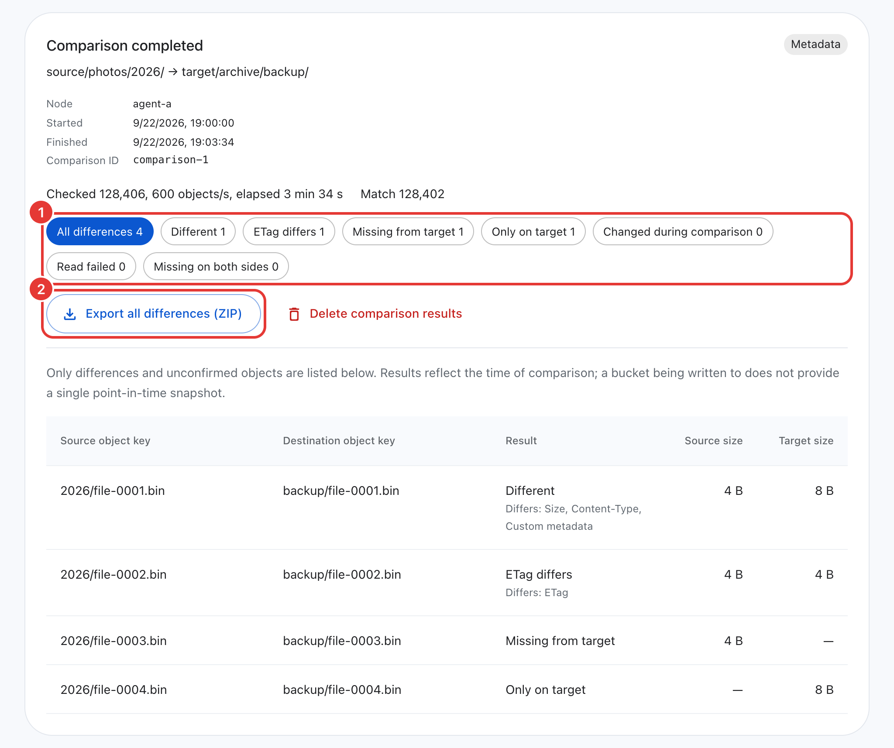

# Operations guide

[中文](operations.zh-CN.md)

This page is for the reader who runs migrations day to day. The first half is organized by symptom: a task is stuck, a node is offline, an object failed. Find the section that matches what you see. The second half, [How execution works](#how-execution-works), explains rate-limit allocation, large-object transfers, disconnected-node takeover and other internals; consult it when you need to tune performance or understand an unusual reading in the console.

- [Troubleshooting](#troubleshooting)
- [Retry, resume and recover](#retry-resume-and-recover)
- [Task options](#task-options)
- [Task details: attention and failure summary](#task-details-attention-and-failure-summary)
- [Task reports](#task-reports)
- [Compare objects](#compare-objects)
- [Monitoring and logs](#monitoring-and-logs)
- [Backup and restore](#backup-and-restore)
- [Software updates](#software-updates)
- [Remove a node](#remove-a-node)
- [Reset the administrator password](#reset-the-administrator-password)
- [How execution works](#how-execution-works)

For topology, ports, storage permissions and the incremental cut-over runbook, see [planning](planning.md). For TLS, credentials and passwords, see [security](security.md).

## Troubleshooting

Start from what you see. Messages in the console and the CLI give a short cause and what to do. The original error is behind **Show original error** in the console, inside the tooltip of an exception record, and in the CLI with `--verbose`.

### A storage connection check fails

Saving a connection with **Validate access when saving**, **Test connection**, the bucket list in **Create transfer**, `storage test` and `storage buckets` all run the same check. The check is carried out by an online Agent, not by the Master itself, so it is the Agent that must be able to reach the endpoint, and the Agent resolves the host name with its own DNS.

The check has two steps:

1. List the buckets (ListBuckets).
2. List at most one object (ListObjectsV2) in the specified bucket (or in the first listed bucket when none is specified), using the effective addressing style.

It tries up to 3 times within 20 seconds. When no Agent is online, it reports *No Agent is online. Add an execution node before testing this connection.*

| Message (shortened) | Likely cause | What to do |
| --- | --- | --- |
| *The bucket host name … cannot be resolved. Self-hosted S3 (MinIO, SeaweedFS, Ceph) needs path-style addressing* | Virtual-hosted addressing puts the bucket in the host name (`bucket.s3.example.com`); self-hosted storage usually cannot resolve it | Choose **Use path-style** in the console, or run `oss-transfer-cli storage update NAME --path-style true` |
| *The storage service closed the connection (EOF) when the bucket was addressed by host name* | The same problem, reported as EOF | Switch to path-style as above |
| *The endpoint host name … cannot be resolved* | A wrong host name, or the Agent's DNS cannot resolve it | Check the endpoint, then run `nslookup HOST` on the Agent host |
| *… closed the connection (EOF). Check the endpoint address, port and protocol* | `http://` used on an HTTPS port or the reverse, or a wrong port | Fix the scheme and port of the endpoint |
| *… refused the connection* | Nothing listens on that address and port, or the storage service is down | Check the endpoint and confirm that the storage service is running |
| *The connection to … was reset* or *… timed out* | Protocol mismatch, or a proxy or firewall between the Agent and the endpoint | Check the network path from the Agent host, for example with `curl -v ENDPOINT` |
| *The TLS certificate of … cannot be verified* | A self-signed or private CA certificate, or `https://` on a service without TLS | Make the Agent host trust the certificate; use `http://` if the service has no TLS |
| *The Access Key does not exist* | A wrong Access Key, or one that belongs to another account or region | Check the Access Key |
| *Signature mismatch. Check the Secret Key and the signature version.* | A wrong Secret Key, or a service that only accepts Signature V2 | Check the Secret Key; choose V2 (`--v2-signer true`) only when the service requires it |
| *Bucket … does not exist* | A wrong bucket name, endpoint or region | Check all three |
| *Access denied: the credentials are valid but lack permission for this request.* | The key lacks a required permission | Grant the permissions listed in [planning](planning.md) |

Two results are warnings, not errors; the connection is saved and can be used:

- *These credentials cannot list buckets (ListBuckets was denied) …*: the key is authorized for a single bucket only. Type the bucket name when you create a task. You can also check the bucket under **Check a bucket** in the **Test connection** dialog, or run `oss-transfer-cli storage test NAME --bucket BUCKET`.
- *The credentials cannot list the objects of bucket … (AccessDenied) …*: check the bucket's permissions before migrating from it.

The default addressing style is **Automatic (recommended)**. Its rule: when the endpoint has a port, or its host is an IP address, `localhost`, a name without a dot, or a name ending with `.internal`, `.local` or `.lan`, it uses path-style; otherwise it uses virtual-hosted. The form shows which style the current endpoint will actually use, and the connection card shows *Automatic · Path-style* or *Automatic · Virtual-hosted*.

When the rule is wrong for your service, for example self-hosted storage behind a domain name without a port, choose Path-style or Virtual-hosted explicitly.

Automatic addressing and the bucket-level check both run on the Agent. An Agent older than v4.1.42 treats a connection that has never had an explicit addressing choice as virtual-hosted and only lists buckets, without checking a specific bucket. The test dialog notes that the node version is too old.

### An Agent is offline

**Execution nodes** shows each node's status. A task that uses an offline node reports *Node … is offline; the task waits for it to reconnect*, with the time each node last connected.

Steps to investigate:

1. On the Agent host, check the service and the end of its log:

   ```sh
   sudo systemctl status oss-transfer-agent
   sudo tail -n 50 /opt/oss-transfer/agent/data/logs/service.log
   ```

2. Confirm that the host can reach the Master address it joined with: `curl -fsS http://MASTER:1685/healthz` prints `{"role":"master","success":true}` when it can. Agents connect to the Master; the Master never connects to Agents.
3. If `systemctl status` shows `failed` with `status=78`, the Agent was removed on the Master and stopped by design (see [Remove a node](#remove-a-node)). Run a new join command from **Execution nodes → Add node** to rejoin it, or [uninstall](install.md#uninstall) it.
4. For a Docker Agent, use `docker ps -a` and `docker logs CONTAINER`.

While an Agent is offline, child tasks assigned to it wait. In a task with several nodes, its unfinished child tasks move to the other nodes after about 70 seconds, provided the nodes support it (see [Disconnected nodes](#disconnected-nodes) for details).

### A task is stuck or slow

Open the task details (or run `oss-transfer-cli task show ID`) and check in this order:

1. Read the attention line first. It names offline nodes or the main failure cause; see [Task details](#task-details-attention-and-failure-summary).
2. Compare **Current** with **Effective limit** in the **Request rate** table. A rate that constantly sits at its limit means the limit is holding the task back: raise the task limit with **Adjust**, or raise the node limits on the **Execution nodes** page. Each node defaults to 2,000 Mbps bandwidth and 100 LIST requests per second (see [Node limits](#node-limits)); raise them on fast networks.
3. A node card that shows *Automatically reduced* means the storage service is throttling and the Agent is slowing down on purpose (see [Storage throttling](#storage-throttling)).
4. Many small objects are limited by request latency, not bandwidth. Raise [node concurrency](#node-concurrency) or add Agents (see [Change a task's execution nodes](#change-a-tasks-execution-nodes)).
5. A task lists the source first. No transfers begin until the scan has found objects; after a restart the scan continues from its checkpoint (see [Resume a scan](#resume-a-scan)).

`oss-transfer-cli task nodes ID` shows each node's share of the task limits and whether it is busy.

### Objects failed

Failed objects appear under **Exceptions → Failed objects**; for uploads and downloads they are under **Local transfer failures**. The list shows unresolved records by default. Each record has a short cause; open it for the full error. In the CLI, run `oss-transfer-cli exceptions list failed --task-id ID`. The task details also summarize the main causes; see [Failure summary](#task-details-attention-and-failure-summary).

| Cause | What to do |
| --- | --- |
| Access denied, or the access key is invalid | Fix the key or its permissions (see [planning](planning.md)), then retry |
| The bucket does not exist, or the storage address cannot be resolved | Fix the storage connection (bucket name, endpoint, addressing style), then retry |
| Connection refused, interrupted or timed out, or a storage server error | The storage was unreachable longer than the retries cover (see the next section). Retry once it is back |
| `exceeded maximum number of attempts, 10` with `SlowDown` or a similar code | Throttling lasted too long. Lower the limits (see [Storage throttling](#storage-throttling)), then retry |
| The node has no permission to read or write the local directory | Grant the Agent's service account access (UID 65532 for the Docker Agent), then retry |
| The destination disk is full, or the file system is read-only | Free space or fix the mount, then retry |
| The source object changed after the scan | Retry: it copies the current version (see [Source objects changed after the scan](#source-objects-deleted-or-changed-after-the-scan)) |

Choose **Retry failed items** in the task details or on the **Exceptions** page, or run `oss-transfer-cli task retry ID`. Only the failed objects are transferred again. For more retry options, see [Retry, resume and recover](#retry-resume-and-recover).

### The storage was down, or the network dropped

Agents ride out short outages. A request that fails with a refused, reset or aborted connection, a broken pipe, a timeout, a temporary DNS failure, or HTTP 5xx (except 501 and 505) is retried up to 10 times. The waits grow from about 1 second to 20 seconds, about 1 to 2 minutes in total, before the object is recorded as failed. Throttled requests also get up to 10 attempts; see [Retries](#retries).

Two more failure types are retried up to 10 times as well, but only for a storage host that has already answered the Agent since startup: a connection that ends without a response (`EOF`, as when the storage service stops during a request) and a host name that no longer resolves (as the name of a stopped container). If the host has never answered, these failures point to a wrong endpoint or addressing style and fail after the usual 3 attempts; a host name that does not exist fails at once, as does access denied.

When the source goes down while an object is being read, the read continues from the byte where it stopped once the source answers again, pinned to the version it started with. If the object was replaced in the meantime, it fails as changed. Each retry is written to the Agent's [service log](install.md#logs), at most one line every 30 seconds.

If an outage lasted longer, the affected objects fail with a connection or server cause. Retry them once the storage is back. Multipart uploads that could not be aborted during the outage are not left behind permanently: they are aborted again when a task starts, resumes or retries on that node, after each child task attempt ends, every 5 minutes while any remain, and when the Agent starts. Connection checks still give up after 3 attempts.

### Source objects deleted or changed after the scan

A task lists the source first and transfers later. Objects can change in between.

When the source is object storage, an object deleted after the scan but before its transfer is not counted as failed. It is counted as skipped and does not appear among the failed objects in the exception records. The [task report](#task-reports) lists it in `file-results.csv` with the result `SKIPPED` and the reason code `SOURCE_DELETED`. The skip note in `task show` and in the task details mentions both causes of a skip. A file missing from a local source directory still fails.

An object modified after the scan fails with the reason code `SOURCE_CHANGED` (*The source object changed after the scan; a retry copies its current version*). **Retry failed items** copies the version that exists at retry time, and the task's total size uses the new size. The report marks the object `SOURCE_REFRESHED`.

Changes that happen after an object has been copied are not seen by that task. Keep the source stable, or use multiple incremental rounds and a final comparison (see [planning](planning.md)).

### A download precheck fails

Before a download to a local directory begins, each Agent writes and removes a probe file `.oss-transfer-write-probe-*` in the destination directory, or in the nearest existing parent when the destination directory does not exist. A passing node shows *Destination directory is writable; 12.3 GiB free*; when the destination directory has not been created yet, it shows *Destination directory will be created when the task starts*, with the available space. A failing node shows the reason:

| Message | What to do |
| --- | --- |
| *The node cannot write to /files: the Agent runs as UID 65532; grant that user write access (for example chown 65532)* | Grant that UID write access, for example `sudo chown -R 65532 /files` on the Docker host |
| *The node cannot write to …; grant the Agent service account write access* | Grant the service account (root for native installations) write access, or check the mount options |
| *… is on a read-only file system* | Mount the directory read-write |
| *The disk holding … has no free space* | Free space or choose another disk |
| *… is not a directory and cannot be a download destination* | Choose a directory |

In the CLI, the precheck fields are `writeProbeDirectory`, `effectiveUid` and `freeBytes`. Adding `--validate-only` runs the precheck without creating a task. Agents older than v4.1.42 run the earlier check, which does not write a probe file.

### Staging directories in download destinations

During a download, data is first written to temporary files in a hidden directory `.oss-transfer-staging-…` next to the destination files and published under the final file name only when complete (see [Temporary files](#temporary-files)). An Agent removes a staging directory once no attempt uses it, and removes empty leftovers when it starts. A staging directory that still exists may belong to an unfinished task. Do not delete it while tasks are writing to that directory.

## Retry, resume and recover

Regardless of which action you choose, completed objects are never transferred again.

| Task state | Console | CLI | What happens |
| --- | --- | --- | --- |
| Running, with failed objects | **Retry failed items** | `task retry ID` | Re-transfers the failed objects of finished child tasks while the task keeps running (see [details](#retry-failed-objects-of-a-running-task)) |
| Stopped | **Resume** | `task resume ID` | The scan continues from its checkpoint; unfinished and failed objects are processed |
| Partially failed | **Retry failed items** | `task retry ID` or `task resume ID` | Starts a new round that transfers failed and unprocessed objects; succeeded and skipped objects keep their results |
| Failed | **Retry task** | `task retry ID` or `task resume ID` | Same as partially failed; a scan that stopped with an error continues from where it stopped |
| Completed | — | — | Nothing to do. To pick up later changes at the source, create a new task (see [Incremental migration](#conflict-policies)) |

Stopping a task (`task stop ID`) keeps all progress. A stopped task can be resumed at any time, including after a restart of the Master or the Agents.

From the task list you can resume or retry several tasks at once. When the selection includes both stopped and failed tasks, the button reads **Recover tasks** and performs both actions. `task recover-child ID-N` tells a node to resume one recoverable child task immediately.

A retry reads the source again: an object that changed since the scan is copied in its current version.

[Object comparison](#compare-objects) is resumed separately: **Resume comparison** or `object resume ID` continues an interrupted, failed or canceled prefix comparison from its checkpoint.

## Task options

These options are set in **Create transfer** or with `task create` (see [CLI](cli.md#create-tasks-and-set-rate-limits)). Unless stated otherwise below, they cannot be changed after the task is created.

### Conflict policies

**If the destination exists** decides what happens when the destination already has an object or file with the same name:

| Policy | CLI | API | Effect |
| --- | --- | --- | --- |
| **Skip existing objects or files** (default) | `--conflict skip` | `SKIP` | Keeps the existing object or file in place, without comparing size or content |
| **Overwrite changed objects** | `--conflict changed` | `OVERWRITE_CHANGED` | Overwrites only when the destination looks outdated (rule below); skips the rest |
| **Overwrite existing objects or files** | `--conflict overwrite` | `OVERWRITE` | Replaces every existing object or file; everything is transferred again |

Objects that do not exist at the destination are always copied. Under **Overwrite changed objects**, an existing destination object is overwritten when any of the following conditions is met:

1. The sizes differ.
2. Both ETags are plain MD5 ETags (32 hexadecimal digits) and they differ.
3. The source's Last-Modified time is later than the destination's.

When none of these conditions is met, the object is skipped and counted as skipped. The decision uses listing metadata only; object content is never read. Multipart ETags (`…-N`), weak ETags and local file fingerprints are never compared; an unknown modification time never counts as later.

This policy has several limitations.

A change that keeps the size, on objects whose ETags are not comparable (multipart uploads, and objects of 128 MiB or more copied by OSS Transfer), with a source modification time that is not later, is not detected.

Objects encrypted with SSE-KMS or SSE-C have ETags that are not MD5s of the content. When both sides look like MD5 ETags but differ, every such object is overwritten.

The rule compares the clocks of two storage systems. After a first copy, the destination's Last-Modified time is the copy time, so later changes at the source are detected.

Every Agent of the task must run v4.1.42 or later. Creating such a task on an older Agent fails with *Agent … does not support overwriting changed objects; upgrade it first*, and older Agents cannot join the task.

For a source that keeps changing, the incremental approach is as follows. Run a full migration first, then repeat the same task definition with **Overwrite changed objects** (or with **Skip existing objects or files** and a **Modified after** time) until the remaining changes in each round are small. Then stop writes at the source, run one last round, and [compare](#compare-objects) before switching over. Migrations only copy objects; they do not delete objects. An object deleted at the source still has its copy at the destination. The full cut-over runbook is in [planning](planning.md).

After a task under **Skip existing objects or files** finishes, if it skipped objects the task details show a note, because skipped objects may be stale. For tasks between two object stores, the note provides a **Compare objects** button that opens a prefilled comparison. `task show` prints the same note.

### What to transfer

| Option | Console | CLI | Notes |
| --- | --- | --- | --- |
| Whole bucket | Leave the prefix empty | (default) | |
| Prefix | Source prefix | `--prefix` | Keys that start with the prefix; spaces and slashes are kept as typed |
| Single object | Single object | `--object-key` | Cannot be combined with a prefix |
| Key list | — | `import-inventory` | One task per `.incr` file; see `help tools` |
| Modification time | **Modified after**, **Modified before** | `--date-after`, `--date-before` | Compares the source's Last-Modified time. "After" includes the given time; "before" excludes it. `YYYY-MM-DDTHH:mm:ss` is read in the Master's time zone (the form names it, for example UTC); RFC 3339 with a time zone offset is also accepted |

### Destination naming

| Rule | CLI | Example (source key `logs/2026/a.txt`) |
| --- | --- | --- |
| **Keep original key** (default) | `--mapping preserve` | `logs/2026/a.txt` |
| **Add destination prefix** | `--mapping add-prefix --target-prefix backup` | `backup/logs/2026/a.txt` |
| **Replace source prefix** (requires a source prefix) | `--mapping replace-prefix --prefix logs/ --target-prefix archive/` | `archive/2026/a.txt` |
| **Set destination key** (single object) | `--mapping exact-key --object-key K --target-key T` | `T` |

**Add destination prefix** appends a `/` when the prefix does not end with one. **Replace source prefix** replaces the text literally and adds nothing, so end both prefixes with `/` when they represent directories. Uploads use `--target-prefix` or `--target-key`; for downloads the destination is the bound local directory (`--target-relative-path` for a single object).

### Execution nodes and distribution

Specify the Agents for a task between object stores with `--node`, or for local transfers with `--binding NODE=PATH`. Choose nodes close to the data; see [planning](planning.md).

Two distribution modes are available, set with `--distribution`. **Balanced** is the default: it places each child task on the selected node with the least remaining work, estimated as bytes plus a fixed cost per object. **Affinity** places every child task on the first selected node; the other nodes take over its work only if it disconnects. Upload tasks follow the number of bound nodes.

Nodes can be added or removed while the task exists (see [Change a task's execution nodes](#change-a-tasks-execution-nodes)).

### Limits and concurrency

Task limits (`--bandwidth-mbps`, `--list-qps`, `--head-qps`, `--put-qps`) are totals for the whole task, divided among its nodes, and can be changed while the task runs. See [Task limits across nodes](#task-limits-across-nodes) for details. LIST / GET covers listings and every object read.

Node limits and node concurrency belong to each Agent and apply to all tasks running on it. See [Node limits](#node-limits) and [Node concurrency](#node-concurrency).

Download tasks have a ranged download option `--ranged-download auto|off`, which reads objects of 128 MiB or more in parallel ranges. See [Ranged download option](#ranged-download-option).

### What is copied

Transfers copy the object content, `Content-Type`, `Content-Encoding`, `Content-Disposition`, `Cache-Control` and custom metadata (`x-amz-meta-*`). They do not copy ACLs, storage classes, tags, object lock settings or older versions; the destination uses its own settings and defaults. The destination's Last-Modified time is the time of the copy.

Objects of 128 MiB or more are written as multipart uploads, in parts of 8 MiB (16 MiB from 1 GiB, larger when needed to stay within 10,000 parts). Their ETags therefore differ from single-part ETags.

## Task details: attention and failure summary

The task details show what needs attention above the statistics.

When objects have failed, the display shows the main cause and the number of objects, for example *All 18 objects failed: The node has no permission to read or write the local directory*, up to two further causes (*N more: …*), and *Open Exceptions to see the failed objects and retry them.* The summary is built from at most 1,000 exception records.

When nodes are offline while the task runs, the display shows *Node … is offline; the task waits for it to reconnect*, with *… last connected at …* or *… has not connected yet* for each node. When every node of a running task is offline, this replaces the failure summary.

`oss-transfer-cli task show ID` prints the same content as an *Attention* line. `exceptions list` shows the cause of each record. The API returns them as `attention`, `failureSummary` and `offlineNodes` in `GET /api/master/tasks/{id}`.

## Task reports

After a task has stopped or ended, choose **Export task report** in the task details, or run:

```sh
oss-transfer-cli task report ID --output task-ID.zip
```

The ZIP contains four files:

| File | Contents |
| --- | --- |
| `task-summary.csv` | One row per task, with its counts |
| `file-results.csv` | One row per object: source, destination, node, result (`SUCCESS`, `SKIPPED`, `FAILED`, `UNPROCESSED`, `UNKNOWN`), reason code and error message |
| `exception-details.csv` | The failed and unknown objects with their reasons |
| `report-metadata.json` | Whether the report is complete, the reasons if not, and `reasonCodeMeaning`, which explains every code in English |

A report is complete when it lists the final result of every object the task found. The CLI prints *Report complete: Yes/No* and the counts of each result: *N succeeded, N skipped, N failed, N not processed, N unknown*. When the report is incomplete, each reason is listed and the CLI exits with status 3; the ZIP is still saved:

| Code | Meaning | What to do |
| --- | --- | --- |
| `SCAN_INCOMPLETE` | Not every source object was listed | Resume the task, then export again |
| `TASK_STOPPED` | The task was stopped before every object was migrated | Resume the task, or accept the partial result |
| `UNPROCESSED_OBJECTS` | Some objects were not processed | Retry or resume the task |
| `NODE_REPORT_INCOMPLETE` | Results could not be read from a node; those rows are `UNKNOWN` | Bring the named node online, then export again |
| `STATE_CHANGED_DURING_EXPORT` | The task changed during the export | Export again |
| `COUNTS_DO_NOT_RECONCILE` | The rows do not add up to the task's totals | Export again; if it persists, keep the report for investigation |
| `TASK_ERROR` | The task recorded an error | See `exception-details.csv` |

Reason codes in `file-results.csv` include `TRANSFER_FAILED` (see the error message), `DESTINATION_EXISTS` (skipped by the conflict policy), `SOURCE_DELETED`, `SOURCE_REFRESHED`, `NOT_COMPLETED` and `LEDGER_UNAVAILABLE` (the result could not be read from the node). A complete report only confirms what the task did; it does not prove that the content is equal. For that, use [object comparison](#compare-objects).

`--output -` writes the ZIP to standard output, for example to copy it out of a container: `docker compose exec master oss-transfer-cli task report 12 --output - > task-12.zip`. To export reports for all local transfers at once, use `exceptions export local --output FILE.zip`.

## Compare objects

Under **Tools → Compare objects**, choose a single object or a bucket/prefix on each side. In a prefix comparison, the source prefix is replaced with the target prefix: `images/a.jpg` under `images/` matches `backup/a.jpg` under `backup/`. An empty prefix covers the whole bucket. Results include objects missing from either side.

Each Agent runs one comparison at a time. The Master starts a comparison on an online Agent that has no comparison running, preferring Agents that have been upgraded to this version; the results are stored on that Agent. From the CLI, use `object compare` (see [CLI](cli.md#compare-stored-objects)).

Two modes are available.

**Metadata (does not read content)** sends a HEAD request for each object on both sides and compares the size, `Content-Type`, `Content-Encoding`, `Content-Disposition`, `Cache-Control` and custom metadata, that is, the properties that transfers preserve. Matching metadata does not prove matching content. Modification times and storage classes are not compared.

ETags are not treated as a portable content hash across providers, because multipart uploads and different storage services can produce different ETags for identical content. ETags serve only as a hint: when every compared property matches and both ETags are plain MD5 ETags (32 hexadecimal digits, without the `-N` part count of a multipart upload) that differ, the result is *ETag differs* (`ETAG_MISMATCH`) instead of *Match*. The contents then probably differ, but not certainly. Some storage services return MD5-like ETags that are not the MD5 of the content, for example Amazon S3 for objects encrypted with SSE-KMS or SSE-C; confirm such objects with a content comparison. When either ETag comes from a multipart upload, ETags are not compared.

**Content SHA-256 (streaming)** reads both objects completely, both sides at once, and compares their size and SHA-256; it does not compare metadata. Objects of different sizes are reported as different without being read. This mode does not create local object files, but it does transfer the full contents across the network and may incur storage read charges.

Objects of 8 MiB or less, and objects on storage that does not serve byte ranges, are read with one request and tried up to three times (again after 1 and 2 seconds). Larger objects are read in 8 MiB ranges; a range that fails is retried up to three more times, after 1, 2 and 4 seconds. A read that receives no data for 60 seconds counts as failed. After reading, both objects are checked again with HEAD requests; an object that changed in the meantime is reported as *Changed during comparison*. Progress includes the bytes read on both sides, so a large object shows progress while it is being read.

Each compared object gets one of the following results:

| Result | Console | Meaning |
| --- | --- | --- |
| `MATCH` | *Match* | Counted only, not listed |
| `DIFFERENT` | *Different* | Both objects exist and differ. The row names what differs: `size`, `contentType`, `contentEncoding`, `contentDisposition`, `cacheControl` or `metadata` in metadata mode; `size` or `sha256` in content mode |
| `ETAG_MISMATCH` | *ETag differs* | Metadata mode only: every compared property matches, but the two plain MD5 ETags differ. This is only a hint: single-part ETags that are not MD5s (for example of SSE-KMS or SSE-C objects) can be flagged too |
| `MISSING_TARGET` | *Missing from target* | Exists only on the source; a HEAD request confirmed that the target does not have the object |
| `EXTRA_TARGET` | *Only on target* | Exists only on the target; a HEAD request confirmed that the source does not have the object |
| `CHANGED_DURING_COMPARE` | *Changed during comparison* | The object changed, appeared or disappeared on either side while it was being compared; compare it again later |
| `ERROR` | *Read failed* | One side could not be read; the row gives the cause (see [Errors and logs](#errors-and-logs)) |
| `BOTH_MISSING` | *Missing on both sides* | Single-object comparison: neither key exists on either side |

Every result except `MATCH` is stored as a difference. The counts cover every compared object; "differences" in the list means every result except *Match*.

In metadata mode each Agent compares up to 32 objects at once; in content mode up to 8. Each side is listed in pages of 1,000 keys. Comparisons have no task limits, but they share the node's request and bandwidth limits with transfers on that node (see [Node limits](#node-limits)), so a large comparison and busy transfers slow each other down.

In metadata mode each object requires a HEAD request on each side. At the default HEAD limit of 2,800 requests/s, up to about 1,400 objects per second can be compared; the latency of the storage service often sets a lower actual rate. In content mode the reads of both sides count against the node bandwidth limit, so each byte counts twice: at the default 2,000 Mbps, a comparison covers up to about 125 MB of objects per second.

### View results

The page lists the comparisons of all nodes, newest first, showing the status, source and target, mode, number of objects checked, number of differences, start time and node. Choose a comparison to view it; its ID stays in the page address (`?comparison=ID`). The list refreshes every 5 seconds while a comparison is running.

A comparison on a node that cannot be reached shows *Node unavailable*, without counts, and the page notes how many nodes could not be reached. While a node is unavailable, the list refreshes on its own every 15 seconds; comparisons on that node show their status again once the node is back. Choosing such a comparison shows that its node is unavailable and retries, waiting twice as long each time, up to 60 seconds.

Comparisons that their node has deleted, and comparisons on nodes removed from the cluster, are no longer listed; opening one says that the comparison no longer exists. A node enrolled again with the same data directory keeps its comparisons. Comparisons that an Agent of this version reports but the Master does not know, for example after the Master's database was restored, are listed again and can be viewed, canceled and deleted as usual.

<p align="center"></p>

While a comparison runs, the page shows the number of objects checked, the rate in objects per second and the elapsed time; in content mode it also shows the bytes read. The elapsed time counts only the time the comparison actually ran. The counts double as filters: choose *All differences* or a single result to list only those rows; *Checked* and *Match* show counts only. Each row shows the source and target keys, the result with the differing properties or the error and its detail, both sizes, and in content mode both SHA-256 values. Rows are listed 100 per page with **Previous page** and **Next page**; while the comparison runs, the current page refreshes every 1.5 seconds without changing position. When the selected result is rare in a long list, the page reads ahead several pages on its own; if it has still found nothing, **Keep searching** reads further.

**Cancel comparison** stops a running comparison; a canceled prefix comparison can be resumed later (see [Resume a comparison](#resume-a-comparison)). **Delete comparison results** deletes a comparison that is not running; cancel a running one first. When a comparison has been deleted, for example by the retention rules, its page says the results do not exist and stops refreshing. When its result files are gone from the node, for example because they were removed by hand, the comparison keeps its counts and status, but its page lists no rows and shows *Comparison results are unavailable on this node*; it cannot be resumed.

The API: `GET /api/master/comparisons` lists the comparisons; when some nodes do not answer, `complete` is `false`, `unavailableNodes` names them, and their comparisons have the status `UNAVAILABLE`. `GET /api/master/comparisons/{id}?after=0&limit=1000&status=DIFFERENT,MISSING_TARGET` returns the comparison and a page of rows: `limit` is 1 to 1,000 (default 50), and `status` is optional. Continue with `after` set to the returned `nextAfter`, which is absent on the last page. A comparison on an offline node answers HTTP 503 *Agent is offline* at once; a comparison that no longer exists, including one on a node removed from the cluster, answers HTTP 404 *Comparison not found*. The same applies to cancel, delete, export and resume, except that deleting a comparison of a removed node succeeds and only removes it from the list. A filtered page may hold fewer rows than `limit`, or none, and still carry a `nextAfter`. Besides its settings, a comparison record holds the counts `compared`, `matched`, `different`, `etagMismatch`, `missing`, `extra`, `changed`, `errors` and `bothMissing`, the number of stored rows `rows`, and `rowsTruncated`, `truncatedReason`, `lastStoredKey`, `checkpoint`, `resumable`, `bytesRead`, `elapsedMillis`, `error` and `errorDetail`.

### Export results

Choose **Export ZIP** in the console, or run `object export` in the CLI (see [CLI](cli.md#compare-stored-objects)), to download a ZIP file (from the console the file name is `comparison-ID.zip`) with three files:

| File | Contents |
| --- | --- |
| `differences.csv` | Stored rows in key order, with the columns `number`, `key`, `status`, `sourceKey`, `destinationKey`, `sourceSize`, `destinationSize`, `sourceSha256`, `destinationSha256`, `reasons` (separated by `;`), `error` and `errorDetail`. A status filter (`--status` in the CLI, `status` in the API) keeps only those results |
| `retry-source-keys.incr` | The source key of every `MISSING_TARGET`, `DIFFERENT` and `ETAG_MISMATCH` row, one per line, regardless of the status filter |
| `summary.json` | The comparison itself (ID, node, status, mode, scope, source and target), its counts, `storedRows`, `exportedRows`, `statusFilter`, `complete` and `incompleteReasons`, `truncatedReason` and `lastStoredKey`, `retryStatuses`, `retryKeys`, `retryKeysOmitted`, `retryPrefixesMatch`, `csvEscaping`, and the start, end and export times |

`complete` is `true` only when the comparison has completed, its results are available on the node, it stored every difference, and the file holds all stored rows (with a status filter, all stored rows with those results). Otherwise `incompleteReasons` names each reason: `NOT_COMPLETED:<status>`, `ROWS_TRUNCATED:<reason>`, `RESULTS_UNAVAILABLE` (the node no longer has the result files), `ROW_COUNT_MISMATCH` or `RETRY_KEYS_MISMATCH`. For results that hold every difference, the export is checked against the counts: a filtered export must hold as many rows as the counts of the selected results add up to (`DIFFERENT` counts as `different`, `ETAG_MISMATCH` as `etagMismatch`, `MISSING_TARGET` as `missing`, `EXTRA_TARGET` as `extra`, `CHANGED_DURING_COMPARE` as `changed`, `ERROR` as `errors`, `BOTH_MISSING` as `bothMissing`), otherwise `ROW_COUNT_MISMATCH`; and `retryKeys` plus `retryKeysOmitted` must equal `missing` + `different` + `etagMismatch`, otherwise `RETRY_KEYS_MISMATCH`. These count checks do not apply to results of [older Agents](#older-agents), which counted `BOTH_MISSING` as errors. A running comparison can also be exported; the file then holds the rows stored so far and is marked incomplete. The rows are read from the node page by page while the file downloads; if the node stops answering, the download fails instead of producing a shortened file. The CLI also exports JSON Lines (`--format jsonl`): one stored row per line, in the same format as the API, filtered like the CSV file and without a summary.

CSV files use UTF-8 encoding and standard quoting rules. To prevent spreadsheet programs from running a key as a formula, every value that begins with `=`, `+`, `-`, `@`, `'`, a tab, CR or LF gets a leading apostrophe (`'`). To recover the original value, remove one leading apostrophe from each value that begins with one. Values that contain CR or LF are quoted, and their bytes are kept; some CSV readers, for example Go's `encoding/csv`, convert a CR LF inside a value to LF. `retry-source-keys.incr` and JSON Lines hold the keys unchanged; use the JSON Lines export (`object export --format jsonl`) when you need every key exactly.

If the comparison found differences and you want to re-transfer those objects, you can use `retry-source-keys.incr` as a key list for `import-inventory` (see `oss-transfer-cli help tools`). `import-inventory` creates a task that copies each listed key from the source bucket to the same key in the target bucket, so it fits only when the comparison's source and target prefixes are equal (`retryPrefixesMatch` is `true`). When the prefixes differ, the objects would be written under their source keys; use a transfer task that replaces the prefix instead. Put the file in a directory of its own and add `--overwrite`. Without it, the task skips objects that already exist at the target, which includes every `DIFFERENT` and `ETAG_MISMATCH` key. If a content comparison has confirmed that the `ETAG_MISMATCH` objects are equal, remove those keys from the list first.

```sh
mkdir retry && unzip comparison-ID.zip retry-source-keys.incr -d retry
oss-transfer-cli import-inventory source/photos target/archive retry --overwrite
```

The file leaves out keys that `import-inventory` cannot read: longer than 1,024 bytes, not valid UTF-8, containing NUL, CR or LF, or consisting only of whitespace. `retryKeysOmitted` counts them; find them, exactly, in the JSON Lines export (`object export --format jsonl`). `import-inventory` accepts up to 10 million keys, or 1 GiB of keys, per file; split a longer list into several `.incr` files in the same directory, and each file becomes a task.

The API: `GET /api/master/comparisons/{id}/export?format=zip&status=DIFFERENT` with a bearer token; `format` is `zip` (default) or `jsonl`.

### Resume a comparison

A prefix comparison records a checkpoint about once a second: the key up to which every object has been compared and counted.

When the Agent restarts or is upgraded, the comparison continues from its checkpoint automatically, provided no storage connection in the cluster has changed since the comparison was started or last resumed. "Changed" here means any change to any storage connection in the cluster, because the Master sends every connection to every node. After a storage connection change, the comparison stays *Comparison interrupted* with the error detail `storage connections changed; resume manually`; resuming it manually enables automatic resume again.

Choose **Resume comparison** in the console, or run `object resume ID` in the CLI, to continue an interrupted, failed or canceled prefix comparison, for example after fixing storage access. Canceling also works as a pause. The comparison runs again on the node that holds its results; that node must be online and not running another comparison. The comparison uses the current storage connection settings, so make sure they still point to the same buckets.

Both sides are listed again after the checkpoint key. Counts and stored differences continue, so no object is counted twice or skipped, and the elapsed time adds up. Objects that were in progress at the interruption, such as a large object being read in content mode, are compared again from the start. A comparison that is still being canceled cannot be resumed (*Comparison cannot be resumed*); resume it once it has stopped. The API equivalent is `POST /api/master/comparisons/{id}/resume`.

A resumed comparison is not a snapshot, the same as the original: changes made behind the checkpoint while the comparison was stopped are not seen. Single-object comparisons, comparisons that could not save their results, and comparisons on Agents of 4.1.40 or earlier cannot be resumed; start them again.

### Errors and logs

A row that could not be read shows *Read failed* with a fixed message and a detail that names the side, the request, the HTTP status, the storage error code and the request ID to give the storage provider, for example `target HEAD: HTTP 403 AccessDenied (request ID 1A2B3C)`. Details never contain credentials, signatures, URLs or host names.

A LIST request that fails with HTTP 5xx or 429, a throttling error code such as `SlowDown`, a network error or a timeout (3 minutes per attempt) is retried up to 5 times, after 1, 2, 4, 8 and 16 seconds. Errors such as `AccessDenied` (HTTP 403), `NoSuchBucket` (HTTP 404) or `InvalidAccessKeyId` fail at once. Each HEAD request, retries included, is limited to 2 minutes.

When a listing still fails after retries, or the storage lists keys out of order, the comparison fails. The page shows *Comparison could not finish; check storage access and retry.* with a detail such as `source LIST: HTTP 403 AccessDenied (request ID 1A2B3C)` or `source listing is not in ascending byte order after key "…"`. The Agent writes `comparison <ID> failed: <detail>` to its service log (`/opt/oss-transfer/agent/data/logs/service.log` on Linux). Fix the cause, then resume the comparison: it continues after the last key it had compared. A comparison whose results the Agent could not write fails with *Cannot save comparison results* and cannot be resumed; start it again.

### Result storage and retention

Results stay on the Agent that ran the comparison, in files under `comparisons` in its data directory (`dataDirectory` in `service.json`; `/opt/oss-transfer/agent/data/comparisons` on Linux), one subdirectory per comparison. They are not stored in `agent.db`, do not grow the database, and are not included in database backups or compaction (see [database maintenance](database-maintenance.md#comparison-results)). With keys of about 40 bytes, each stored difference takes about 260 bytes, so 2 GiB holds about 8 million differences; longer keys and the SHA-256 values of content mode take more.

Results are deleted automatically (the running comparison's results are never deleted):

- 30 days after a comparison ended.
- While the total results on the node exceed 2 GiB, the comparison that ended earliest is deleted first.
- While the node holds more than 500 comparisons, the comparison that ended earliest is deleted first.

These rules are applied when the Agent starts, whenever a comparison ends and every hour. While a comparison is running, the total may temporarily exceed the budget until the next check deletes older results. **Delete comparison results** or `object delete` removes a comparison at once; its files are deleted in the background and across restarts.

A comparison stops storing differences, but continues comparing and counting, in these cases: its own differences would exceed the entire budget (`STORAGE_BUDGET`); or writing them would leave less than 1 GiB free on the disk that holds the data directory (`LOW_DISK_SPACE`). Its page then shows the reason and the last stored key. The rows are complete up to that key; later differences are only counted. Raise the budget or free disk space and compare again, or compare the remaining keys under narrower prefixes. A third reason, `LEGACY_LIMIT`, marks results of [older Agents](#older-agents), which store at most 10,000 differences.

To change these limits, add a `comparison` object to the Agent's `service.json` and restart the Agent. Keys that are left out, or set to 0, keep their defaults:

| Key | Default | Effect |
| --- | --- | --- |
| `budgetBytes` | 2147483648 (2 GiB) | Total size of stored differences on the node, and the most one comparison stores; at least 67108864 (64 MiB) |
| `retentionDays` | 30 | Days a comparison is kept after it ended; at most 3,650 |
| `minimumFreeBytes` | 1073741824 (1 GiB) | Free space that storing differences leaves on the disk of the data directory |

For example, to keep up to 10 GiB of differences for 90 days, add the object to the existing JSON object and keep the other keys:

```json
"comparison": {
  "budgetBytes": 10737418240,
  "retentionDays": 90
}
```

A lower budget or retention deletes older results when the Agent starts. An unknown key or a value out of range keeps the Agent from starting; the Master rejects a `comparison` object in its own `service.json`. Check the file with `--check-config` before restarting, as for [automatic reduction tuning](#tune-automatic-reduction). The limit of 500 comparisons is fixed. Agents installed with Docker have no `service.json` and use the defaults.

### Older Agents

Agents of 4.1.40 or earlier keep their previous behavior until they are updated. They compare one object at a time, store only the first 10,000 differences of a comparison (the page then says that the node's version stores at most that many) and keep only their 10 most recent comparisons, deleting the oldest when another starts. They lack the ETag hint and error details, and on storage that reports listing times with milliseconds they mark almost every object *Changed during comparison*. A restart or update ends their running comparison for good.

The Master lists, filters and exports the rows they stored, but an export cannot go beyond those 10,000 rows, and resuming is refused with a message that the node needs to be upgraded first. New comparisons go to updated Agents first.

Update the Agents (see [Software updates](#software-updates)). Comparisons that an Agent kept from before its update stay readable, count as 512 bytes per difference toward the budget and are deleted under the same rules.

### Limitations

- A comparison is not a point-in-time snapshot: each object is compared when its turn comes. Pause writes if you need a fixed dataset verified.
- Only S3-compatible object storage can be compared; local directories cannot.
- Listings must return keys in ascending byte order, as S3 requires. Storage that lists in another order fails the comparison with a detail that names the key after which the order broke.
- Keys are matched byte for byte after removing each prefix, without case folding, Unicode normalization or slash cleanup.

### Verify a large migration

A comparison runs on one Agent, and each Agent runs one comparison at a time. At the default limits, a metadata comparison checks up to about 1,400 objects per second, so 100 million objects take about 20 hours on one Agent; a content comparison reads both sides and is far slower and costlier.

To verify a large migration:

1. Split the bucket by prefix, for example by top-level directory, and start one comparison per prefix. The Master places each new comparison on an online Agent that has no comparison running, so several prefixes run in parallel on several Agents.
2. Compare every object in metadata mode. Then compare a sample of prefixes, or the objects whose ETags differ (`ETAG_MISMATCH`), in content mode.
3. Run comparisons when transfers are done or quiet, because comparisons share node limits with transfers.
4. Export each comparison and re-transfer the listed objects if needed (see [Export results](#export-results)), then compare those prefixes again.

Each Agent keeps up to 2 GiB of differences by default (see [Result storage and retention](#result-storage-and-retention)). [Planning](planning.md) includes the comparison in the cut-over runbook.

## Monitoring and logs

OSS Transfer has no built-in alerting. Monitor the following items by hand or with a script:

| What | How |
| --- | --- |
| Master is up | `curl -fsS http://MASTER:1685/healthz` returns `{"role":"master","success":true}` (no login needed) |
| Agents are online | **Execution nodes**, or `oss-transfer-cli node list` |
| Tasks that failed or partially failed | `oss-transfer-cli task list --status FAILED` and `--status PARTIAL_FAILED` |
| Why objects failed | The task's attention line (see [Task details](#task-details-attention-and-failure-summary)), **Exceptions**, `exceptions list failed --task-id ID` |
| Throttling | Banners in the console when a node's limits are reduced; `limit list` and `limit history` (see [Storage throttling](#storage-throttling)) |
| Disk space | The data directories of the Master and Agents, and download destinations |

The CLI is well suited for scripts: add `--json` for machine-readable output and check the exit status (0 success, 1 failure, 3 incomplete; see [CLI](cli.md#output-language-and-exit-codes)). For example, to list offline Agents from cron on the Master host:

```sh
oss-transfer-cli --json node list | jq -r '.data.nodes[] | select(.agent and (.online | not)) | .address'
```

Each service writes its log to `logs/service.log` in its data directory (`/opt/oss-transfer/master/data/logs/service.log` and `/opt/oss-transfer/agent/data/logs/service.log` on Linux). systemd records only starts, stops and exit statuses (`journalctl -u oss-transfer-master`). The services do not rotate their logs; use `logrotate` with `copytruncate`. See [logs](install.md#logs). For Docker, use `docker compose logs` or `docker logs`.

Lines worth searching for in the logs: `Service failed:` (the service stopped with an error), `comparison … failed:` (a comparison stopped), and `Startup failed` in installer output. An Agent's log also records when each child task attempt starts and ends (`task #12-3 (child …): attempt 1 ended PARTIAL_FAILED: 120 succeeded, 0 skipped, 5 failed of 125 objects`), the first 20 failed objects of each attempt with their key and cause (`object "…" failed:`), storage request retries (`storage request PutObject on bucket …: attempt 2 of 10 failed (transient failure), retrying:`, at most one line every 30 seconds), and changes of its connection to the Master (`Connection to the Master at … lost`, `… restored after 45s`). Request URLs appear without their query string; credentials are never logged.

## Backup and restore

The Master's database holds accounts, storage connections (encrypted), tasks and their progress. Each Agent's database holds its identity, its part of each task and its results; comparison results are files next to it. Migrated objects and files are not part of either.

Backups are taken while the service is stopped; there is no online backup. Running tasks continue after the service is started again.

To back up a native installation, for example the Master on Linux:

1. Stop the service: `sudo systemctl stop oss-transfer-master`.
2. Copy the whole `config` and `data` directories, including the key file (`master.db.key` or `agent.db.key`): `sudo tar -czf master-backup.tgz -C /opt/oss-transfer/master config data`.
3. Start the service: `sudo systemctl start oss-transfer-master`.
4. Store the archive somewhere safe. It contains the database key, so whoever reads it can decrypt the storage credentials.

Back up Agents the same way (replacing `master` with `agent`) when you want to keep their task results; an Agent can also be replaced by a new one.

To restore on the same host, or a new host at the same paths:

1. Install the same version (using `--version`; see [install](install.md#install-a-specific-or-prerelease-version)), or keep the existing installation, and stop the service.
2. Replace the `config` and `data` directories with the backup: `sudo tar -xzf master-backup.tgz -C /opt/oss-transfer/master`.
3. If needed, run the installer again with the same role and `--root-dir` to repair the service definition (see [reinstall without losing data](install.md#reinstall-without-losing-data)), or start the service directly.
4. Sign in and check the tasks and nodes.

Agents connect to the Master address they joined with. Restore the Master where that address leads (move the IP address or the DNS name); otherwise the Agents cannot reconnect.

Docker installations keep everything in their volumes or data directories; see [Docker Compose](docker-compose.md). The installer's own upgrade backups are covered in [Recover from a failed upgrade](#recover-from-a-failed-upgrade).

## Software updates

Update the Master first, then the Agents. Wait for active tasks to finish when possible.

1. Open **Tools → Software updates**. The Master card shows the current version and the latest stable release. Choose **Update Master**: the Master installs the latest stable release and restarts briefly.
2. Open **Execution nodes → Software updates** and choose **Update all nodes**. Agents update to the Master's version one at a time: each node must reconnect at the new version before the next one starts. A failed update stops the queue. The queue is saved on the Master, so closing the page or restarting the Master does not lose it. You can also update a single node.

From the CLI:

```sh
oss-transfer-cli update check
oss-transfer-cli update master --yes
oss-transfer-cli update agents --all --yes
oss-transfer-cli update status --watch 5
```

`update check` prints the current version, the available version with a link to the release notes, or says that the version is up to date. `update master` checks on its own and installs the latest stable release; when the Master is already current it says so and exits with status 0. Accepting an update does not mean it has finished: follow it with `update status`.

Some nodes cannot be updated online. The **Update** button is then disabled and its tooltip shows the reason; `update status` shows the same reason. Common reasons and what to do:

| Reason | What to do |
| --- | --- |
| The node is offline | Bring it back online; it can update after it reconnects |
| The node runs in a container (Docker) | Use **Update commands** (below) |
| The service must run as root (Windows: with administrator privileges) to update itself | Upgrade with the installer: `install.sh --upgrade`, or `Install.ps1 -Upgrade` |
| No installer metadata was found, or the installation record does not match | Upgrade once with the installer (`install.sh --upgrade`) |
| The CLI recorded by the installer is missing | Repair with `install.sh --upgrade --force` |
| Already at the Master version | Nothing to do |

After a host issue is fixed (for example its service account), the node is checked again within a minute; no restart is needed.

A container Agent cannot replace itself. Its row has an **Update commands** button, which opens *Update Docker node NAME* with commands to copy and run on its host. When the Agent already runs the Master's version, the button reads **Recreate commands** (opening *Recreate Docker node NAME*); the commands are the same and can be used for changes such as adding a directory mount. The exact steps depend on how the Agent was installed:

- Started with `docker run`: `docker pull IMAGE`, `docker rm -f NAME`, then the `docker run -d …` command that starts it again from its data volume `NAME-data`. Keep any extra options you added when creating the container (for example directory mounts).
- Installed with the installer's Docker Compose method: change `image` in `/opt/oss-transfer-compose/agent/docker-compose.yml` to the new image, then run `docker compose -p oss-transfer-agent -f /opt/oss-transfer-compose/agent/docker-compose.yml pull` and `… up -d`.

The node keeps its identity and settings; running child tasks resume when the node reconnects. A Docker Compose Master is updated by pulling its new image (see [Docker Compose](docker-compose.md)).

### How an online update works

When you need to upgrade with tasks running, update the Master first, then update the Agents one by one. Before stopping an Agent, the native installer asks the Master to temporarily reserve that Agent's assignments; the reservation ends after the new service passes verification or a successful rollback, and expires after 30 minutes if the installer cannot finish. An older Master must be upgraded first before the Agent installer can use this protection.

The updater on the Master and on each Agent downloads the release package from GitHub or the JD Cloud OSS mirror and verifies the archive before stopping the service; hosts without internet access use the [offline installation](offline-install.md#upgrade-and-reinstall) upgrade steps instead. The updater then runs the native installer in a separate process. The installer makes a temporary backup of the programs, configuration, service definition and stopped database. After the new service passes its health check and confirms the installation, the backup is deleted. If startup fails, the installer attempts to restore the previous installation and keeps the recovery files. Agent transfers interrupted by the restart resume when the Agent reconnects; for a comparison that was running, see [Resume a comparison](#resume-a-comparison).

On Linux, the update runs in a transient systemd unit named `oss-transfer-update-…`, which also works with systemd 219. Before systemd 236, a failed update leaves that unit listed as failed until you run `systemctl reset-failed`. Before systemd 240, systemd cannot report an update helper that fails to start; such an update is shown as failed after an hour without progress.

Backups are written to the host's [default backup directory](install.md#paths-and-ports), even if an earlier installation saved a shared-storage path. An explicit `--backup-dir` (PowerShell: `-BackupDir`) selects another directory. Before stopping the service, the installer cleans eligible old backups and checks available space. **Upgrade backups → Clean up backups** removes backups from successful upgrades. Failed backups and older backups without a completion marker are kept. Database backup progress is printed every 10 seconds, including the final disk sync.

If you plan to downgrade, make a separate backup of each service's programs, configuration and stopped database before upgrading (see [Backup and restore](#backup-and-restore)); successful upgrades do not leave a rollback copy. Downgrading the Master to a version before demand-based task limit allocation may cause running tasks to briefly exceed their limits; see [Task limits across nodes](#task-limits-across-nodes). When automatic rollback could not finish, see [manual recovery](#recover-from-a-failed-upgrade).

Online updates install only the latest stable release. To install another version, run the installer on the host with `--version` (see [install](install.md#install-a-specific-or-prerelease-version)); `update master --version X` with any other stable version is refused. The first upgrade from a version that does not support online updates also uses the installer. Replacing a binary inside a running container is lost when the container is recreated.

### Upgrading to v4.1.42

The Agents also need to be updated. Several v4.1.42 features run on the Agent: automatic addressing and the bucket-level connection check, **Overwrite changed objects**, the longer retries for storage outages, skipping objects deleted at the source, and the download write probe. With older Agents, the Master falls back to the previous behavior.

Connections that never had an explicit addressing choice use automatic addressing once their Agents are upgraded to v4.1.42: an endpoint with a port, an IP address or a local host name becomes path-style. This is what self-hosted storage needs; if your service needs virtual-hosted addressing, choose it explicitly.

An Agent removed on the Master now stops instead of restarting every 5 seconds. Existing systemd units get `RestartPreventExitStatus=78` on their next upgrade.

Reports of tasks that were stopped and resumed, or whose failed objects were retried, are complete again. This fix is on the Master and works with older Agents.

CLI exit codes have also changed: command-line mistakes found before contacting the Master now exit with 2 (previously 1 for some), and a 401 or 403 always exits with 1. Check scripts that depend on exit codes (see [CLI](cli.md#output-language-and-exit-codes)).

Passwords must have at least 8 characters, must not be a common or easily guessed password (see [security](security.md)), and must differ from the user name and the current password.

### Try a prerelease

Update checks only offer the latest stable release. Prereleases, such as `X.Y.Z-beta.N` or `X.Y.Z-rc.N`, are never offered automatically; a stable installation is never moved to a prerelease unless you choose it. Versions are ordered by [SemVer](https://semver.org/) precedence: `X.Y.Z-beta.1` < `X.Y.Z-beta.2` < `X.Y.Z-rc.1` < `X.Y.Z`.

To install a prerelease on a managed native Master:

1. Open the Software updates page with the prerelease channel parameter: `/tools?tab=updates&channel=prerelease`. A **Specific version** control appears on the Master card; without the parameter it is hidden.
2. Enter the exact version, for example `X.Y.Z-beta.1`, and choose **Install this version**.
3. Confirm the warning. A prerelease is an experimental build that normal updates never offer.

From the CLI, run `oss-transfer-cli update master --version <prerelease-version> --allow-prerelease --yes`. Without `--allow-prerelease`, a prerelease version is rejected as a parameter error (exit code 2). The API equivalent is `POST /api/master/software-updates/master` with `{"version": "<prerelease-version>", "allowPrerelease": true}`; without the flag the Master rejects a prerelease version.

The Master first verifies that the exact release is published: on GitHub it reads `releases/tags/vX.Y.Z-…` and accepts the prerelease mark only when the flag is given (drafts are always rejected); on the JD Cloud OSS mirror it reads the versioned directory, not `latest/`. The download then uses the same archive digest, SHA-256 and version checks as a stable update, and the target version must be newer than the running one.

After the Master runs the prerelease, **Update all nodes** (or `update agents --all --yes`) brings Agents to exactly the Master's version; choosing the Master's own version counts as the explicit opt-in. Agents must run a release with prerelease update support (the release that introduced this feature or a later release); older Agents are skipped with a message, and you should update them once with the installer. While the Master runs a stable release, Agents are never offered or sent a prerelease.

When a stable release newer than the current prerelease is published (for example `X.Y.Z` after `X.Y.Z-beta.2`), the normal update check offers it; update the Master and then the Agents as usual. Moving from a prerelease back to an older stable release is a downgrade: online updates refuse it, and the database may already use a newer format. Make a separate backup before installing a prerelease if you may need to return.

Docker Compose installations select a prerelease with `OSS_TRANSFER_IMAGE=moonwx/osstransfer:<prerelease-version>`; see [install a specific version](install.md#install-a-specific-or-prerelease-version). Masters released before this feature reject the `allowPrerelease` field.

### Recover from a failed upgrade

Use the backup directory printed by the installer. Stop the affected service, then run a Master or Agent binary that can read both the current and backup database formats with `--config <backup-directory>/service.json --restore-state <backup-directory>/database`. Keep `database.key` beside the snapshot when present. The command restores the database to the data directory recorded in the saved configuration. If the installed database has lost its key, restore its matching `master.db.key` or `agent.db.key` from a backup of that same database first.

Restore the saved program, configuration, installation metadata, service definition and CLI to their original locations, then start the service. Transferred files remain where they are. For your own backups, see [Backup and restore](#backup-and-restore); retain the matching program version for a planned downgrade.

## Remove a node

When you no longer need an Agent, or want to replace it:

1. Stop or finish the tasks that use it, or move the tasks to other nodes first (see [Change a task's execution nodes](#change-a-tasks-execution-nodes)). The Master refuses to remove an Agent that an unfinished task uses; completed and stopped tasks do not block the removal.
2. Export anything you want to keep. Per-object results of [task reports](#task-reports) and [object comparison](#export-results) results are stored on the Agent. After the Agent is removed, the results stored on it are no longer available: a task report exported later is incomplete (objects on that node are `UNKNOWN`), and the Agent's comparisons disappear from the comparison history. Save the task reports (`oss-transfer-cli task report ID`) and comparison results (`oss-transfer-cli object export ID`) first. The removal dialog and `agent remove` without `--yes` also give this reminder.
3. On the **Execution nodes** page, choose **Remove node**, or run `oss-transfer-cli agent remove NODE --yes`. The CLI confirms: *Removed node NODE. Its Agent service stops by itself and does not restart; to delete its program and data, run the installer on that host with --uninstall --role agent*.
4. On the Agent host, [uninstall](install.md#uninstall) it, or leave it stopped.

The removed Agent writes to its service log *Service failed: agent enrollment was revoked by the Master. This Agent was removed from the cluster or its enrollment was revoked on the Master, so the service has stopped and will not restart automatically …* and exits. The behavior on each system:

- Linux: `systemctl status oss-transfer-agent` shows `failed` with `status=78`; systemd does not restart it.
- Windows: exit status 78; the service stays stopped.
- macOS: exit status 0, so launchd does not restart it.
- FreeBSD: its `daemon(8)` supervisor is stopped.
- Docker image: the container logs the reason and stays idle until you stop it; remove the container and its data volume (see [uninstall](install.md#agents-started-with-the-consoles-docker-command)).

To use the host again, run a new join command from **Execution nodes → Add node**.

## Reset the administrator password

For a default Linux installation:

```sh
sudo systemctl stop oss-transfer-master
sudo /opt/oss-transfer/master/bin/oss-transfer-master \
  --config /opt/oss-transfer/master/config/service.json --reset-admin-password
sudo systemctl start oss-transfer-master
```

Sign in with the printed password, then set a new one. On other systems, stop the service and run the Master binary with the same arguments. Use the installation's actual paths if you customized them.

## How execution works

The sections below explain in detail how Agents share and limit work. Consult them when you need to tune a large migration or understand an unusual reading in the console.

### Node concurrency

Open **Execution nodes → Edit node** to change **Subtask concurrency** and **Objects per subtask**. The defaults are 32 and 4 respectively, allowing up to 128 simultaneous object transfers on one node; existing saved settings are retained. From the CLI, run `node update <node> --child-concurrency 32 --object-concurrency 4` (see [CLI](cli.md#add-and-remove-agents)).

Changes apply immediately to running work and survive restarts. Reducing a limit lets in-flight requests finish before admitting more under the new limit. Raising concurrency can help when the network is underused; node and task bandwidth and QPS limits still apply. Subtask concurrency accepts 1 to 256, and objects per subtask 1 to 64, with a combined maximum of 1,024. Idle object slots also let large objects fetch more ranges at once (see [Large objects](#large-objects)).

### Node limits

A task's requests are subject to two kinds of limits at the same time. Node limits belong to a single Agent and are shared by all tasks running on it. Task limits are totals for a single task, divided among its nodes; see [Task limits across nodes](#task-limits-across-nodes). A request is sent only when both kinds allow it. Requests that do not belong to a task, such as object comparisons, are subject only to node limits. When the storage service throttles requests, the Agent temporarily lowers its own node request limits (see [Storage throttling](#storage-throttling)). Task limits are never modified automatically.

Each Agent has four node limits:

| Limit | Default | Covers |
| --- | --- | --- |
| LIST | 100 requests/s | Object listings (ListObjects, ListBuckets) |
| PUT | 1,400 requests/s | Uploads (PutObject, UploadPart, CreateMultipartUpload, CompleteMultipartUpload) |
| HEAD | 2,800 requests/s | Object metadata (HeadObject) |
| Bandwidth | 2,000 Mbps | Data read from the source, including every range of a large object |

Object GETs, including the range reads of large objects, have no node request limit: node bandwidth applies to them, and a task's LIST / GET limit caps their rate. Multipart listings (ListParts) and multipart aborts also have no node limit. Each retry counts as a new request.

To change node limits, open **Execution nodes**. Under **Live status**, each node card has a **Requests and bandwidth** section with one row per limit. Choose **Adjust** on a row to change that limit on that node, or choose **Adjust limits** at the top of the page to apply one value to every node (**Apply to**: **All workers**); each node then uses that value, not a share of it. Request limits are in requests per second and bandwidth in Mbps; 0 means unlimited. The Master accepts 0.01 to 1,000,000 requests/s and up to 1,000,000 Mbps. From the CLI, use `limit set` (see [CLI](cli.md#set-node-limits)).

The saved value becomes the node's target limit and takes effect at once, ending any automatic reduction of that limit. The value is kept across Agent restarts. If some nodes do not confirm the change, the dialog stays open, shows how many nodes did not confirm and lists each of them with its reason: common reasons such as a timeout are translated, others are shown as the Agent reported them.

Each row shows several key values. **Active limit** is the limit the node currently enforces; it is below the target only during an automatic reduction. The target is labeled **Configured target** when it equals the configured value (from `nodeControl`, or the built-in default), or **Saved target** when another value was saved from the console or CLI. **Measured rate** is the average requests per second (retries included) over the last 5 seconds; for the bandwidth row, the data read from the source per second. The label beside the limit's name shows its [status](#limit-status).

To change the defaults in the configuration file: the defaults above are built into the Agent. To change them, add a `nodeControl` object to the Agent's `service.json` (`/opt/oss-transfer/agent/config/service.json` on Linux; see [paths](install.md#paths-and-ports)) with any of `listQps`, `putQps`, `headQps` and `bandwidthBitsPerSecond` (in bit/s). A value of 0 means unlimited; keys you leave out keep their defaults. A newly installed Agent has no `nodeControl` object; an Agent converted from V4 has one with all four limits. After editing, restart the Agent; note the following:

- A limit saved from the console or CLI keeps its saved value and cannot be reset. Saving the configured value again shows **Configured target**, but the value is still treated as saved. The exception is a limit that has never been saved and runs at its configured value: saving the same value stores nothing, so later `service.json` edits still apply to it.
- Turning on (from 0 to a positive number), lowering or turning off (to 0) a request limit takes effect at once. If the limit is being reduced automatically and the new target is at or below the active limit, the reduction ends.
- A raised request limit takes effect gradually: after the restart the row shows *Automatically reduced*, then *Recovering gradually*, with the active limit climbing by 20% every 10 seconds until it reaches the new value.
- A changed `bandwidthBitsPerSecond` takes effect at once (bandwidth is never reduced automatically). Bandwidth is enforced in whole bytes per second, so a value that is not a multiple of 8 is rounded down (for example, 500000004 becomes 500000000 bit/s).

Changes from the console or CLI need no restart. Agents installed with Docker have no `service.json` and start with the defaults. The `comparison` object in the same file limits the comparison results the Agent keeps (see [Result storage and retention](#result-storage-and-retention)).

Both node and task request limits space requests at even intervals, one every 1/rate seconds, with no bursts, so fractions are valid: 0.5 means one request every 2 seconds. Node limits go down to 0.01 requests/s, and task limits down to 0.000001. A task limit is divided among its nodes, and each node spaces requests by its own share: at 0.5/s on two busy nodes, each sends one request every 4 seconds. Under a task limit, a node's first request of each type also waits one interval. Measured rates are averaged over 5 seconds and so change in steps of 0.2 requests/s per node: a node sending 0.5 requests/s shows 0.4 or 0.6.

### Task limits across nodes

Task limits are set in **Create transfer** under **Transfer options → Task limits** and can be changed in the task details with **Adjust** (shown as **Set limit** when the task has no bandwidth limit), or with `task limits` (see [CLI](cli.md#create-tasks-and-set-rate-limits)). **Task bandwidth limit** accepts 0.1 to 1,000,000 Mbps; left blank, only node limits apply. **LIST / GET QPS** caps listings and every object GET, range reads included; **HEAD QPS** caps metadata requests; **PUT QPS** caps uploads, multipart requests included. A blank or 0 QPS sets no limit for that type. The limits of a stopped or finished task cannot be changed; a stopped task resumes with the limits it had.

The task details show the limits as **Request limit (task total)** with up to six decimals. The **Request rate** table shows three columns per request type: **Current** is the requests per second (retries included) averaged over the last 5 seconds, where GET counts object reads and LIST includes multipart listings; **Task limit** is the task's limit; **Effective limit** is the most the nodes can send, calculated for HEAD and PUT by summing the lower of each node's task share and node limit, and for LIST / GET by summing task shares alone (because the node LIST limit does not cover GETs). Node limits are shared with other tasks, so the actual ceiling can be lower. The table rounds to one decimal, so a limit below 0.05 requests/s shows as 0. Rates appear only when every node reports them.

A task's bandwidth limit and its cluster-wide LIST / GET, HEAD and PUT limits are totals for the whole task. The Master divides them among the active nodes by demand as the task runs. A node counts as busy while it has unfinished child tasks, can receive new work (the scan is still running or batches are waiting to be assigned), takes part in a queued handoff, or is the scanner of an unfinished scan. While the task is not running (for example while it resumes or stops) and while the work or scan of a fenced node is being moved, every node counts as busy. Every other node counts as idle and keeps 1/64 of an equal share (at least one byte per second). The remaining total is shared equally among the busy nodes, up to any per-node cap.

For example, with a 1,000 Mbps limit on two nodes, when one node finishes its work while the other is still transferring its last large object, the idle node releases its share and the busy node gets about 992 Mbps instead of 500. A node counts as idle only after two reconciliation steps in a row (about half a second). A node that receives work again is raised at once, as soon as the other nodes have confirmed their reduced shares.

At no moment do the shares that Agents may enforce add up to more than the task limit. A node's share is lowered first; the share it released goes to other nodes only after that node has confirmed the lower value. While a limit is being lowered, the sum stays within the previous limit and falls to the new one as nodes confirm. An offline node keeps its last share until it confirms or, with lease fencing, until its execution lease expires and it is fenced; without lease fencing it keeps the share until it reconnects. Per-node limits (`PER_NODE` scope) are not divided; the node's own bandwidth and request limits still apply.

Bandwidth limits, both a task's share on a node and the node's own bandwidth limit, are enforced over time rather than at every instant. A transfer that pauses, for example while a slow disk catches up, may then read faster than the limit until it has made up the pause, but by at most 100 ms of the limit (at least 64 KiB, at most 16 MiB). Over any period an Agent therefore reads at most about the limit times that period plus this allowance; a newly set or changed limit starts with none of it. This lets a limited task use nearly all of its share even when the destination stalls briefly. Request limits have no such allowance: requests are spaced evenly.

The execution nodes dialog and `task nodes` show each node's current share and its demand: *On demand (busy)* or *Idle (released)*. *Adjusting: waiting for the node to confirm its reduction* means the node still holds its previous, larger share until it confirms. An older Master, which divides limits equally, shows no demand. A busy node can receive almost the whole limit, but a single large object may not use all of it: a download to a local directory reads about one second of the node's share in parallel ranges, while a transfer to object storage of a task with its own bandwidth, LIST / GET or PUT limit streams each object and is bounded by the throughput of one connection (see [Large objects](#large-objects)).

When the Master is upgraded from a version that divided limits equally, tasks already running keep the equal split until every node has confirmed it, then switch to demand-based shares. Agents need no upgrade; the Agent protocol is unchanged.

Downgrading the Master to a version that divides limits equally causes that Master to use an equal split with a newer limit revision, which Agents accept. The shares may then briefly add up to more than the limit (at most the dynamic share plus the equal share of each node). To avoid that window, stop running tasks before downgrading.

### Storage throttling

A storage service throttles a client that sends too many requests: it answers with HTTP 503 or 429, or with an error code such as `SlowDown`, `Throttling`, `RequestLimitExceeded` or `TooManyRequests`, regardless of the HTTP status. The Agent then retries the request after a pause and lowers its own limit for that type of request, raising it again step by step once the throttling stops.

Short-lived throttling therefore does not fail objects. 503 or 429 responses in the storage provider's logs, or reductions in the limit history, show that the Agent slowed down, not that objects failed.

#### Retries

A throttled request gets up to 10 attempts. Before each retry the Agent waits a random time of up to 1, 2, 4, 8 and 16 seconds, then up to 20 seconds: about a minute over all ten attempts on average, at most 111 seconds. Each retry passes the node and task request limits again, so retries slow down with the limits.

Transient failures (for example a refused, reset or aborted connection, a timeout, a temporary DNS failure, or HTTP 5xx other than 501 and 505; and, from a host that has answered before, a connection that ends without a response or a name that stops resolving) also get 10 attempts, but each wait is at least half of its ceiling, so they span about 1 to 2 minutes: long enough for a storage service restart (see [Storage outages](#the-storage-was-down-or-the-network-dropped)). Other retryable errors keep 3 attempts. Throttled and transient retries do not use up the S3 SDK's retry quota; stopping a task ends a waiting retry at once.

An object request (GET, HEAD or PUT) that is still throttled on its 10th attempt fails that object. The error contains `exceeded maximum number of attempts, 10` and the error code (such as `SlowDown`). Retry those objects once the throttling has eased (see [Retry failed objects of a running task](#retry-failed-objects-of-a-running-task)). A range of a large object is read again only when its response body is interrupted, up to three reads in total, so one range makes at most 30 GET requests.

A listing request that is still throttled on its 10th attempt stops the scan with that error; the same applies to the HEAD requests that a file-list or single-object task uses to look up its keys during the scan. Once the already-listed objects are processed, the task ends as partially failed (or failed if no object was transferred or skipped). Objects not yet listed are not recorded as failed, so retrying failed objects while the task runs does not transfer them. Retry the task after it ends; the scan then continues where it stopped (see [Resume a scan](#resume-a-scan)).

#### Automatic reduction

Each Agent counts throttled responses separately for its LIST, PUT and HEAD limits over the last 5 seconds. When one limit has at least 5 throttled responses and they account for at least 1% of that limit's responses, the Agent lowers the limit. Successful responses in between do not reset the count, so throttling among many concurrent requests is still noticed; sporadic throttling, such as 5 of 1,000 responses, does not trigger a reduction.

The new limit is 90% of the lower of the active limit and the highest number of requests of that type sent in any one of the last 5 seconds, so a limit far above the actual traffic drops at once: a limit of 1,000/s with traffic peaking at 300/s becomes 270. The limit never drops below 200 requests/s (or below the target, if that is lower). Limits already at this floor are not lowered, nor are unlimited limits; with the defaults this includes the LIST limit of 100 requests/s. After a reduction, the same limit is not lowered again for 5 seconds and needs new throttled responses, so one burst lowers it once.

Automatic reduction changes only the active limit. The target, task limits and bandwidth limits are never adjusted automatically. Throttled object GETs, multipart listings and multipart aborts are retried but lower no limit; a task's LIST / GET limit caps GETs. Each Agent detects throttling and adjusts its own limits independently. An active reduction is kept when the Agent restarts, unless the limit's new target in `service.json` is at or below the active limit, or is 0.

If throttling keeps coming back, set the limit below the rate at which it starts on every Agent that uses the bucket, or limit the task. **Measured rate before reduction** on the adjustment details shows that rate.

#### Recovery

Once throttling stops, a lowered limit climbs back to its target. The first step comes 10 seconds after the last throttling event that met the reduction rule; continued throttling keeps postponing it. The size of the steps depends on how long ago the limit was last lowered:

| Since the last reduction | Each step adds | Next step |
| --- | --- | --- |
| Less than 10 minutes | 5% of the throttled rate | After 30 s; each further reduction within those 10 minutes doubles the interval, up to 8 minutes |
| 10 minutes or more, or after an Agent restart | 20% of the active limit | After 10 s |

A reduction lands at 90% of the throttled rate, so the first two steps return to that rate and later ones probe above it. With the defaults, a PUT limit throttled at its full 1,400 requests/s drops to 1,260, rises to 1,330 after 10 seconds and is back at 1,400 another 30 seconds later. Probing slowly keeps several Agents that share one bucket's request limit from being throttled again every few seconds. Saving a limit from the console or CLI ends a reduction at once.

#### Limit status

Each limit row on **Execution nodes**, and each row of `limit list`, shows a status:

| Console | CLI | Meaning |
| --- | --- | --- |
| *Automatically reduced* | *Reduced* | Lowered after throttling; lasts until the first recovery step, at least 10 seconds |
| *Recovering gradually* | *Recovering* | Raised at least once, still below the target; a new reduction returns it to *Automatically reduced* |
| *Target restored* | *Recovered* | Back at the target within the last minute |
| *At target limit* | *Normal* | Running at the target |
| *Unlimited* | *Unlimited* | No limit: the target is 0 |
| *Status unconfirmed* | — | Auto-refresh is paused, the last status request failed, or the status is older than 30 seconds (or two refresh intervals, if longer); the values are from the last reading |

Bandwidth is never adjusted automatically, so its row shows only *At target limit* or *Unlimited* (or *Status unconfirmed*). While a request limit is reduced or recovering, its row shows a progress bar (active limit / target limit) and the node card shows *The node may be throttled. Its active limits were adjusted automatically.* with **View details**. The other console pages show a banner for each such node; on any page, a notification appears when a node's limits are reduced, raised or restored to the target.

#### Limit history

The **Limit history** tab on **Execution nodes** lists the 50 most recent adjustments across all nodes, newest first: the change of the active limit, the stage (*Manual change*, *Automatically reduced*, *Recovering gradually* or *Target restored*), the reason and the target at the time. A reduction's reason gives the throttled responses in the window and their share, for example *Storage throttling (HTTP 503, 429, SlowDown or similar): 12 responses in 5 s, 2.4% of these requests.*

**View details** opens the adjustment details: the request that triggered the reduction (action, task, bucket, object key, HTTP status code, error code, and the request ID to give the storage provider), the trigger conditions and every step of that round. **Increase per step** shows the step used 10 minutes after a reduction (20% by default); before that, the steps are the smaller probes described above. Records from older versions show only HTTP 503 counts.

Each Agent keeps every adjustment in its database. From the CLI, `limit history --limit 200` lists up to 200 and `limit adjustment` shows one round (see [CLI](cli.md#set-node-limits)).

#### Tune automatic reduction

The `autoAdjust` object inside `nodeControl` in the Agent's `service.json` changes these rules. Keys that are left out keep their defaults:

| Key | Default | Effect |
| --- | --- | --- |
| `throttleThreshold` | 5 | Throttled responses needed in the window (1 to 1,000,000); `consecutive503Threshold` is accepted as its earlier name |
| `throttleRatio` | 0.01 | Share of that limit's responses that must be throttled (above 0, at most 1) |
| `throttleWindowMs` | 5000 | Length of the window, and the pause between two reductions of one limit (1,000 to 60,000, rounded up to whole seconds) |
| `reduceFactor` | 0.9 | Factor applied by a reduction (above 0, below 1) |
| `minQps` | 200 | Lowest value a reduction sets; a target at or below it is never lowered (above 0) |
| `recoveryIntervalMs` | 10000 | Wait before the first recovery step, and between steps after 10 minutes without a reduction; probes wait three times as long |
| `increaseFactor` | 1.2 | Factor of each step after 10 minutes without a reduction (above 1) |

For example, to let reductions lower the default LIST limit as well, set `minQps` below 100. Add the key to the existing JSON object and keep the other keys:

```json
"nodeControl": {
  "autoAdjust": { "minQps": 20 }
}
```

A `minQps` at or above every target keeps all limits from being lowered; throttled requests are still retried. An unknown key, an invalid value, or a `throttleThreshold` that differs from `consecutive503Threshold` keeps the Agent from starting. Check the file before restarting the Agent:

```sh
sudo /opt/oss-transfer/agent/bin/oss-transfer-agent --config /opt/oss-transfer/agent/config/service.json --check-config
sudo systemctl restart oss-transfer-agent
```

### Large objects

Within one Agent, an object of 128 MiB or more is transferred as parallel byte ranges instead of one stream. Transfers to object storage send the ranges as multipart parts. Downloads to a local directory fetch 8 MiB ranges concurrently, but the temporary file is written strictly in order, as a sequential stream: a range that arrives early waits in memory until the ranges before it have been written. Network and FUSE filesystems therefore see the same write pattern as a single-stream download and are not slowed by scattered writes. The file appears under its final name only after every range has been written (see [Temporary files](#temporary-files)).

Each object is guaranteed 4 concurrent ranges and borrows more, up to 16 in total, while the node has idle object slots. A single large object can therefore use an otherwise idle node, while a busy node is not oversubscribed. Every range in flight holds memory from the Agent's 256 MiB transfer memory budget, which all uploads and downloads on the Agent share. A downloaded range keeps its slot and its memory until it has been written; one object holds at most 16 ranges (128 MiB) in memory. When the disk cannot keep up, fetching pauses.

From object storage, every range is a separate conditional GET request pinned to the source version. It counts against the task's LIST / GET request limit (node request limits do not cover object GETs; node bandwidth still applies). A source that changes during the transfer fails the object. An interrupted range is fetched again, up to three reads in total. Storage that does not serve conditional byte ranges is read as one stream. Live progress counts the bytes of all ranges together and does not move backwards when a range is fetched again.

Limits also bound the ranges of a download to a local directory. Each object holds at most about one second of what its reads may take on that node: the lower of the task's bandwidth share and the node bandwidth limit, divided by the 8 MiB range size, and with a LIST / GET limit, no more ranges than the task's GETs per second on that node; never more than 16. An object below two ranges per second (16 MiB/s, about 134 Mbps, or 2 GETs/s) is downloaded as one stream. This is decided when the object starts; the window is checked again before each further range, so a share or node limit that drops shrinks it at once. Ranges wait for the limit while holding memory, so the window keeps an object from pinning more shared memory than it reads in about a second, and all its ranges together still stay within the share. Transfers to object storage stream each object when the task has its own bandwidth, LIST / GET or PUT limit (a HEAD-only limit does not count); a node limit alone does not cause streaming.

Under a bandwidth limit, the ranges of an object downloaded to a local directory take the bandwidth lowest offset first, so they complete one after another in write order rather than all together at the end of the window. A range that has waited 10 seconds is read next, so that a server or proxy does not close its open request for lack of data.

#### Ranged download option

Download tasks (object storage to a local directory) have a **Ranged download** option in the **Transfer options** section of **Create transfer**: **Auto (default)** or **Off**. Auto, described above, is right for almost every task. Choose Off only if parallel range reads cause trouble, for example storage that throttles many concurrent GET requests, an Agent short of memory, or when support asks. Every object of that task is then downloaded as one sequential stream. The choice is fixed when the task is created and kept through stop, resume, retry and node changes. Task details and `task show` display the choice for downloads to a local directory; tasks created before this option behave as Auto.

From the CLI, add `--ranged-download off` to `task create oss-to-local` (see [CLI](cli.md#create-tasks-and-set-rate-limits)). In the API and in import files, a task request row takes `"rangedDownload": "auto"` or `"off"`; omitting it means auto, and `off` is rejected for tasks whose destination is not a local directory. Task details and the rows saved by **Export JSON** include `rangedDownload`.

Agents from before this option never download in ranges and already behave as Off. During a rolling upgrade, the Master sends the choice only to Agents that report support for it, and asks an unsupported Agent again on its next delivery. A child task delivered without the choice downloads each object as one stream, for Auto tasks too, until the task is stopped and resumed. This covers children accepted by an Agent before it was upgraded and children delivered by a Master from before this option, including to Agents that were already upgraded. An Off choice is therefore never lost during an upgrade.

### Temporary files

A download to a local directory, ranged or not, is written to a temporary file that is synced to disk and published under its final name only after every byte has arrived, so a failed, stopped or interrupted download never leaves a partial file at the destination. Each Agent keeps these files in its own hidden staging directory, `.oss-transfer-staging-…`, inside each destination directory it writes to, and records the directory and each file in its database before writing. When the Agent restarts, it removes temporary files left by a crash. Multipart uploads to object storage are similarly recorded, and those left incomplete by a crash are aborted on restart; uploads whose abort failed, for example while the destination was down, are aborted again later (see [Storage outages](#the-storage-was-down-or-the-network-dropped)). Once no attempt uses a staging directory, the Agent removes it after a child task attempt ends, and it removes empty leftovers when it starts. Scans of a local source skip staging directories. If a destination directory or its staging directory is deleted, for example when the directory is removed and recreated during a task, the Agent creates a new staging directory the next time it writes there.

### Disconnected nodes

In a multi-node task, unfinished child tasks can be moved to another selected node after an Agent loses contact. All participating Agents must support task leases. The Master renews execution permission every 20 seconds. An isolated Agent stops starting new work and cancels active transfers when its 60-second lease expires. Reassignment waits another 10 seconds.

The execution nodes dialog marks the node **Offline** while it is unreachable and **Disconnected** once its work has been taken over. When the node reconnects, it can rejoin the task if both sides support recovery fencing and the original shared directory is still accessible; its old execution permission is revoked before it receives a new ownership epoch. Older Agents remain excluded from that task.

The recovered node can receive new assignments and queued children from healthy nodes, even after scanning has finished. Redistribution uses the task's existing placement policy, estimating load as remaining bytes plus 64 KiB per object. Only children that have never started can move: the current owner must atomically revoke their execution permission before the Master changes ownership. Running and interrupted transfers stay with their current owner. Rebalancing runs in bounded batches after recovery and does not continuously reshuffle the queue.

Takeover supports transfers between object stores and verified shared directories. A small hidden marker file stays in each shared directory so another node can verify that it still sees the original volume. A private local directory, a missing marker or an older Agent prevents automatic reassignment. Completed children stay unchanged; incomplete children keep their numbers and saved file results, and the new owner checks already-completed objects before continuing. If the scanning node fails, another node takes the scan over (see [Scan handoff](#scan-handoff)).

A request already accepted by object storage may finish after its client is cancelled, so takeover cannot guarantee exactly-once writes across arbitrary S3 services. Sources should remain stable during a transfer. Enabling task leases raises the database format to schema 5; safely rejoining a retired node requires schema 8, credential encryption requires schema 9, and queue handoff requires schema 10. Downgrading requires the matching pre-upgrade database backups for both Master and Agents.

### Change a task's execution nodes

Open a task, then **Execution details → Execution nodes → Edit node**, or use [`oss-transfer-cli task nodes`](cli.md#change-a-tasks-execution-nodes). The API endpoint is `GET`/`POST /api/master/tasks/{id}/nodes`. The dialog lists the current nodes with their state, the scanning node, unfinished child tasks, and each node's share of the task's bandwidth and QPS limits with its demand (see [Task limits across nodes](#task-limits-across-nodes)).

When adding a node, only online, enrolled Agents that support task leases, recovery fencing and queued handoff can be added; the same checks gate automatic takeover. Older Agents are listed but cannot be selected, with a reason given; tasks whose current nodes are too old also reject the addition; an Agent that is being updated must finish its update first. For upload and download tasks, each added node needs the local path of the task's shared directory. The system runs the same preflight as task creation: it writes a test file through one node and reads it through the current and added nodes. A new node starts as *Joining*: it receives no work until the Master has revoked any residual authority on it, verified the task's shared-directory marker and issued a fresh ownership epoch. After that it receives future child tasks, and queued children that never started are also moved to it through the queue handoff mechanism. Adding a node to a single-node task first enables lease fencing for the task; the existing node's running transfers pause briefly while that is armed and continue from their saved progress. Adding a node switches an affinity task to balanced placement, so the added node receives work instead of only holding a share of the limits.

When removing a node, at least one node that can receive work must remain; joining nodes do not count, because a joiner may never finish its handshake. To replace a node, add the new one first and remove the old one after it has joined.

Two removal modes are available. **Graceful removal (recommended)** is the default: the node receives no new child tasks. Its queued children that never started are moved to the remaining nodes, with the current owner revoking each one atomically before ownership changes. Running children finish on it, and then it leaves the task. **Immediate removal** revokes the node's execution lease at once and cancels its running transfers. The Master collects the last saved progress of those child tasks, and the children continue on the remaining nodes through the takeover path; completed objects are checked rather than copied again. This requires takeover support (a transfer between object stores, or a verified shared directory) and is rejected otherwise.

If a node disconnects while the only other node is draining, the disconnected node's work moves to the draining node, which runs it or hands it off again before it leaves. A leaving node is fenced before anything moves: an online node acknowledges a durable lease revocation and stops all I/O for the task; an offline node is handled like a disconnected node and leaves when its lease expires. Without lease fencing (an exclusive local directory, or an Agent without lease support) its work cannot move, and it leaves only after it reconnects and finishes or hands off its work. Failed child tasks still assigned to it move with it and are retried by the remaining nodes. If it was responsible for scanning, the scan moves to a remaining node (see [Scan handoff](#scan-handoff)). A removed node never rejoins the task automatically; add it again to bring it back.

While the dialog is open it refreshes at the console's refresh interval and pauses while the page is hidden. A refresh only updates node states, unfinished child tasks and shares: nodes you have marked, local paths you have entered and a preflight that has passed all stay as they were, and the confirmation step keeps the summary you are confirming. Each node row shows how its change is progressing. A joining node reads *Completing handshake and checks; work is assigned after it joins*. A leaving node shows how many child tasks it still has *To finish or hand off*. An offline node being removed reads *Offline; it leaves when its execution lease expires and its work continues on the other nodes*, or without lease fencing, *Offline; it leaves after it reconnects and finishes or hands off its work*. A note above the node list shows where the scan stands (see [Scan handoff](#scan-handoff)).

The stages of a requested change are progress, not task errors: a leaving node that refuses work after being fenced, an offline leaving node waiting for its lease to expire, the scan moving to another node, and a node that has just joined before its first preparation. An unexpected disconnect or a failing node is still reported on the task, naming the node. The task details show a runtime problem only after it has persisted for about four seconds (with a refresh interval of four seconds or less, also across two consecutive refreshes), and remove it after it has been absent for the same duration, so a problem raised and cleared by a single coordination step does not flash. An ended task's error shows at once. The task's limit dialog shows *Synchronizing rate limits…* while a node still holds its older limits, but only until the Master has tried to deliver the new ones; after a failed delivery it shows *Not applied on all nodes*, and this warning outside the dialog follows the same four-second rule. Known runtime messages are shown in the console's language; other details appear after a translated label.

When a node joins, the other nodes first confirm their reduced shares; the new node receives its first execution lease only after all reserved shares fit within the task limit. If an offline node still holds its last share, the new node starts with the remaining room and is raised once that share is released; the offline node delays the join only when no room remains. When a node leaves, the other nodes' shares are raised only after it has been fenced. A draining node keeps its share while it still runs child tasks; once it has none left it drops to the idle share. The task's bandwidth limit must allow at least one byte per second for every node, joining nodes included.

Several limitations apply. Single-object tasks, single-file uploads, completed tasks, deleted tasks and tasks migrated from the previous version cannot change nodes. Stopped or failed tasks can; the change applies when they resume. Until lease fencing has been enabled for a task (for example a running or stopped single-node task), every current node must be online for a change, because an unreachable node could still hold unfenced work. While a task is stopping or resuming, retry after it settles. Only one change is in progress at a time. While nodes are joining or draining, the Master accepts only changes that ensure the pending change can always be undone: removing a joining node (cancels the join), re-adding a draining or immediately removed node before it has left (cancels the removal; local transfers keep the existing path, so no new path or preflight is needed), immediately removing a draining node, or removing a disconnected node whose work has already been taken over. Anything else is rejected until the previous change finishes. Every change carries a request ID and the membership revision it was based on, so a retried request is applied once and a change based on stale information is rejected. Changes are saved in the Master database and continue after a Master or Agent restart. The first change raises the Master database format to schema 11.

### Retry failed objects of a running task

A running task can retry its failed objects without stopping. Choose **Retry failed items** in the task details or on the **Exceptions** page, or run `task retry <ID>` in the CLI. The Master reopens each finished child task that has failed objects (FAILED or PARTIAL_FAILED) on its original node, within the task's current run. Only the failed objects are transferred again; succeeded and skipped objects keep their results, and the rest of the task keeps transferring. A reopened child task waits for a free slot under the node's concurrency limit and makes that node count as busy for the task's bandwidth and QPS shares. Exception records show **Retrying** and then the result.

Child tasks that are still running keep their failed objects until they finish; retry again afterwards. Child tasks on a node that is leaving the task are skipped, because the node that takes over its work retries them. A repeated request does not reopen a child task twice. If a stop is requested during the retry, the reopened child tasks stop with the rest of the task, and their objects show **Retry incomplete**. The node's Agent must be upgraded to this version; for an older Agent the Master reports the reason and leaves its child tasks unchanged. One request reopens at most 64 child tasks; retry again for more. Stopped, failed and partially failed tasks use the ordinary retry, which resumes them (see [Retry, resume and recover](#retry-resume-and-recover)).

### Resume a scan

Stopping a task or restarting the scanning Agent preserves the scan position in the Agent database. Object storage scans continue from the saved listing token. Local scans reopen the active directory path and skip completed subdirectories and previously processed files. A very large active directory still needs its file names read and sorted on restart; files before the saved position are not individually inspected. File-list tasks also preserve their position.

Checkpoints are committed with the preceding scan results. A restart may replay a small uncommitted portion, which is deduplicated before creating child tasks. Checkpoints add bounded traversal state per task, not a second copy of every file name. Upgrade the scanning Agent to enable this behavior. Unfinished scans from older versions without a checkpoint need one compatibility rescan to establish their first checkpoint.

This continues the same traversal; changes behind the saved position may not be discovered. Keep the source stable or use a snapshot when a fixed dataset is required. A rejected listing token or a replaced active local directory stops the scan with an error rather than silently restarting or skipping data. An already-completed scan is not repeated when transfers resume.

#### Scan handoff

When the scanning node leaves the task or loses contact, a remaining node takes the scan over once the original scanner has been fenced. The Master retains the checkpoints covered by the assignments it has saved. The new scanner rebuilds its scan index from those assignments and continues from the last source-page checkpoint they cover, which can be behind the original Agent's private scan position; scan-ahead results that never reached the Master are listed again, without downloading object contents. Tasks without a transferable checkpoint still need a compatibility rescan. Shared local paths may differ between nodes, but the original volume and active directory identities must match. Once the scan has finished and every batch has been assigned, no scanner is needed and nothing moves.

The execution nodes dialog marks only a node that is scanning, or taking the scan over, as the **Scanner node**, with a note showing where the scan stands: *Handing over the scan; it continues from the Master's checkpoint* while the new scanner rebuilds, *The scanning node has left; another node takes over the scan from the Master's checkpoint* between the old scanner being fenced and the new one starting, and *The scan is complete; no scanning node is needed* with a *Scan complete* tag once every batch has been assigned. `task nodes` and `task show` print matching notes.

### Database space

Agents release scan batches after the Master durably saves, acknowledges and authorizes their release. Completed scans also release their deduplication indexes in the background. Permanently deleting a task releases its scan and execution records. Freed pages are reused; to shrink an existing database file, see [database maintenance](database-maintenance.md).
