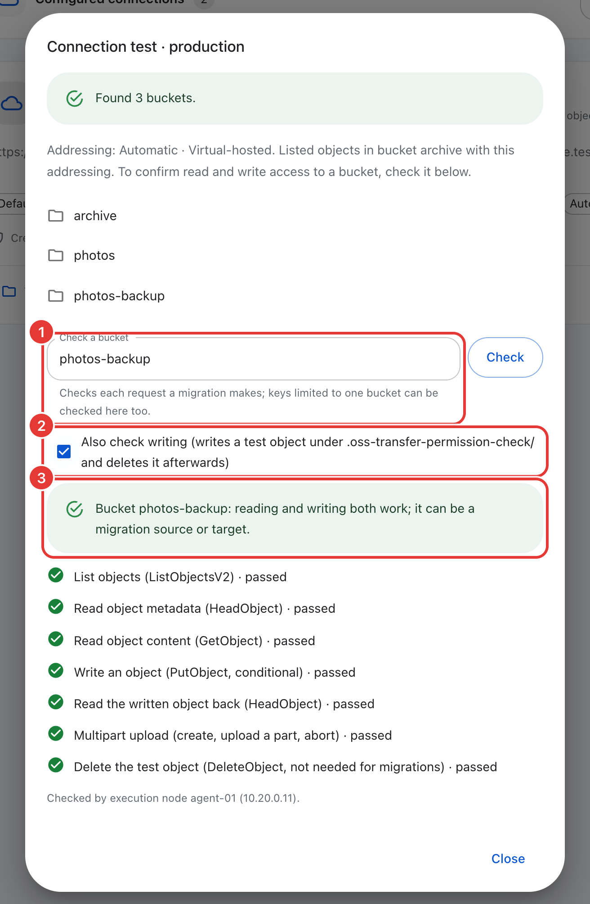

# Plan a migration

[中文](planning.zh-CN.md)

Read this page before you install. You need to settle several things: where to deploy the nodes, which ports to open, what permissions to grant the keys, how to estimate speed and disk usage, and how to plan the verification and the cut-over. Security settings are in [security](security.md).

## Checklist

1. Choose the hosts: one Master, and one or more execution nodes near the data (see [topology](#topology)).
2. Open the ports in the [network table](#network-and-firewall).
3. Create keys with only the [minimum permissions](#storage-permissions) for the source and the target.
4. Run a pilot task on a representative prefix to measure the actual speed (see [speed](#speed-and-what-limits-it)).
5. Change the defaults that slow down large migrations (see [defaults to review](#defaults-to-review-for-large-migrations)).
6. Plan the verification and the cut-over (see [verification](#verify-a-large-migration), [cut-over](#incremental-migration-and-cut-over)).

## Topology

| Component | How many | Where |
| --- | --- | --- |
| Master | One per cluster | A host reachable by the operators' browsers and all execution nodes |
| Execution node (Agent) | One or more | Hosts with good bandwidth to both the source and the target |

The Master provides the console and the API and schedules tasks. No object data passes through it, so it does not need to be near the data; it only needs to be reachable by the operators' browsers and all execution nodes. Execution nodes are different: each one reads from the source and writes to the target, so they should be deployed close to the data.

Every execution node in a task needs to reach both the source and the target storage endpoints. Each object is read once from the source and written once to the target; no matter which side the execution node is on, the data crosses the link between the two sites once. With the execution node in the source cloud, it reads through the internal endpoint and sends data out over the public internet to the target. With the execution node in the target cloud, it reads from the source over the public internet and writes through the internal endpoint. Compare the outbound traffic prices of the two providers in each direction and place the execution nodes on the side where the network is faster or traffic is cheaper.

Run only one execution node per host. Multiple execution nodes sharing a network card and disks contend for resources. To make better use of a larger host, raise that node's concurrency and limits instead of adding another execution node (see [defaults to review](#defaults-to-review-for-large-migrations)).

When migrating local directories, the path in the task is a path on the execution node's host. Run the execution node on the host that owns or mounts that directory. When multiple execution nodes work on the same local directory, it must be shared storage that every node mounts.

The Master does not support clustered deployment; back up its data directory (see [database maintenance](database-maintenance.md)). Execution nodes reconnect automatically after a Master restart. The native installer asks whether to install a local execution node on the Master host, which is convenient for small migrations. For large migrations, deploy execution nodes on other hosts so that transfers and the console do not compete for resources.

## Network and firewall

All connections are initiated by execution nodes. The Master never connects to an execution node, so execution nodes need no inbound ports.

| From | To | Port | Used for | Required |
| --- | --- | --- | --- | --- |
| Operators' browsers | Master | TCP 1685 (HTTP), or 443 behind an HTTPS reverse proxy | The console | Yes |
| `oss-transfer-cli` on another computer | Master | Same as the browser | Remote CLI use | Only for remote CLI |
| Execution nodes | Master | The address given in the join command | Commands, results and heartbeats (HTTP long polling) | Yes |
| Execution nodes | Source and target storage endpoints | Usually 443 (HTTPS) or 80; self-hosted S3 often uses its own port, such as 9000 | Transfers, connection checks, object comparison | Yes |
| New native execution nodes | Master, or GitHub / JD Cloud OSS (public or internal address) | 443 | Downloading the execution node package | During the join |
| New Docker execution nodes | Docker Hub (or your registry) | 443 | Pulling the `moonwx/osstransfer` image | During the join and updates |
| Master and native execution nodes | GitHub (`api.github.com`, `github.com`, `raw.githubusercontent.com`) or `moonwx.s3.cn-north-1.jdcloud-oss.com`, plus `www.cloudflare.com` | 443 | Update checks and online updates | Only for online updates |

The download source for native execution nodes during the join is shown in the **Add node** dialog. When downloading from the public internet, the installer also contacts `cloudflare.com` and `ipinfo.io` to detect the host's region, unless you specify the download source with `--source github`, `--source jdoss` or `--source jdoss-internal` (see [download sources](install.md#download-sources)). Execution nodes in the JD Cloud Beijing region can select **JD Cloud internal (Beijing)** in the dialog, which accesses only the internal address `moonwx.s3-internal.cn-north-1.jdcloud-oss.com`.

The Master listens on `0.0.0.0:1685` by default. To use a different port, pass `--port` to `install.sh`; to bind a specific address, pass `--listen HOST:PORT` (effective only on the first installation; see [installation options](install.md#paths-and-ports)).

The Master never contacts storage endpoints. Connection checks, bucket lists and object comparisons all run on execution nodes; the check when you save a connection is also run on an online execution node chosen by the Master. Add at least one execution node before you add storage connections, and make sure every execution node can reach every storage endpoint.

Hosts without internet access can use all features except online updates and public downloads. Install and upgrade them with [offline installation](offline-install.md). Execution nodes can also connect to the Master through an HTTPS reverse proxy; see [security](security.md#https-with-a-reverse-proxy) for the proxy settings.

## Storage permissions

Create separate keys for OSS Transfer, authorized only for the buckets involved in this migration. The tables below use AWS IAM action names; other S3-compatible services have their own corresponding permissions.

### Source bucket

| Action | Used for |
| --- | --- |
| `s3:ListBucket` | Listing the objects to transfer (ListObjectsV2), connection checks and object comparison |
| `s3:GetObject` | Reading objects (GetObject, including byte-range reads of large objects). On AWS it also authorizes HeadObject. |

### Target bucket

Which permissions the target needs depends on the chosen conflict policy and whether you use object comparison.

| Permission | When needed | Without it |
| --- | --- | --- |
| `s3:PutObject` | Always | Cannot write |
| `s3:AbortMultipartUpload` | When there are objects larger than 8 MiB | Leftover parts occupy storage and are billed |
| `s3:ListMultipartUploadParts` | Same as above | Cannot confirm that parts have been cleaned up |
| `s3:GetObject` | Skip or Overwrite changed policies; object comparison | Writes, verification and comparison all fail |
| `s3:ListBucket` | Connection checks and object comparison | The connection check only warns; new objects fail to be written under Skip or Overwrite changed; comparison is impossible |

`s3:PutObject` covers normal writes and multipart uploads (CreateMultipartUpload, UploadPart, CompleteMultipartUpload). Objects larger than 8 MiB use multipart uploads; when a part fails or is interrupted, `s3:AbortMultipartUpload` cleans up the leftover parts. Without this permission, leftover parts occupy storage and are billed, and the system retries the cleanup every 5 minutes. `s3:ListMultipartUploadParts` is used to confirm after an abort that all parts have been cleaned up (ListParts); without it the system retries the confirmation periodically.

With **Skip existing objects or files** (the default) or **Overwrite changed objects**, each object is checked with HEAD on the target before writing, to determine whether it already exists or has changed. After an execution node restart or a resumed task, objects written before the interruption are also verified with HEAD. Content comparison reads target objects too. All of this requires `s3:GetObject` on the target (on AWS it also authorizes HeadObject).

`s3:ListBucket` is used for connection checks (listing one object in the bucket) and object comparison. On AWS and similar services, without this permission a HEAD on a nonexistent object returns 403 instead of 404; combined with the two policies above, this causes new objects to fail to be written.

The three common minimal sets are as follows.

With the default policy (**Skip existing objects or files**) or for incremental migration (**Overwrite changed objects**), grant `s3:PutObject`, `s3:GetObject` and `s3:ListBucket`, plus `s3:AbortMultipartUpload` and `s3:ListMultipartUploadParts` when there are large objects.

With only **Overwrite existing objects or files** and without object comparison, normal writes need only `s3:PutObject` (plus the two multipart cleanup permissions for large objects). The verification after an execution node restart or a resumed task still requires HEAD, so `s3:GetObject` is still recommended.

For object comparison alone, grant `s3:ListBucket` and `s3:GetObject` on both buckets.

If you are not sure whether the permissions are sufficient, use the [per-permission check](#check-each-permission-of-a-bucket) in the connection test on the target bucket with the write check selected to verify.

`s3:ListAllMyBuckets` is optional. With this permission, connection checks and the console can list your buckets. Without it, you can still use the system; see [bucket-scoped keys](#bucket-scoped-keys-and-the-connection-check).

Migrations never delete objects or buckets, so `s3:DeleteObject` is not needed. The per-permission check with the write check selected attempts to delete the test object it wrote; without delete permission the check still reports its results. If you want to delete objects that exist only on the target (see [deletions at the source](#deletions-at-the-source)), use your provider's tools with a separate key.

Summary by direction:

| Direction | Source permissions | Target permissions |
| --- | --- | --- |
| Object storage → object storage | Source bucket table | Target bucket table |
| Object storage → local | Source bucket table | The execution node's service account can write the local directory |
| Local → object storage | The execution node's service account can read the local directory | Target bucket table |
| Object comparison | Both buckets need `s3:ListBucket` and `s3:GetObject` | |

A minimal AWS-style policy for the source key (replace `source-bucket` with the actual name):

```json
{
  "Version": "2012-10-17",
  "Statement": [
    {
      "Effect": "Allow",
      "Action": ["s3:ListBucket"],
      "Resource": "arn:aws:s3:::source-bucket"
    },
    {
      "Effect": "Allow",
      "Action": ["s3:GetObject"],
      "Resource": "arn:aws:s3:::source-bucket/*"
    }
  ]
}
```

For the target key, covering the default conflict policy, incremental migration and object comparison (replace `target-bucket` with the actual name):

```json
{
  "Version": "2012-10-17",
  "Statement": [
    {
      "Effect": "Allow",
      "Action": ["s3:ListBucket"],
      "Resource": "arn:aws:s3:::target-bucket"
    },
    {
      "Effect": "Allow",
      "Action": [
        "s3:GetObject",
        "s3:PutObject",
        "s3:AbortMultipartUpload",
        "s3:ListMultipartUploadParts"
      ],
      "Resource": "arn:aws:s3:::target-bucket/*"
    }
  ]
}
```

To list buckets, add a statement with `"Action": ["s3:ListAllMyBuckets"]` and `"Resource": "*"`. On AWS, buckets encrypted with SSE-KMS also need `kms:Decrypt` on the source key and `kms:GenerateDataKey` on the target key in the KMS key policy.

### Bucket-scoped keys and the connection check

A connection check (saving with **Validate access when saving**, **Test connection**, **Fetch buckets**, `storage test` or `storage buckets`) first lists the buckets (ListBuckets), then lists at most one object (ListObjectsV2) in one bucket using the connection's addressing: the bucket you specify, or the first one listed.

Keys authorized for only a single bucket usually cannot list buckets. In that case the connection is still saved, with a warning rather than an error. Check the bucket separately: in the console, open **Test connection**, enter the bucket name under **Check a bucket** and choose **Check**; from the CLI, run `oss-transfer-cli storage test <connection> --bucket <bucket>`.

The check passes when it reports that objects have been listed in that bucket. The result of each permission is described in the next section. When creating a task, enter the bucket name directly. If listing the objects in that bucket is also denied, the connection is still saved with a warning, but transfers from that bucket will fail; fix the permissions first.

Automatic addressing and the bucket-level check run on the execution node and require Agents on v4.1.42. Older execution nodes only list buckets.

### Check each permission of a bucket

In **Test connection**, enter a bucket name under **Check a bucket** and choose **Check** (CLI: `oss-transfer-cli storage test <connection> --bucket <bucket>`). It executes, on that bucket, each request a migration uses, and shows for each one whether it passed, failed or was skipped, together with a one-sentence conclusion (for example, "reading works; it can be a migration source").

<p align="center"></p>

| Check | Request | Used by migrations to |
| --- | --- | --- |
| List objects | ListObjectsV2 | Scan the source, compare |
| Read object metadata | HeadObject (first listed object) | Determine whether the target exists, verify results |
| Read object content | GetObject, only 1 byte | Read source objects |
| Write an object (with the write check selected, CLI `--write`) | PutObject with `If-None-Match: *` | Write to the target; "Skip existing objects" uses this conditional write |
| Read back the written object | HeadObject | Verify after writing |
| Multipart upload | CreateMultipartUpload, UploadPart, AbortMultipartUpload | Upload and clean up large objects |
| Delete the test object | DeleteObject | Not needed for migrations; only removes the test object |

The write check writes a very small test object under `.oss-transfer-permission-check/` and deletes it afterwards. The multipart upload is aborted after the check and leaves no data. Without delete permission, the result shows the key of the leftover test object so you can delete it manually. When the bucket is empty, reading objects cannot be checked and shows as skipped. In the CLI, the command exits with code 1 when any required check fails. This check requires a Master and Agents on v4.1.43 or later.

## Speed and what limits it

Migration speed is determined by the most restrictive limit. The defaults per execution node are:

| Limit | Default | Effect |
| --- | --- | --- |
| Node bandwidth | 2,000 Mbps | Data read from the source |
| LIST requests | 100 per second | Listing the source (and object comparison) |
| PUT requests | 1,400 per second | At least one per written object or part |
| HEAD requests | 2,800 per second | Metadata checks |
| Concurrency | 32 child tasks x 4 objects each = 128 objects at once | Number of objects processed simultaneously |
| Storage service | Set by the provider | Per-bucket or per-prefix request limits, throttling (`SlowDown`), latency |
| Network | Your hosts and links | Bandwidth and round-trip time to each storage endpoint |

These defaults are explained in [node concurrency](operations.md#node-concurrency) and [node limits](operations.md#node-limits). A task can set lower task-level limits; when the storage service throttles, execution nodes slow down automatically (see [storage throttling](operations.md#storage-throttling)).

Small objects are limited mainly by request rates and latency; large objects are limited mainly by bandwidth. Speed depends on the provider, the region and the object sizes. There is no universal figure; measure it yourself:

1. Choose a prefix whose object size distribution is representative of the overall data and create a pilot task.
2. In the task details, observe the speed and the actual rates and limits for LIST, GET, HEAD and PUT. Whichever rate consistently approaches its limit is the bottleneck.
3. Estimate the duration: take the larger of *total bytes / measured bytes per second* and *object count / measured objects per second*.
4. Estimate the number of execution nodes: the required rate divided by one execution node's measured rate, rounded up, provided the storage service allows that total rate.

### Defaults to review for large migrations

| Setting | Default | When to change | How |
| --- | --- | --- | --- |
| Node bandwidth | 2,000 Mbps | The host has 10 Gbps or more | **Execution nodes → Live status → Adjust**, or `oss-transfer-cli limit set bandwidth 8 --unit Gbps --all` |
| Node LIST / PUT / HEAD limits | 100 / 1,400 / 2,800 per second | Many small objects and the provider allows higher rates | **Adjust**, or `limit set list 500 --all` |
| Child task concurrency and objects per child task | 32 and 4 | High latency or small objects leave bandwidth unused (maximum 256, 64, for a total of 1,024 objects) | **Execution nodes → Edit node**, or `node update <node> --child-concurrency 64 --object-concurrency 8` |
| Comparison result budget | 2 GiB per execution node, kept 30 days | You expect many differences | `comparison` in the execution node's `service.json` (see [result storage](operations.md#result-storage-and-retention)) |

Raise one setting at a time and observe the throttling status and error rate before deciding the next step.

## Disk and database

| Where | What grows | Planning guidance |
| --- | --- | --- |
| Master data directory (`/opt/oss-transfer/master/data` on Linux) | `master.db`: tasks, child tasks and their results | Grows with the number of objects, not their size |
| Execution node data directory (`/opt/oss-transfer/agent/data`) | `agent.db`: scan and execution records; `spool`: parts of large objects that do not fit in memory; `comparisons`: object comparison results | Records grow with the number of objects; the space limit for comparison results is described below |
| Local download destination | The files themselves, plus temporary files in a hidden `.oss-transfer-staging-…` directory | Allow room for the data plus the objects currently in flight. The download preflight shows the available space |

Object comparison results take up to 2 GiB per execution node by default (about 8 million differences with 40-byte keys). When less than 1 GiB of free space would remain, the system stops saving difference details.

There is no fixed "space per object" figure. The most reliable approach is to measure during the pilot: note the size of `master.db` and `agent.db` before and after, divide by the number of objects, and scale to the full dataset with a safety margin.

These records are kept until the task is permanently deleted; stopping a task or moving it to the trash does not remove them. Freed space is reused by later records, but the database file itself does not shrink. Shrinking the file requires offline compaction, which needs enough room for a full copy of the database (see [database maintenance](database-maintenance.md#reclaim-disk-space)).

## Verify a large migration

Use [object comparison](operations.md#compare-objects) to verify the data after migration (**Tools → Compare objects**, or `oss-transfer-cli object compare`). It has two modes.

Metadata mode sends one HEAD request per object on each side and compares size, content-related headers and custom metadata, without reading content. Use it for all objects.

Content mode reads both objects in full and compares SHA-256. Both sides are read, which may incur charges. Use it for samples, such as a few prefixes or your most important data.

When there are many objects, split by prefix to speed up the process. Each execution node runs only one comparison at a time, and each comparison runs on only one node. Start one comparison per prefix; the Master assigns each to an idle execution node, so multiple prefixes run in parallel.

Do not run comparisons at the same time as migration tasks, because they share the node's rate and bandwidth limits. Run comparisons after the copy completes, or use execution nodes that have no migration tasks.

One comparison stores at most the execution node's budget (2 GiB by default) of differences; beyond that it continues counting but stops saving difference details. If this happens, narrow the prefix range or raise the budget.

When exporting results, confirm that `summary.json` in the ZIP has `complete: true`. When the export is incomplete, `object export` exits with status code 3.

If there are inconsistent objects, the export's `retry-source-keys.incr` lists the missing or inconsistent keys. Import it with `import-inventory ... --overwrite` to transfer these objects again (see [export results](operations.md#export-results)).

In the task details of an object storage to object storage task, **Compare source and target** opens the comparison form pre-filled with the task's buckets and prefixes.

## Incremental migration and cut-over

During a large-scale copy, the data usually continues to change. The approach is to copy in rounds and stop writes only during the last, short round.

### What each conflict policy does with existing objects

| Conflict policy | `--conflict` | An object that already exists on the target |
| --- | --- | --- |
| Skip existing objects or files (default) | `skip` | Skipped by name only. Objects modified at the source remain the old version on the target. |
| Overwrite changed objects | `changed` | Overwritten when it appears changed (rules below); otherwise skipped |
| Overwrite existing objects or files | `overwrite` | Always copied again |

**Overwrite changed objects** decides from the metadata of the listing and one HEAD request, without reading content. It overwrites the target object when any of the following conditions is met:

- The sizes on the two sides differ.
- Both ETags are plain MD5 ETags (32 hexadecimal digits) and they differ.
- The source's Last-Modified time is later than the target's.

Otherwise the object is skipped and counted as skipped.

This policy has several limitations. If an object is modified at the source without a change in size, has a multipart ETag (`…-N`) or another non-MD5 format, and its Last-Modified time is not later than the target's, the policy cannot detect the change. Multipart ETags and the fingerprints of local files are never compared.

Encryption can make all objects appear changed. With SSE-KMS or SSE-C, and on some providers, ETags look like MD5 values but are not the MD5 of the content. Source and target ETags then differ for identical objects, and the policy copies them all again, equivalent to **Overwrite existing objects or files**. Verify with a pilot first: if almost no objects are skipped in a second round, this is the cause.

The comparison is between two systems' clocks. The source's Last-Modified time comes from the source service and the target's from the target service. A target copy normally has a later time (the time it was written), so the Last-Modified rule fires only when an object has already been copied to the target and is then modified at the source. A clock that is far off on either side can cause extra copies or missed changes.

This policy requires Agents on v4.1.42. The Master refuses the policy when a selected execution node's version is too old.

### Runbook

1. Perform the full copy. Create migration tasks, for example by bucket or top-level prefix:

   ```sh
   oss-transfer-cli task create oss-to-oss source/photos target/photos --conflict changed
   ```

   Wait until the task reaches **Completed**. Retry failed objects from **Exceptions**.
2. Run incremental rounds. Create the same task again with **Overwrite changed objects** (`--conflict changed`). Each round lists the entire source again and checks each existing object, copying only new and changed objects. Repeat until a round is short enough to fit in your maintenance window. To reduce the listing scope, you can add **Modified after** (`--date-after`), which filters by the source's Last-Modified time interpreted in the server's time zone. Choose a time well before the previous round started, to allow for clock differences.
3. Freeze writes at the source. Stop the applications from writing, or switch them to read-only.
4. Run the final round. Run one more round with **Overwrite changed objects** and wait until it reaches **Completed** with no failed objects.
5. Verify. Run a metadata comparison for each prefix and content comparisons for samples (see [verification](#verify-a-large-migration)). A result of **No differences found** means all objects match. If objects are missing or inconsistent, export the comparison results, transfer `retry-source-keys.incr` again with `import-inventory ... --overwrite`, and compare again.
6. Switch the applications to the target endpoint, bucket and keys.
7. Keep the source read-only until you are sure you no longer need it.

### Deletions at the source

OSS Transfer only copies; it never deletes. Objects deleted at the source between rounds remain on the target. If an object is deleted from the source after the task has scanned it, the task counts it as skipped, with the reason `SOURCE_DELETED` in the report.

To find objects that exist only on the target, run an object comparison of the same scope after the final round. These objects appear as **Only on target** (`EXTRA_TARGET`). View them with `oss-transfer-cli object status <comparison-id> --status EXTRA_TARGET`, or export them with `object export <comparison-id> --output extra.zip --status EXTRA_TARGET` and read `differences.csv`. Delete them with your provider's tools when you need both sides to be identical.

## Mixed versions

Before a large migration, update all execution nodes to the same version as the Master (see [software updates](operations.md#software-updates)). Older execution nodes continue to work, but with two limitations. First, connections without an explicitly chosen addressing method use Virtual-hosted on execution nodes before v4.1.42, and their connection checks only list buckets. Second, the Master does not allow **Overwrite changed objects** on execution nodes before v4.1.42.
