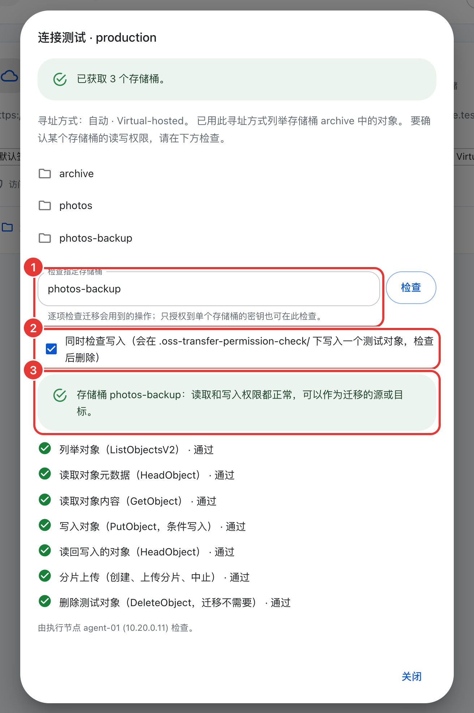

# 规划迁移

[English](planning.md)

安装之前先读这一页。你需要确认几件事：节点部署在哪里、端口如何开放、密钥授予什么权限，还要估算速度和磁盘用量、确定验收和切换的方案。安全相关的设置在[安全说明](security.zh-CN.md)。

## 准备清单

1. 选好主机：一个 Master，加上一个或多个靠近数据的执行节点（见[部署拓扑](#部署拓扑)）。
2. 按[网络表](#网络与防火墙)开放端口。
3. 为源端和目标端分别创建只有[最小权限](#存储权限)的密钥。
4. 用一个有代表性的前缀试迁移，测出实际速度（见[速度](#迁移速度及其限制)）。
5. 调整拖慢大规模迁移的默认值（见[需要检查的默认值](#大规模迁移需要检查的默认值)）。
6. 规划验收和切换（见[验收](#验收大规模迁移)、[切换](#增量迁移与切换)）。

## 部署拓扑

| 组件 | 数量 | 部署位置 |
| --- | --- | --- |
| Master | 每个集群一个 | 浏览器和所有执行节点都能访问到的主机 |
| 执行节点（Agent） | 一个或多个 | 到源端和目标端带宽都较好的主机 |

Master 提供管理页面和 API，负责调度任务，对象数据不经过它，所以它不必靠近数据，只要浏览器和所有执行节点都能访问到。执行节点不同，它从源端读取、向目标端写入，因此需要部署在靠近数据的位置。

任务中的每个执行节点都需要能访问源端和目标端两个存储端点。每个对象从源端读一次、向目标端写一次，无论执行节点放在哪边，数据都要跨一次两地之间的链路。放在源端云内，通过内网端点读取，再经公网出口写到目标端。放在目标端云内则反过来，公网从源端读，内网写入。比较两家服务商这两个方向出流量的价格，把执行节点放在网络更快或流量更便宜的一侧。

一台主机上只运行一个执行节点。多个执行节点共用网卡和磁盘，互相争用资源。要更充分地利用大规格主机，提高该节点的并发和限速即可，不要再加一个执行节点（见[需要检查的默认值](#大规模迁移需要检查的默认值)）。

迁移本地目录时，任务中的路径是执行节点所在主机上的路径。你需要在拥有或挂载了该目录的主机上运行执行节点。多个执行节点处理同一个本地目录，这个目录必须是每个节点都挂载了的共享存储。

Master 不支持集群部署，应当备份它的数据目录（见[数据库维护](database-maintenance.zh-CN.md)）。Master 重启后，执行节点自动重连。原生安装器会询问你是否在 Master 主机上安装一个本机执行节点，小规模迁移时比较方便。大规模迁移应当把执行节点部署到其他主机上，避免传输和管理页面争用资源。

## 网络与防火墙

所有连接都由执行节点主动发起，Master 从不连接执行节点。执行节点不需要开放入站端口。

| 来源 | 目标 | 端口 | 用途 | 是否必需 |
| --- | --- | --- | --- | --- |
| 运维人员的浏览器 | Master | TCP 1685（HTTP），或 HTTPS 反向代理的 443 | 管理页面 | 必需 |
| 其他电脑上的 `oss-transfer-cli` | Master | 与浏览器相同 | 远程使用 CLI | 仅远程使用 CLI 时 |
| 执行节点 | Master | 加入指令中填写的地址 | 命令、结果和心跳（HTTP 长轮询） | 必需 |
| 执行节点 | 源端和目标端的存储端点 | 通常为 443（HTTPS）或 80；自建 S3 常用自己的端口，例如 9000 | 传输、连接检查、对象比对 | 必需 |
| 新加入的原生执行节点 | Master，或 GitHub / 京东云 OSS（公网或内网地址） | 443 | 下载执行节点安装包 | 加入时 |
| 新加入的 Docker 执行节点 | Docker Hub（或你的镜像仓库） | 443 | 拉取 `moonwx/osstransfer` 镜像 | 加入和更新时 |
| Master 和原生执行节点 | GitHub（`api.github.com`、`github.com`、`raw.githubusercontent.com`）或 `moonwx.s3.cn-north-1.jdcloud-oss.com`，以及 `www.cloudflare.com` | 443 | 检测更新和在线更新 | 仅在线更新时 |

原生执行节点加入时的下载来源显示在 **添加节点** 窗口中。从公网下载时，安装器还访问 `cloudflare.com` 和 `ipinfo.io` 判断主机所在地区，除非用 `--source github`、`--source jdoss` 或 `--source jdoss-internal` 指定下载源（见[下载源](install.zh-CN.md#下载源)）。位于京东云华北-北京地域的执行节点可以在窗口中选择 **京东云内网（华北-北京）**，只访问内网地址 `moonwx.s3-internal.cn-north-1.jdcloud-oss.com`。

Master 默认监听 `0.0.0.0:1685`。要换端口，给 `install.sh` 加 `--port`；要只监听某个地址，加 `--listen HOST:PORT`（仅首次安装时有效，见[安装选项](install.zh-CN.md#路径和端口)）。

Master 从不访问存储端点。连接检查、存储桶列表、对象比对都在执行节点上运行，保存连接时的检查也由 Master 选定一个在线执行节点执行。因此要先添加至少一个执行节点，再添加存储连接，并确保每个执行节点都能访问每个存储端点。

不能访问公网的主机，除了在线更新和从公网下载，其他功能都可以使用。安装和升级按[离线安装](offline-install.zh-CN.md)操作。执行节点也能通过 HTTPS 反向代理连接 Master，代理设置见[安全说明](security.zh-CN.md#用反向代理提供-https)。

## 存储权限

给 OSS Transfer 单独创建密钥，只授权到这次迁移涉及的存储桶。下面用 AWS IAM 的操作名，其他 S3 兼容服务有各自对应的权限。

### 源端存储桶

| 操作 | 用途 |
| --- | --- |
| `s3:ListBucket` | 列举要迁移的对象（ListObjectsV2）、连接检查和对象比对 |
| `s3:GetObject` | 读取对象（GetObject，包括大对象的分段读取）。在 AWS 上它同时授权 HeadObject。 |

### 目标端存储桶

目标端需要哪些权限，取决于所选的冲突策略和是否做对象比对。

| 权限 | 何时需要 | 没有时 |
| --- | --- | --- |
| `s3:PutObject` | 始终 | 无法写入 |
| `s3:AbortMultipartUpload` | 有大于 8 MiB 的对象时 | 残留分片占存储并计费 |
| `s3:ListMultipartUploadParts` | 同上 | 无法确认分片已清理 |
| `s3:GetObject` | 跳过或覆盖有变化的策略；对象比对 | 写入、核对和比对均失败 |
| `s3:ListBucket` | 连接检查和对象比对 | 连接检查只给警告；用跳过或覆盖有变化的策略时新对象写入失败；无法比对 |

`s3:PutObject` 涵盖普通写入和分片上传（CreateMultipartUpload、UploadPart、CompleteMultipartUpload）。大于 8 MiB 的对象使用分片上传，失败或中断时靠 `s3:AbortMultipartUpload` 清理残留分片。没有这个权限，残留分片占用存储并计费，系统每 5 分钟重试一次清理。`s3:ListMultipartUploadParts` 用于在中止后确认分片已清理完毕（ListParts），没有这个权限时系统也会定期重试确认。

用 **跳过同名对象或文件**（默认）或 **覆盖有变化的对象** 时，每个对象写入前先 HEAD 目标端，判断是否已存在、是否有变化。执行节点重启或任务恢复后，也要 HEAD 核对中断前已写入的对象。做内容比对时还要读取目标对象。这些都需要目标端的 `s3:GetObject`（在 AWS 上它同时授权 HeadObject）。

`s3:ListBucket` 用于连接检查（在存储桶中列举一个对象）和对象比对。在 AWS 等服务上，如果没有这个权限，对不存在的对象 HEAD 返回 403 而不是 404，配合上面两种策略就会导致新对象写入失败。

下面是三种常见的最小组合。

用默认策略（**跳过同名对象或文件**）或做增量迁移（**覆盖有变化的对象**），给 `s3:PutObject`、`s3:GetObject`、`s3:ListBucket`，有大对象时再加 `s3:AbortMultipartUpload` 和 `s3:ListMultipartUploadParts`。

只用 **覆盖同名对象或文件** 且不做对象比对，正常写入只需要 `s3:PutObject`（大对象加上两个分片清理权限）。但执行节点重启或任务恢复后的核对仍要 HEAD，仍建议给 `s3:GetObject`。

只做对象比对，两端都给 `s3:ListBucket` 和 `s3:GetObject`。

如果不确定权限是否足够，可以用连接测试里的[逐项检查存储桶权限](#逐项检查存储桶权限)在目标存储桶上勾选写入检查，实际验证一次。

`s3:ListAllMyBuckets` 是可选的，有这个权限时连接检查和管理页面能列出你的存储桶。没有这个权限也可以使用，见[只授权到单个存储桶的密钥](#只授权到单个存储桶的密钥与连接检查)。

迁移从不删除对象或存储桶，所以不需要 `s3:DeleteObject`。逐项检查中勾选写入检查时，会尝试删除它写入的测试对象，没有删除权限也不影响检查结果。如果要删除只存在于目标端的对象（见[源端删除](#源端删除的对象)），用服务商的工具和另一把密钥操作。

按迁移方向汇总：

| 方向 | 源端权限 | 目标端权限 |
| --- | --- | --- |
| 对象存储 → 对象存储 | 源端存储桶表 | 目标端存储桶表 |
| 对象存储 → 本地 | 源端存储桶表 | 执行节点的服务账号可写入本地目录 |
| 本地 → 对象存储 | 执行节点的服务账号可读取本地目录 | 目标端存储桶表 |
| 对象比对 | 两个存储桶都需要 `s3:ListBucket` 和 `s3:GetObject` | |

源端密钥的最小 AWS 风格策略（把 `source-bucket` 替换为实际名称）：

```json
{
  "Version": "2012-10-17",
  "Statement": [
    {
      "Effect": "Allow",
      "Action": ["s3:ListBucket"],
      "Resource": "arn:aws:s3:::source-bucket"
    },
    {
      "Effect": "Allow",
      "Action": ["s3:GetObject"],
      "Resource": "arn:aws:s3:::source-bucket/*"
    }
  ]
}
```

目标端密钥，适用于默认冲突策略、增量迁移和对象比对（把 `target-bucket` 替换为实际名称）：

```json
{
  "Version": "2012-10-17",
  "Statement": [
    {
      "Effect": "Allow",
      "Action": ["s3:ListBucket"],
      "Resource": "arn:aws:s3:::target-bucket"
    },
    {
      "Effect": "Allow",
      "Action": [
        "s3:GetObject",
        "s3:PutObject",
        "s3:AbortMultipartUpload",
        "s3:ListMultipartUploadParts"
      ],
      "Resource": "arn:aws:s3:::target-bucket/*"
    }
  ]
}
```

需要列出存储桶时，再加一条 `"Action": ["s3:ListAllMyBuckets"]`、`"Resource": "*"` 的语句。在 AWS 上，使用 SSE-KMS 加密的存储桶还需要在 KMS 密钥策略中给源端密钥 `kms:Decrypt`、给目标端密钥 `kms:GenerateDataKey`。

### 只授权到单个存储桶的密钥与连接检查

连接检查会先列举存储桶（ListBuckets），再用该连接的寻址方式在一个存储桶中最多列举一个对象（ListObjectsV2）。指定了存储桶就检查该存储桶，未指定则检查列出的第一个。触发连接检查的操作有：勾选 **保存时验证访问权限** 后保存、**测试连接**、**获取存储桶列表**，以及 CLI 的 `storage test` 和 `storage buckets`。

只授权到单个存储桶的密钥通常无权列举存储桶。这时连接仍然保存，只显示警告而不是报错。接下来你要单独检查这个存储桶：在管理页面打开 **测试连接**，在 **检查指定存储桶** 中填写存储桶名称，点击 **检查**；或者用 CLI：`oss-transfer-cli storage test <连接名> --bucket <存储桶>`。

结果表明已列举该存储桶中的对象，即为通过。各项权限的结果见下一节。创建任务时直接填写存储桶名称。如果连该存储桶中的对象都无法列举，连接仍然保存并显示警告，但从该存储桶迁移必定失败，应先修正权限再继续。

自动寻址和存储桶级检查由执行节点完成，需要 v4.1.42 的执行节点。旧版执行节点只列举存储桶。

### 逐项检查存储桶权限

在 **测试连接** 的 **检查指定存储桶** 中填写存储桶名称，点击 **检查**（CLI：`oss-transfer-cli storage test <连接名> --bucket <存储桶>`）。它在这个存储桶上依次执行迁移用到的请求，逐项显示通过、未通过或跳过，并给出一句结论，例如“读取权限正常，可以作为迁移的源”。

<p align="center"></p>

| 检查项 | 请求 | 迁移中的用途 |
| --- | --- | --- |
| 列举对象 | ListObjectsV2 | 扫描源，比对 |
| 读取对象元数据 | HeadObject（列出的第一个对象） | 判断目标是否已存在，核对结果 |
| 读取对象内容 | GetObject，只读 1 个字节 | 读取源对象 |
| 写入对象（勾选写入检查，CLI 加 `--write`） | 带 `If-None-Match: *` 的 PutObject | 写入目标；“跳过同名对象”使用这种条件写入 |
| 读回写入的对象 | HeadObject | 写入后核对 |
| 分片上传 | CreateMultipartUpload、UploadPart、AbortMultipartUpload | 大对象的上传与清理 |
| 删除测试对象 | DeleteObject | 迁移不需要，只用来清理测试对象 |

写入检查在 `.oss-transfer-permission-check/` 下写入一个很小的测试对象，检查后删除。分片上传检查后中止，不留下数据。没有删除权限时，结果给出遗留测试对象的 Key，手动删除即可。存储桶为空时无法检查读取对象，显示为跳过。CLI 中任一必需项未通过时退出码为 1。这项检查需要 v4.1.43 及以上的 Master 和执行节点。

## 迁移速度及其限制

迁移速度由最严格的一项限制决定。下面是每个执行节点的默认值：

| 限制 | 默认值 | 影响 |
| --- | --- | --- |
| 节点带宽 | 2,000 Mbps | 从源端读取的数据 |
| LIST 请求 | 每秒 100 次 | 列举源端（以及对象比对） |
| PUT 请求 | 每秒 1,400 次 | 每写入一个对象或分片至少一次 |
| HEAD 请求 | 每秒 2,800 次 | 元数据检查 |
| 并发 | 32 个子任务 × 每个 4 个对象 = 同时 128 个对象 | 同时处理的对象数 |
| 存储服务 | 由服务商决定 | 按存储桶或前缀的请求上限、限流（`SlowDown`）、延迟 |
| 网络 | 你的主机和链路 | 到各存储端点的带宽和往返时间 |

这些默认值的说明见[节点并发](operations.zh-CN.md#节点并发)和[节点限速](operations.zh-CN.md#节点限速)。任务可以设置更低的任务限速；存储服务限流时，执行节点自动降速（见[存储限流](operations.zh-CN.md#存储限流)）。

小对象主要受请求数和延迟限制，大对象主要受带宽限制。速度取决于服务商、地域和对象大小，没有通用的数字，需要实际测量：

1. 选择一个对象大小分布能代表整体数据的前缀，创建试迁移任务。
2. 在任务详情中观察速度，查看 LIST、GET、HEAD、PUT 的实际速率和上限。哪一项速率持续接近上限，哪一项就是瓶颈。
3. 估算耗时：取 *总字节数 ÷ 实测每秒字节数* 和 *对象数 ÷ 实测每秒对象数* 中较大的一个。
4. 估算执行节点数量：所需速率除以单个执行节点的实测速率，向上取整。前提是存储服务允许达到这一总速率。

### 大规模迁移需要检查的默认值

| 设置 | 默认值 | 何时调整 | 方法 |
| --- | --- | --- | --- |
| 节点带宽 | 2,000 Mbps | 主机带宽达到 10 Gbps 或更高 | **执行节点 → 实时状态 → 调整**，或 `oss-transfer-cli limit set bandwidth 8 --unit Gbps --all` |
| 节点 LIST / PUT / HEAD 上限 | 每秒 100 / 1,400 / 2,800 次 | 小对象很多，且服务商允许更高速率 | **调整**，或 `limit set list 500 --all` |
| 子任务并发和每个子任务的对象数 | 32 和 4 | 延迟高或对象小，带宽没有用满（最多 256、64，合计 1,024 个对象） | **执行节点 → 编辑节点**，或 `node update <节点> --child-concurrency 64 --object-concurrency 8` |
| 对象比对结果预算 | 每个执行节点 2 GiB，保留 30 天 | 预计会有大量差异 | 执行节点 `service.json` 中的 `comparison`（见[结果的保存和清理](operations.zh-CN.md#结果的保存和清理)） |

每次只调高一项，观察限流状态和错误率再决定下一步。

## 磁盘与数据库

| 位置 | 增长的内容 | 规划建议 |
| --- | --- | --- |
| Master 数据目录（Linux 上为 `/opt/oss-transfer/master/data`） | `master.db`：任务、子任务及其结果 | 随对象数量增长，与对象大小无关 |
| 执行节点数据目录（`/opt/oss-transfer/agent/data`） | `agent.db`：扫描和执行记录；`spool`：内存放不下的大对象分片；`comparisons`：对象比对结果 | 记录随对象数量增长，比对结果的空间限制见下文 |
| 下载到本地的目标目录 | 文件本身，以及隐藏目录 `.oss-transfer-staging-…` 中的临时文件 | 预留数据量加上正在传输的对象的空间。下载预检显示可用空间 |

对象比对结果默认每个执行节点最多占 2 GiB（键长 40 字节时约 800 万条差异）。剩余空间不足 1 GiB 时停止保存差异明细。

没有固定的“每个对象占多少空间”这样的数字。在试迁移中实际测量最为可靠：记录 `master.db` 和 `agent.db` 迁移前后的大小，除以对象数，再按全部数据量估算并留出余量。

这些记录保留到永久删除任务为止，停止任务或把任务移到回收站都不清理。释放的空间留给后续记录复用，数据库文件本身不缩小。缩小文件需要做离线压缩，而压缩需要能容纳一份完整数据库副本的空间（见[数据库维护](database-maintenance.zh-CN.md#回收磁盘空间)）。

## 验收大规模迁移

用[对象比对](operations.zh-CN.md#对象比对)核对迁移后的数据（**运维工具 → 对象比对**，或 `oss-transfer-cli object compare`）。它有两种模式：

元数据模式对每个对象在两端各发一次 HEAD 请求，比较大小、内容相关的头和自定义元数据，不读取内容。用于全部对象。

内容模式完整读取两端对象并比较 SHA-256。两端都要读，可能产生费用。用于抽样，例如几个前缀或最重要的数据。

对象很多时，按前缀拆分来加速。每个执行节点同一时间只运行一个比对，一个比对也只在一个节点上运行。为每个前缀各启动一个比对，Master 把它们分到空闲的执行节点上，多个前缀就能并行。

不要和迁移任务同时运行比对，因为它们共用节点限速。在复制完成后再比对，或者使用没有迁移任务的执行节点。

一个比对最多保存执行节点预算（默认 2 GiB）大小的差异，超出后继续计数但不再保存差异明细。遇到这种情况，应缩小前缀范围或提高预算。

导出结果时，确认 ZIP 中 `summary.json` 的 `complete: true`。导出不完整时，`object export` 以状态码 3 退出。

如果存在不一致的对象，导出文件中的 `retry-source-keys.incr` 列出了缺失或不一致的 Key，用 `import-inventory ... --overwrite` 导入，重新迁移这些对象即可（见[导出结果](operations.zh-CN.md#导出结果)）。

在对象存储 → 对象存储任务的详情中，点击 **比对源和目标** 打开已填好该任务存储桶和前缀的比对表单。

## 增量迁移与切换

大规模数据在复制过程中通常还在变化。做法是分轮复制，只在最后一轮短时间停写。

### 各冲突策略如何处理已存在的对象

| 冲突策略 | `--conflict` | 目标端已存在的对象 |
| --- | --- | --- |
| 跳过同名对象或文件（默认） | `skip` | 只按名称判断并跳过。源端修改过的对象在目标端仍是旧版本。 |
| 覆盖有变化的对象 | `changed` | 看起来有变化时覆盖（规则见下），否则跳过 |
| 覆盖同名对象或文件 | `overwrite` | 一律重新复制 |

**覆盖有变化的对象** 只根据列举结果中的元数据和一次 HEAD 请求做判断，不读取内容。满足以下任一条件时覆盖目标端对象：

- 两端大小不同
- 两端 ETag 都是普通的 MD5 ETag（32 位十六进制）且不同
- 源端的 Last-Modified 时间晚于目标端

否则跳过，计入已跳过。

这个策略有几处局限。如果源端对象修改后大小未变，ETag 又是分片上传的格式（`…-N`）或其他非 MD5 形式，Last-Modified 也不晚于目标端，该策略无法发现这种变化。分片上传的 ETag 和本地文件的指纹从不参与比较。

加密可能让所有对象都像有变化。使用 SSE-KMS 或 SSE-C 时，以及在某些服务商上，ETag 看起来像 MD5，实际上不是内容的 MD5。相同的对象两端 ETag 也不同，于是全部重新复制，效果等同 **覆盖同名对象或文件**。先通过试迁移验证：如果第二轮几乎没有跳过对象，原因就在这里。

比较的是两个系统的时钟。源端的 Last-Modified 来自源端服务，目标端的来自目标端服务。目标端副本的时间通常更晚（即写入时间），所以 Last-Modified 这一条只在对象已经复制到目标端之后、源端又修改了这个对象时才起作用。任一端时钟偏差很大，都可能导致多余的复制或遗漏修改。

这个策略需要 v4.1.42 的执行节点。所选执行节点版本过旧时，Master 会拒绝使用这个策略。

### 操作步骤

1. 做全量复制。创建迁移任务，例如按存储桶或顶层前缀划分：

   ```sh
   oss-transfer-cli task create oss-to-oss source/photos target/photos --conflict changed
   ```

   等任务变为 **已完成**。在 **异常记录** 中重试失败的对象。
2. 执行增量轮次。用 **覆盖有变化的对象**（`--conflict changed`）再次创建相同的任务。每一轮重新列举整个源端并检查每个已存在的对象，只复制新增和有变化的。重复执行，直到一轮的耗时短到能放进维护窗口。如果想减少列举范围，可以加 **修改时间晚于**（`--date-after`），它按源端的 Last-Modified 过滤，时间按服务端时区解释。选择一个明显早于上一轮开始的时间，留出时钟偏差的余量。
3. 停写源端。让应用停止写入，或切换为只读。
4. 执行最后一轮。再用 **覆盖有变化的对象** 运行一轮，等它变为 **已完成** 且没有失败对象。
5. 验收。对每个前缀做元数据比对，并对抽样做内容比对（见[验收](#验收大规模迁移)）。结果显示 **未发现差异**，说明全部对象一致。如果有缺失或不一致的对象，导出比对结果，用 `import-inventory ... --overwrite` 重新迁移 `retry-source-keys.incr`，然后再比对一次。
6. 切换应用到目标端的端点、存储桶和密钥。
7. 确定不再需要之前，保持源端只读。

### 源端删除的对象

OSS Transfer 只复制，从不删除。两轮之间在源端删除的对象留在目标端。如果某个对象在任务扫描到它之后才从源端删除，任务把它计为已跳过，报告中的原因是 `SOURCE_DELETED`。

要找出只存在于目标端的对象，在最后一轮之后对相同范围做一次对象比对。这些对象显示为 **目标多余**（`EXTRA_TARGET`）。用 `oss-transfer-cli object status <比对ID> --status EXTRA_TARGET` 查看，或用 `object export <比对ID> --output extra.zip --status EXTRA_TARGET` 导出后查看 `differences.csv`。需要两端完全一致时，再用服务商的工具删除它们。

## 版本混用

大规模迁移前，把所有执行节点更新到与 Master 相同的版本（见[版本更新](operations.zh-CN.md#版本更新)）。旧版执行节点仍能工作，但有两个限制。一是没有明确选择寻址方式的连接，在 v4.1.42 之前的执行节点上仍使用 Virtual-hosted，连接检查也只列举存储桶。二是 Master 不允许在 v4.1.42 之前的执行节点上使用 **覆盖有变化的对象**。
